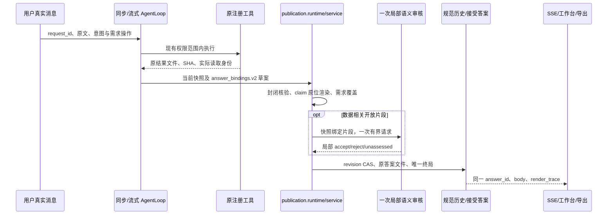

# P1–P3 单路径切换与退役审阅收据

日期：2026-10-01。实施树 `C:/Users/duguy/.codex/worktrees/trust-rebuild/data-agent`；分支 `codex/trust-rebuild-20260927`；HEAD `71e23d0ac26091365508ae1b50fa7dd88b238591`，候选含未提交修改。D 供体 `b181646` 只读，所有既有 dirty/untracked 保留。阶段状态只见[唯一计划](../superpowers/plans/2026-09-22-analysis-agent-trust-reset-plan.md)。本文件是实施证据与可审阅范围，不是第二计划。

## 1. 已接入的实际链

同步与流式已共用 publish/commit；中间工具轮次文本不作为可见终局。持久化失败不发送成功正文。咨询不因文件存在而强制分析；纯概念咨询不调用额外审核。确认 response 先由原状态机验证，再按实际终态/版本恢复或重放。

工作台不再以模型 confidence/普通证据注释授予已验证事实；只读取接受答案 trace，并分别检查每条 claim 的真实源身份。导出与历史改写定位指定原答案，不猜 latest 或相似消息。压缩归档规范原文及字节 SHA，摘要没有事实授权。

## 2. 当前本地证据及边界

- 切换前 `tmp/tpub-e2-1001-r2` 3091 passed / 2 skipped 仅为旧 app 加新核心的历史证据。
- 切换后 `tmp/p123-full-r2`：2966 passed / 173 failed / 2 skipped / 16 warnings，237.72 秒；全量不通过，不能签收 P1–P3。
- `tmp/p123-statistics-actions-r2`：165 passed / 1 skipped，19.32 秒，六文件新链与原回执测试；包括原描述统计的列/统计键绑定、禁止用 mean/max 代替 sum、分离行动需求引用同章节事实的正反例。脚本审核只证明机制，不证明自然审核质量。
- 全量污染诊断 `tmp/p123-context-diagnosis-r1`：截至首个线程上下文用例，2271 passed / 73 failed / 1 skipped，344.57 秒；该上下文用例通过，与原全量失败相矛盾。发现旧流式测试失败时未关闭生成器，已加 finally 关闭；尚须稳定全量复验才能判定根因收敛。
- 流式上下文原 14 项已迁移至真实 v2 历史/终局，保留关闭、异常、外层上下文恢复、持久化先于可见正文；联合原范围/新链/原回执/上传契约 `tmp/p123-lifecycle-statistics-r2` 376 passed / 1 skipped，29.13 秒，exec 80954 exit 0。稳定完整 `tmp/p123-full-r3` 为 3047 passed / 99 failed / 2 skipped，236.69 秒；`tmp/p123-full-r4` 为 3091 passed / 62 failed / 2 skipped，310.12 秒。两次均未通过，但新链与原范围上下文已通过。r4 失败完整清单已存于 retirement-review-r1。
- r4 后原描述工具已直接生成原精度 sum/mean/std/min/max/quartiles；integer sum 使用实际 Python 整数求和，避免 int64 溢出。最新 `tmp/p123-original-total-gaps-r3` 494 passed / 1 skipped，51.89 秒，实际原值/大整数/空列/局部状态差异、假设源提交及重启复验均有局部证据。完整 `tmp/p123-full-r5` exec 77404 exit 1：3100 passed / 62 failed / 2 skipped，330.47 秒；仍不通过。
- 本页所有运行禁止 Provider transport，实际 Provider initiated 0；没有运行真实服务、浏览器、部署或外部 Git。E3/视觉/E4 全部不由这些 pytest 收据代签。

## 3. 精确源码退役范围

以下两个旧模块已无 app 或脚本代码 import（旧 audit 自身 import synthesis 除外）。旧测试仍直接引用，必须先迁移其用户行为断言；不能用全量失败为理由删掉未承接能力。

| 文件 | 行数 | 当前 SHA-256 |
| --- | --- | --- |
| `src/data_agent/agent/publication_synthesis.py` | 5417 | `0c75c245352aa5d700d40ef3de5b589a796577b68ad690b377e47490def91049` |
| `src/data_agent/agent/publication_audit.py` | 903 | `add7fe9bd94395f0714409690494ef23954f0382290dd561407df34895869245` |

接替者为 `agent/publication/{contracts,facts,native,requirements,renderer,service,audit,runtime}.py` 和原 history/confirmation/tools 的精确来源接口。旧 formatter 已迁到 confirmation/runtime；不是旧模块转发。app 不保留 v1 wrapper、旗标或散文词表门。

**自动审批障碍：**此前包含这两模块、16 整个测试文件及其它 helper 清理的批量删除命令被自动审批拒绝；命令未运行，文件未删除。理由是影响范围过广、具体删除未经明确授权，备份不足以消除验收覆盖风险。本次范围缩为这两个源码模块；不申请整体删除 16 个测试文件。测试须逐项分类、迁移，有未承接行为即保留。`tmp/p123-retirement-review-r1/inventory.json` 给出全部静态 import、旧测试函数名、源码 SHA 和行数，可复核。

## 4. 旧测试处置的行为原则

| 旧测试族 | 对应新行为 / 处置 |
| --- | --- |
| 自报数值、散文词表、v1 parser、整篇失败/重审、private builder、packet latest | 旧机制已按批准设计退役；新合同拒绝数值替换、越界引用与覆盖自报；新审核最多一次，故障保留独立事实 |
| 描述、比较、分组边界、百分比、零分母、六来源、Python 原值 | 迁入实际 registry→原回执→当前快照→接受答案正反例，不能仅凭私有 helper pass 保留或删除 |
| 真实业务确认、单位、公式与 skip/版本变化 | 原确认状态机保留；曲线比例/百分数、skip、compaction 及 resolved/skipped/cancelled app 恢复已有证据；账面成本公式已接实际原问题工具/确认恢复，96/86 与 skip/未确认/旧版本均有当前局部收据；其它业务语义仍需逐项核对，不整删 |
| 当前假设/错指标/旧版/因果升级 | 当前注册假设原测量测试保留；自然 M04 和完整 app 矩阵仍未核 |
| 公共消息、历史、图表/产物、导出、刷新、只读 | 同一接受答案身份验收；图表工具旧字符串 API 保留，结构路径由 registry 增补。混合测试文件中原工具、导出和数值保护必须保留 |
| 模型 confidence→Workbench verified / 模糊验证器回退 | 按批准事实权威直接替换为真实接受答案/原身份验收，禁止恢复旧批准权威 |

本节当时未全部迁移：10月2日早期清单有12个文件直接 import 两旧发布模块（最新7文件见第7.8节）；剩余混合旧 helper 断言及原功能完整映射。rehearsal emitter、chat-only 分支续聊与本轮摘要/覆盖/数值/详情行为已有局部新链收据；混合咨询+实际结果已核同轮两项独立交付，但自然意图语义未验收。指定 hypothesis_id 状态有封闭绑定，但泛化多假设目标仍须需求映射复核，不能以 trend 值替代。不能静默宣称保留全部能力。

## 5. R5 与未核材料

旧三文件加新包及迁出替代 helpers 合并计数，不按拆文件报收缩。两旧模块仍实际存在，因此 R5 净收缩尚未达标。行数和新包测试数不能替代完整 E2、P4 联合行为或 P5 自然模型验收。

原真实批次 `tmp/trust-rebuild-p08-real-71e23d0-r1` 在两指定树中缺失，只有已保留摘要；原始重放 unassessed，不伪造回放结果。新 Provider 仍需新精确冻结及授权；正式默认/部署、外部 Git 单独授权。

本节当时 R5 合并统计（后续核算见第7.8节）：`{"old_core_baseline": 10967, "current_old_core_plus_package": 11601, "package_lines": 1526, "helper_deltas": {"scripts/testing/run_p7_browser_rehearsal.py": 0, "scripts/testing/run_regression.py": 4, "src/data_agent/agent/analysis_plan_contracts.py": 37, "src/data_agent/agent/analysis_state.py": -13, "src/data_agent/agent/compact.py": -2, "src/data_agent/agent/confirmation/runtime.py": 23, "src/data_agent/agent/hypotheses.py": 2, "src/data_agent/agent/llm_intent.py": 4, "src/data_agent/agent/trust_workflow_runtime.py": 1, "src/data_agent/agent/verification.py": -7, "src/data_agent/agent/workbench_view.py": -134, "src/data_agent/session/history.py": 61, "src/data_agent/session/public_messages.py": -1, "src/data_agent/session/workspace.py": 23, "src/data_agent/tools/curve_fitting.py": 20, "src/data_agent/tools/data_transform.py": 5, "src/data_agent/tools/data_understand.py": 5, "src/data_agent/tools/eda.py": 8, "src/data_agent/tools/interaction.py": 2, "src/data_agent/tools/registry.py": 0, "src/data_agent/tools/report.py": -62, "src/data_agent/tools/result_reference.py": 3, "src/data_agent/web/agent_manager.py": 3, "src/data_agent/web/app.py": 20, "src/data_agent/web/blueprints/sessions.py": 2, "src/data_agent/web/static/js/app.js": 5, "src/data_agent/web/templates/index.html": 1}, "helper_net": 10, "combined_net": 644}`。仍未删除两旧模块，净 +644 行，不满足净收缩。

## 6. 本轮原用户行为承接与新 RED（2026-10-01）

- 混合路由：`p123-mixed-route-red-r1` 2 failed / 53 passed，咨询顶层标签吞掉同轮计算。`p123-mixed-route-green-r2` 273 passed，21.53 秒；以原当前需求判定数据相关性，保持知识解释与真实 mean=15.0 分别归属。纯咨询五路无文件不强制上传，实际 no-data 执行仍提示缺数据。脚本分类/审核不证明自然语义。
- 原 golden 三族：`p123-golden-port-r2` 5 passed，6.00 秒；实际收入比较原值1750→1320、差-430、-24.57%、59/61日；原漏斗/咨询的工具、范围和限制保留，旧精确 Markdown 表格式不再授予事实。
- 工作台：`p123-workbench-port-r1` 66 passed，22.34 秒；保留8条总数/展开、已核与待核分开、中文依据/下一步、当前描述假设/因果不足/旧源失效。使用实际接受答案 trace；投影子集测试不冒充整矩阵或视觉。
- 账面公式：原 `measurement_mapping` factory 和原问题工具增加真实 cost_scopes；宿主生成明确 SUM 差式，不增加确认状态机。`p123-accounting-red-r1` 10 failed / 55 passed；`p123-accounting-green-r1` 140 passed。同原文新消息 RED `p123-accounting-source-red-r1` 1 failed / 65 passed，原 claim ID 碰撞；修正唯一原消息/选项归属后 `p123-accounting-source-green-r1` 258 passed，32.62 秒。确认记录版本/选项改动拒绝提交。
- 原问题工具测试先错误传 options=""，被真实 array schema 拒绝，保留诊断收据，改为真实 options=[]。多轮重复原文不能按全历史子串匹配；改为可选规范 source_message_ref，省略只绑定当前原消息。`p123-original-confirmation-green-r1` 144 passed，38.96 秒，含实际同步/流式悬挂、同义务恢复、重复原文和原状态机。
- 原分组工具整数溢出 RED `p123-grouped-integer-red-r1` 1 failed / 14 passed：两笔9e18被原 int64 sum变为负数。修正原工具 integer 求和使用 Python int；原结果与发布值均为18000000000000000000。此修复在上项144和后续完整r6中复验；空数字列不授予零值。
- 原拒绝草案全文现按当前快照/原稿 SHA 写入现有 publication_rejected 原子产物，初稿和额度耗尽稿都可审计，不进入规范公开答案/证据索引；接受答案 draft_digest 可关联原稿。不是新 fact、planner 或审核循环。新增写入 RED 暴露 Windows 原子临时路径过长，沿原 writer 处理扩展路径；文件名使用短摘要，文件内保留完整身份。
- 原 M02/控制/恢复：逐项替换原私有门断言，保留实际 run_python/curve_fitting、预算拒绝、原D7=0.2296（单位未知）、D30证据不足、未来收集建议、未知D30 claim局部拒绝、Rejected原稿隔离、假设未计算及一次共享格式恢复。`p123-control-recovery-port-r2` 141 passed / 1 failed，41.19 秒；最后真实失败为持久成功后 pending_fallback_resolution 未关闭。仅在持久接受终局后结束该预算待办，不提升结果强度。`p123-control-recovery-port-r3` 142 passed，41.61 秒。
- 无效启动 `p123-mixed-route-green-r1` / `p123-boundary-archive-r3` 因指定不存在测试路径退出；不是测试通过。archive r1/r2/r4、boundary r5及各 fixture/source RED 全保留，未拼成完整运行。
- quick 原 v1 synthesis 入口由五个新发布 suite 替换；原执行/工具恢复/Web/SSE 仍保留。full-offline 继续收集整个 tests，不忽略旧失败。
- 完整 r6 已完成：3157 passed / 31 failed / 2 skipped，252.79 秒；31 个失败在原文件内逐项迁移，没有批量删除测试。原数值、两源比较、分组 sum/count/size/nunique、追问、写入回滚和 compaction 引用保留；旧私有机制另列，不能计为新链行为。
- 原 curve_fitting 的可选显式 scenario_points 已承接：按原三个模型参数直接计算，负值不裁剪，溢出 unavailable，全部标明未验证参数情景/未来真实值未知。无参数默认不外推；不能将情景代替 D30 预测验证。
- 原 B03 产物 oracle 发现接受答案没有登记原 manifest：提交时在原历史/状态/manifest 事务和原锁内登记 accepted_answer，失败一起回滚；幂等不重复产物，不成为任意事实来源。
- 原组合负例 RED `p123-original-composition-port-r3` 259 passed / 1 failed，36.74 秒：原结果文件被破坏后，元数据快照缓存仍复用旧 claim。删除该缓存，让每稿重读原来源；GREEN `p123-original-composition-port-r4` 260 passed，39.57 秒，坏聚合不影响独立比较。提交仍再次 CAS 验证。
- 当前完整 `tmp/p123-full-r7` 3189 passed / 2 skipped / 16 warnings，594.46 秒，exec 36079 exit 0；默认 quick `tmp/p123-default-quick-r1` 391 passed / 1 skipped，44.40 秒，exec 18088 exit 0。370 个源码/测试摘要无变化，JUnit 摘要与跳过原因见 `tmp/p123-full-r7-reconciled.json`。跳过是实际模型 smoke 未启用和 OS 符号链接权限；没有新增 ignore。Provider initiated 0，E3/视觉/E4仍 unassessed。
- 完整通过不签收全部 P1–P3：旧源码尚在、旧私有测试仍直接引用、演练 emitter/分支继承/全部工具及180 oracle/原自然材料待闭合。

## 7. 继续实施与当前冻结（2026-10-02）

### 7.1 已完成的局部行为

- 演练脚本：原 43 个终稿返回迁入 v2 draft，工具顺序保留，现有一次审核入口输出 v2 定位决定；`p123-rehearsal-emitter-green-r5` 84 passed / 36.58 秒。实际 describe、Python、compare 原工具 → 草案 → 宿主发布 → 持久接受答案；未来 AND 行动、错误窗口和外来 ref 有定位负例。固定脚本审核只证明编排，不证明自然审核质量，完整演练矩阵未执行。
- 用户明确选择分支只继承聊天历史：父答案只作历史，不授予分支事实；规范 transcript 按原 byte SHA 复制，父接受答案/源 transcript 破坏时失败，不复制数据/证据/确认/计划/状态。新 v2 分支可咨询、重新加载和分析，旧分支仍只读。`p123-branch-chat-green-r2` 374 passed / 55.08 秒；父文件未修改、子上下文范围独立。
- 纯咨询实际工具约束：按已有 typed intent 与当前规范数据需求控制 offered tools 及实际 registry 调用；不靠提示词词表。恶意脚本提出 describe/run_python 时未执行；混合请求保留执行，规划/知识工具保留。`p123-consult-long-chat-green-r2` 199 passed / 51.31 秒，含同步/流式、原路由与 Web SSE。130 次需求窗口更新保留129条退休原文及1条当前需求；不让历史条数消耗当前快照上限。
- 原两个覆盖/数值文件、摘要6函数、跨轮复用2函数、缺数据3函数、发布合同剩余6函数，以及两个混合文件各1个旧门函数已逐项迁移；所有原 test 函数名保留，原字节备份见 `tmp/p123-retirement-review-r1/original-tests`。混合文件其余图表、导出、sandbox、原数据接口测试未删除。
- 摘要/复用联合 `p123-summary-prior-port-r2` 65 passed / 25.77 秒。通过实际 get_dataset API 执行 Python；1142/317 与原乘积、12行/日期、同版原接受答案、外来/陈旧/破坏来源和未进入原答案的新结果分别验证。
- 新 RED `p123-named-gap-red-r1` 2 failed / 38 passed：明确不存在的结构 dataset target 只给通用未计算。现有 snapshot 根据当前会话 inventory 给局部具体数据缺口及唯一上传动作；没有 typed target 时不扫描用户 prose 猜数据名，已有目标不冒充缺数据。
- 当前联合 `p123-local-retirement-green-r2` **194 passed / 57.13 秒**，exec 76869 exit 0。完整12/150组与最后一个组、实际详情 SHA/路径、原3/40/150规模和65000字符预算、局部坏引用/一次审核及原工具/图表/导出保护同跑。原100组扫描截断退役，当前有界原结果完整保留；超限/不可读不能声称完成。纯 fixture 乘法/算术校验仍标 E1，单位/自然表达不借此提升。

### 7.2 失败与诊断保留

- 覆盖原文长度错误已修正为原字符串长度；摘要/复用迁移一度误用了不存在的 df API，`summary-prior-port-r1` 4 failed /61 passed，改为原 get_dataset 后完整组合复验。没有修复产品来适应错误 fixture。
- `named-gap-green-r1` 157 passed /1 failed：用户原文末尾“下一步”与 renderer 冒号组合，使测试子串计数把原问题也当成动作；改为明确上传动作及单个 gap trace 的独立 oracle。`local-retirement-green-r1` 180 passed /1 failed：测试把非 deliverable 方法元数据也写成 claim 节点；收窄草案为宿主已绑定 deliverables，正例与两个外来 ref 的拒绝分别核对。
- 普通局部组合三次在首次导入 Flask/Werkzeug 时失败：numeric-port-r2、coverage-numeric-port-r1、coverage-numeric-port-r2（最后一次104 passed /1 failed）。Python 3.14.0、Flask3.1.3、Werkzeug3.1.8；异常位于 Werkzeug `_find_exceptions` 对 live globals.values() 的迭代。官方源码参照：https://github.com/pallets/werkzeug/blob/main/src/werkzeug/exceptions.py 。未修改 site-packages、升级依赖或提前导入 Flask 掩盖问题。
- 新进程单独 Flask import 成功；加函数追踪、失败钩子与原 runner 插件诊断的 r1/r2/r3 分别105 passed（42.33/41.97/49.91秒），未捕获全局键变化/失败帧。194组合普通 runner 当前通过。**异常根因仍未确认**；诊断成功不追认原失败，通过完整 r8 也不能单独证明此环境问题消失。临时诊断仅在 tmp，用原测试与原 runner，没有新浏览器/Provider框架或 probe family。
- 中间两次环境读命令自动审批超时、普通 Python 启动失败；后续具体命名修改和 runner 已恢复执行。没有服务/PID/listener 或新 Provider 批次。

### 7.3 当前完整 gate 与剩余出口

完整 `tmp/p123-full-r8` 已结束：**3205 passed /2 failed /2 skipped /16 warnings，278.95秒**，exec **48143** exit1；冻结 `tmp/p123-full-r8-source-freeze.json`，**371**个 src/scripts/tests .py/.js/.html 摘要（比 r7 多计入原已生成的本地 Plotly JS 资源，不是新增发布逻辑），HEAD71e23d0。371个摘要结束时均未变，JUnit/失败见 `tmp/p123-full-r8-reconciled.json`。r7是旧冻结上的完整通过，不用于签收r8新变更；r8不能由局部通过拼成完整通过。

r8完成时 `current-legacy-imports-20261002.json` 有 **12 个**直接依赖旧模块的测试文件；静态清单含 class 内的方法，不把未直接 Name 引用误记为已迁移。两旧模块保持原 SHA，未删；精确删除审批仍待回答。旧依赖/重要用户行为未闭合前不执行删除。原180 oracle完整签收、全部原工具族、泛化多假设目标/复杂单位、自然风格、原始自然重放仍有具体未核项，不将局部通过记作 P1–P3 完成。

R5机器核算见 `line-accounting-20261002.json`：旧核心基线10967；当前旧核心加新包11626；新包1534；关联 helper净-53，**合并净+606行**（含原在途修改）。仍未净收缩。Provider initiated **0**；无服务、浏览器、正式配置修改、部署、暂存、提交或外部 Git。

### 7.4 r8 两个实际回归与咨询控制修正

- 原流式确认恢复没有 suspended record；原 data-requirement golden 没有方案待办。新咨询执行禁止将原 ask_user_question / task_create 也拦在 registry 之前。修正同一 CONSULTATION_TOOLS 责任，保留原提问、任务创建/更新和原确认必要性判断；未请求 describe/Python 等实际数据执行仍禁止，没有增加另一审批器。
- 原 savings golden 的“确认采用前后对照方法”是已批准退役的通用方法许可，不作为新预期。仅该 fixture 改为 scope 数据方案待办，原 must-have/recommended/missing/causal 字段和 workflow 跟踪保留；断言新增 pending confirmations为空、无confirmation节点，未删除原 test 函数或原方案能力。当前在途字节备份 `original-tests/test_golden_scenarios.pre-20261002.py`。
- `p123-consult-controls-green-r1` 指定了不存在的test_tool_groups.py，runner拒绝，未运行，不能算RED/GREEN。此前 golden 更新因 CRLF 精确断言退出，文件未修改；registry 命名变更已完成，随后正常 UTF8读取修正 fixture。
- **`p123-consult-controls-green-r2` 218 passed /42.12秒，exec53393 exit0**；原确认、golden、执行监管、质量范围、意图、搜索和新咨询禁止/发布运行时同跑。不是“未弹窗”单一 oracle。
- 完整 `tmp/p123-full-r9` 已通过 **3207 passed /2 skipped /16 warnings，288.35秒**，exec **91183 exit0**；371个摘要核对无变化，见 `tmp/p123-full-r9-reconciled.json`。freeze SHA `46829c742337d16afb7688c6e658a10fa4af9f7fda4a52ff1fe363ca17951a28`；JUnit SHA `149484c08f32b8d2337ca48bd4b1e84db165b03a0757f79f668c45e4c689b9b8`。r8失败与差异保留；以下后续修改不借用r9签收。

### 7.5 原曲线情景、来源和确认的行为迁移

- `scenario_envelope_and_disclosure`原9函数及`provenance_revision_only`原4函数保留；用真实三个模型参数和D30情景核算，负值不裁剪、单位未知。范围解释进入一次定位审核，不按词表或句内数值/族名配对。来源原SHA只证明字节与范围，不证明模板/真实业务来源；修订不自动放行，正确事实保留。
- `p123-scenario-origin-port-r1` **111 passed /9.17秒**，exec83442 exit0。固定审核决定只测试编排，不证明自然质量。
- `r2_measurement_confirmation`原3函数、`scenario_claim_binding`原11函数保留。真实ConfirmationService/事件存储、原消息和当前列/版本决定观测点单位；非法模型value/status/unit/family/time_point字段拒绝。去除曲线测试中的生成恒真/恒假分支，378→178行是测试清理，不计产品源码R5收缩。
- `p123-curve-confirmation-port-r1` **128 passed /41.16秒**，exec44433 exit0，含原运行时；无Provider。原字节各自备份，原自然r2文字只作为固定负例，不冒充原自然重放。

### 7.6 原生方法族实际整链核验

- 新增剩余16族真实 registry → 原回执/detail → snapshot → runtime publish → CAS/manifest → read_answer 的行为验收，与原7族检查联合。独立字段/行数/参数/原精度/完整来源先列，再检查当前发布；不拿注册清单当能力完成。
- `p123-all-native-red-r1` 16 failed /15 passed /11.24秒：含错误夹具字段（fields/contributions）、把元数据写为deliverable和绕过runtime服务直接commit。仅修正夹具；第二完整族组合 `p123-all-native-red-r2` **5 failed /26 passed /12.05秒**，定位真实五项缺口。
- 修正原preview_data输出实际结构行并保留原summary与精度；同一native字段表补原quick_profile.columns、分类/回归的train_size/test_size/cv。SHAP原requires错误AND退役，现有实现自行核精确当前训练模型（二选一）、目标与数据身份；没有创建新依赖控制器。
- `p123-all-native-green-r1` **122 passed /1 warning /29.53秒**，exec73590 exit0。含23族实际调用、原方法/执行范围、未训练与旧模型拒绝、大整数9000000000000000001/原浮点/空值保留。高级方法各模式与全部180场景未因此签收；原7族并非每一族都单独新增持久化案例。warning为原共线性样本，不报已修复。

### 7.7 原业务名称确认承接

- 原aggregate_business_confirmation两函数、五响应及源版本负例改为真实工具/确认/current receipt；`p123-business-name-red-r1` **1 failed /5 passed /6.16秒**：用户raw确认“销售额对应amount”后新链丢失业务名称绑定。
- 沿同一聚合确认适配器补原列SUM的业务名claim，绑定原规范消息、原选项/版本、每个原group operand path；原sum/count记录独立保留，单位未知，不授予因果/增量。成本公式继续同一分支/来源验证。
- `p123-business-name-green-r1` **1 failed /153 passed /64.16秒**，exec92060 exit1：原适配器产出业务名后宿主合同尚未承接该派生，拒绝为unknown derivation。已沿同一HostSnapshot合同明确raw确认、原operand路径和单位未知；拒绝缺确认、外来确认、缺输入和伪币种。
- `p123-business-name-green-r2` **203 passed /50.66秒**，exec29896 exit0，原公式、运行时、23族和曲线确认同跑，未把上一失败改记通过。

7.7完成前静态旧测试依赖 **7 文件**，清单 `current-legacy-imports-20261002-r2.json`；合并源码净 +632 行，见 `line-accounting-20261002-r2.json`。旧核心两文件保持原SHA，未删除；精确删除审批待答，原广泛删除自动审批拒绝仍有效。P1–P3未完成，Provider initiated0。

### 7.8 精确无调用helper退役与新完整冻结

verification中8个私有函数及3个专用常量/regex import仅在彼此内部出现；当前_check_claim只走显式证据ID/原测量相容性，不调用这些散文匹配。逐项AST外部import与剩余本文件Load检查通过，原字节和证明在 `verification.pre-dead-helper-20261002.py` / `verification-dead-helper-proof.json`。458→376行，原证据/测量/清洗/计划诊断保留。首次静态检查遇原method_playbooks.py BOM即退出，未写文件；改以utf-8-sig读取后核完，不修改该文件。此精确退役不包含待批准的旧核心与任何测试文件，未绕过原宽范围删除拒绝。

完整 `tmp/p123-full-r10` **3237 passed /2 skipped /16 warnings，286.13秒**，exec **65567 exit0**；371个摘要均未变。freeze SHA `2f7ae33a5225f3293946f98326b49ab56482951856ae8522904b2a8e92e0269f`；JUnit SHA `e06cd28be0104f7fa8e0593b8f533b127e9f6a02eeb790bb4adbb9685bc6650e`；来源/跳过见 `tmp/p123-full-r10-reconciled.json`。运行期间仅改文档。跳过仍为未开启实际模型smoke和OS符号链接权限；16warning仍原退化统计/record_property等。Provider initiated0；无自然审核/浏览器签收。r9/r8均保留各自身份。

截至7.8合并核算：核心加新包 11652、新包 1560，helper -128，合并 +557 行；收据 `line-accounting-20261002-r3.json`。R5仍未满足，旧依赖7文件与两旧核心删除审批未闭合，P1–P3尚未完成。

### 7.9 原跨源与单位权威迁移

原P7跨源/范围三函数及单位五函数保留名称、参数和字节备份；计划互斥与九个谓词/假设函数保持原行为。真实A的D1—D7、B的D1—D30及当前fraction确认独立；倒序、A冒用B点、无源引用和同名换版拒绝。原未知金额120的SUM由实际描述回执给出；真实raw业务映射也不授予CNY。历史 `test_confirmed_unit_allows_currency` 的旧bare unit_status豁免按PUB-02/08替代，现为无实际币种来源不得授权；不是删除真实币种功能，复杂单位/币种正例仍未核。

`p123-p7-source-port-r1` **111 passed /9 warnings /9.92秒**，exec27405 exit0；`p123-unit-authority-port-r1` **72 passed /9.36秒**，exec90445 exit0。两者在r10之后，只具局部新身份，未借用r10完整冻结。备份 `original-tests/test_value_preservation_p7_boundaries.pre-20261002.py`、`test_authority_mutex_and_unit_binding.pre-20261002.py`。固定开放审核不证明自然质量。

### 7.10 M01原始行动与六源比较行为迁移

- 原行动四函数保留，实际14日数据、compare_periods及run_python原执行结果绑定；前期700/140/560/70，后期770/175/595/77，成本分母70/77，175÷77原精度及未来未观测由原工具输出保留。错误净贡献、六日窗口、零分母、陈旧来源及模型自报rule/value分别检查；有效观测不能被行动拒绝吞掉。完整规则保留原canonical来源，允许草案换序；遗漏需求的开放内容不能借用其他片段覆盖。
- 第一次runner调用缺少suite参数，在建目录/测试前被argparse拒绝；按原接口执行 `p123-action-original-port-r1` **2 failed /84 passed /8.01秒**，exec16057 exit1。新夹具错误是假定同字节add必换版、误写合同错误名；改为真实改变amount和stale_draft，不修改产品。新目录r2 **86 passed /10.15秒**，exec17250 exit0。
- 原比较16函数中12个旧门函数迁移，4个已迁移行为保留。真实维度1750→1320/-430/-24.57、六来源10→11至60→66、原3/4记录、零分母、负基线19.05%、相邻坏源与实际探索图逐项核对；破坏文件、重算SHA仍错误的算术/百分比、跨需求chart/claim引用均拒绝。
- `p123-comparison-original-port-r1` **4 failed /106 passed /46.13秒**，exec94141 exit1。三项新测试错误为CRLF导致sys替换漏掉、把all-requirements section误当单需求、原重复日期未显式chart aggregation。修正夹具，不放宽产品；另一项真实回归为两个不同call ID的同源同窗口比较输出重复。
- 唯一snapshot在完整加载/验证后按原arguments、data_identities、result_sha256、plan_id去重复交付；保留全部原回执及显式原接受答案所需receipt，不按数字/语言/最新值猜测。不同窗口即使总值相同仍独立，坏源不吞其它源。`p123-comparison-original-port-r2` **147 passed /46.33秒**，exec47804 exit0，含当前运行时/原六源/行动与语义合同。原数据/审核/测试字节分别备份；未新增第二selector/planner。

### 7.11 原审计目标承接与完整新冻结

原审核12函数中10个旧view/shadow/trial函数迁入唯一v2审核与接受对象，2个已有运行时函数保持原当前字节。核实际12条/120/12日、相邻解释定位、单次额度、非法/未知ID/外来证据/过长响应、规范历史/接受产物/trace SHA、未持久候选及原拒绝稿digest。固定决策只签收编排；旧shadow独立总审批、默认关闭/二次修订机制按已批准PRD替代。

`p123-audit-view-original-port-r1` **4 failed /81 passed /18.77秒**，exec67400 exit1。三项新夹具误写 `raw_draft_sha256`，原归档实际字段为draft_digest；另一项真实缺口为同purpose一段accepted掩盖另一段reject，结果被错误标answered。仅沿service原requirement_outcomes投影将failed_open计入完整性，保留通过片段/事实并给单个局部gap，不新增审核循环或事实通道。r2 **175 passed /49.52秒**，exec53480 exit0；所有失败目录保留。

当前静态旧依赖 **2测试文件**：publication_synthesis、r3_aggregate_host_claims；新清单 `current-legacy-imports-20261002-r3.json`含类方法和源码摘要，唯一非测试旧import为旧audit自身。两旧源码保持原SHA；没有删除旧核心/整个测试文件，原广泛删除拒绝与精确两核心审批待答仍有效。源码合并净 **+567行**、新包1570，机器收据 `line-accounting-20261002-r4.json`；R5未满足。

完整 `tmp/p123-full-r11` **3245 passed /2 skipped /16 warnings，298.75秒**，exec **61182 exit0**；冻结371个src/scripts/tests .py/.js/.html，结束时无摘要差异，见 `tmp/p123-full-r11-reconciled.json`。freeze SHA `a24576fd742909984167ce10466138c35ed041832f3283a525911d247d8d4179`；JUnit SHA `5789a99d085a8c40f0a6e1d86ff3f8181433de4c338c3538b345fcc1541afe09`。HEAD71e23d0，Python3.14.0/Flask3.1.3/Werkzeug3.1.8/pytest9.0.3；运行期间只改文档。两skip仍为live模型smoke未启用与OS符号链接权限；16warning原统计退化/record_property等，不宣称已修。

运行时diff检查发现新审核测试EOF多余空行，没有修改冻结运行中的文件。完整结束/核摘要后仅移除EOF多余空行，保存 `tmp/p123-full-r11-eof-format-proof.json`：完整AST、原函数名及全部非EOF字节不变；这是已核格式差异，不把运行冻结摘要改写为新字节摘要。后续git diff --check通过。五迁移文件共48个原test函数名保持原序，逐文件原SHA/备份/当前SHA见 `migrated-original-functions-20261002-r2.json`。

六文档相对链接无缺失、UTF8无replacement字符、180原编号唯一、10个原Mermaid图保留。Provider initiated0；没有服务/PID/listener/浏览器或新授权批次；全部原oracle、原自然重放、P4正常app/视觉和P5自然验收未完成。旧两核心未删、旧依赖仍2、R5+567，P1–P3仍进行中。

### 7.12 原聚合源范围与确认行为迁移

原聚合14函数名/顺序、原数据A/B、20/0金额及count/size/nunique、120/110/14/10与账面86/96均保留；旧fake Workspace/receipt helper由真实源表、registry、ConfirmationService/event store与canonical history替换。原可见公式、skip/unconfirmed/缺输入、响应身份、相关来源/派生换版、自动命名精确结果、独立新源和接受答案来源逐项检查。无关derived的数量不作身份权威，原结果明确指名；旧“任意plan变化拒绝一切原事实”改为当前typed来源和commit CAS，不能借新计划改写正在提交的答案。

- p123-aggregate-original-port-r1：**2 failed /12 passed /6.37秒**，真实缺口是工具仅记录派生2行，原源4行及日期范围缺失。原transform_data结果补source_observation，复用原typed date函数；唯一native按原路径渲染，不新增builder或散文门。
- r2：**1 failed /103 passed /36.64秒**，exec88344 exit1，新夹具误以为非法自报value草案无需原一次格式恢复；产品预算不改。
- r3：**6 failed /153 passed /52.96秒**，exec67825 exit1，均为迁移夹具合同错误：格式恢复追加系统消息后需要新digest、修改外来当前请求不应撤销本会话有效确认、原公式含quoted列名/说明。改用真实record范围变化或明确保留合法本会话事实。
- r4：**193 passed /62.14秒**，exec12782 exit0，完整五文件联合含原发布、比较、审核及原生族。全部失败目录保留。原聚合字节备份SHA57f8e26806209856eb81832ed9e181ef1f5271ff57334084774c9be8c2d5a0ba。

### 7.13 原综合数值/范围承接及审核预算诊断

综合92原test函数名/顺序全部保留，当前只逐项迁入7函数，其余不删除。原62点夹具以独立正交噪声/已知指数参数生成实际观测，原curve_fitting实际返回a=.18800129、R²=.98240474和62点；没有fabricated receipt。原两期47/24行、1818/684、-1134、合并71行/30日均真实执行。十二组原name/revenue/count和Python D1 .17080/.16803/差.00277由实际result_data交付，stdout/replay不提升为事实。原字节SHA30e94376afc8942f9145d642dfe24e645c2e94f4d20e980b1f1b22dd22061c7f。

- p123-synthesis-original-port-r1：**3 failed /150 passed /12.01秒**，exec83361 exit1，真实缺口是已有combined字段未进入新适配器。沿原native增加两范围claim，日历并集核对重叠/不相交窗口，不重复计算统计引擎；错误日数与不可能记录数即使重算摘要仍拒绝。
- r2：**1 failed /329 passed /68.88秒**，exec89589 exit1，新增两范围字段触发已有M01开放审核不派发。独立p123-action-audit-context-diagnostic-r1：**1 failed /3 passed /9.01秒**，exec65643 exit1，uneven分支audit_status=unavailable、claims 58279字节、issues=[]；其余需求/片段令请求超过原64KB。
- 唯一service将审核claims限定为已校验open_parts.claim_refs；保留active原需求、原Python全部行动操作数及规范完整规则。接受snapshot/正文全部facts不删，未知引用原拒绝、一轮64KB额度不改。不用追加词表或更大阈值遮盖范围问题。
- r3：**358 passed /73.15秒**，exec88916 exit0，完整八文件联合含原审核view、来源边界、工具族、聚合、行动与实际发布。固定审核只证明上下文/定位/额度，原自然质量仍未核。

当前旧测试依赖只余test_publication_synthesis.py，见current-legacy-imports-20261002-r4.json；两旧核心SHA不变，未删除整个测试或旧核心。两文件共106个原函数的保留证明在aggregate-synthesis-original-function-proof-20261002-r1.json。当前新包1597行、旧三文件加新包11689行、helper净-125，合并净+597，line-accounting-20261002-r5.json；R5仍未满足。旧核心删除原精确审批待答，未绕过原广泛删除拒绝。

full-offline新目录tmp/p123-full-r12已启动，exec82163；源码/测试冻结371文件，freeze SHA44f07bef0120e9749e4a961ac305fa9cb511d4c7e8276ce35bc358c096c8b41f。运行期间不修改源码/测试。该冻结仅本地回归，不授权真实Provider。Provider initiated0；无服务、浏览器、配置变更、部署、暂存、提交或外部Git；P1–P3、180原场景、P4/P5和自然原始重放仍未闭合。

### 7.14 完整r12失败核对与新冻结复验

完整tmp/p123-full-r12：**3266 passed /3 failed /2 skipped /16 warnings，307.23秒**，exec82163 exit1。371冻结摘要无变化，reconciled记录保留全部三失败；JUnit SHA6755952c5b266cae322358d0dabad0d375fa932ffcf15c94b6cfd3f01f9a81e2。

三项是与本轮明确新行为不符的原断言：golden收入归因只允许两期59/61日，却没有承接新增合并120日；两个原曲线范围/错误散文测试要求审核携带全部未引用facts，而片段只显式引用一个原scenarios claim。更新为保留两期59/61并独立核combined=120；审核精确等于原scenarios claim且claim_refs同一ID。原三个族的数值、全部公式/单位、全部公开facts和原错误文字仍各自断言；原函数名/字节证明在scoped-audit-combined-oracle-proof-20261002-r1.json，不新增自然通过声明。

五文件联合p123-scoped-audit-original-oracles-r1：**56 passed /19.63秒**，exec48300 exit0。产品源码没有再改。新完整tmp/p123-full-r13已启动，exec76759；371文件freeze SHAbcdc9ccd2bde0997250b091279d0f3dc89d95bf1d3937e78ef06cebe05828a2d。r12保持失败，不能拼接局部通过为完整通过。

AST逐函数与本地helper闭包确认综合文件仍有70个原test函数依赖旧核心，另22函数已用新行为（含本轮7项）；remaining-synthesis-function-map-20261002-r1.json标注行号与依赖。该静态清单不签收180oracle。后续继续按功能群承接这70项，保留原业务输入和开放文字，不用整个文件删除或兼容wrapper退役旧核心。两旧核心删除审批仍待答；源码R5净+597、本地app及自然验收仍未闭合。

### 7.15 原源/派生正文粒度核对与当前冻结

完整tmp/p123-full-r13：**3269 passed /2 skipped /16 warnings，317.41秒**，exec76759 exit0；371摘要无变化，tmp/p123-full-r13-reconciled.json，JUnit SHAe339b1a137b5fc232fa77771bc9f63f8de2ede5c3ee3e91448d2e2eaf7c8ed2a。两skip仍原live smoke未启用与OS symlink权限；16warning原统计退化/record_property。此后只针对原聚合正文粒度继续核对，不借r13冻结签收后改源码。

原源4行/派生by_channel2行在新trace有双身份，但正文只显示generic transform_data:rows=2，缺派生表名称。补原正文断言后p123-aggregate-derived-label-red-r1：**1 failed /32 passed /22.62秒**，exec84980 exit1。唯一native原循环三行从已验证result.dataset/rows给派生表记录数明确标签和“条”单位；原源观测、分组数值、未知业务金额及所有basis保持同一事实通道，不增加新claim或语义分支。

p123-aggregate-derived-label-green-r1：**157 passed /55.06秒**，exec90115 exit0，完整聚合/原生族/实际发布三文件。原函数名/顺序仍全部保留，当前字节证明更新aggregate-synthesis-original-function-proof-20261002-r2.json。新包1600行、旧三加包11692、helper净-125，合并净+600，line-accounting-20261002-r6.json；R5仍未满足，两旧核心原SHA/精确删除审批未变。

当前full-offline tmp/p123-full-r14已启动，exec49555；371冻结文件，freeze SHA0876349c1ddb15315ddd361aca0eeff782fda2b7d71c5199c72a7865138346e5。运行期间不改源码/测试。r12失败、r13此前完整绿灯均保留原身份；Provider initiated0，无服务/浏览器/正式配置/部署/暂存/提交/外部Git。

### 7.16 记录单位与业务口径断言收敛

完整tmp/p123-full-r14：**3265 passed /4 failed /2 skipped /16 warnings，771.93秒**，exec49555 exit1；371摘要无变化，reconciled保留4个原响应分支失败，JUnit SHA360903f04a98f23dcf3adab333b7985318a4ff2d8cab0a5f23af1d8cd2ca2c70。本轮耗时较前批长，原因未作结论；同一exec继续输出，只读核到Python PID19416/540，未重启。普通CIM只读被Windows拒绝，批准通道一次只读成功，不把该控制权限问题当产品失败。

四分支同属原业务名称确认的“所有fact.unit必须None”断言。新已核派生记录数为1条；销售金额和未确认业务名称仍没有单位/映射授权。只改该测试：measurement_records单位仍None，所有非None单位精确只允许原rows字段的“条”，原rows值=1；五种响应、mapped bool、金额20、原确认ID/operand、旧源与伪CNY拒绝均保持。原字节与函数名见aggregate-business-tests.pre-count-unit-20261002.py和aggregate-count-unit-oracle-proof-20261002-r1.json。产品源码未修改。

四文件联合p123-aggregate-count-unit-oracles-r1：**167 passed /59.54秒**，exec98390 exit0。当前完整tmp/p123-full-r15已启动，exec5889；371freeze SHAaee2713f4b1ed4d801814cd87b2ea1f2fac25501bc24da67f1e6ef2090901191，脚本明确核对相对r14仅test_r3_aggregate_business_confirmation.py变化，所有产品源码不变。r14失败仍保留，未用局部通过替代完整通过；本轮没有自然Provider、正式配置、部署或外部Git。

### 7.17 当前完整r15与本轮出口

完整tmp/p123-full-r15：**3269 passed /2 skipped /16 warnings，332.44秒**，exec5889 exit0。371个冻结摘要均无变化，tmp/p123-full-r15-reconciled.json；freeze SHAaee2713f4b1ed4d801814cd87b2ea1f2fac25501bc24da67f1e6ef2090901191；JUnit SHAb9db7fc07e54a8a51e025743c50a698506ebd3f13f7f0e2f45976a5805bfd5d9。运行期间只改文档；完整结束核摘要后也未再改源码或测试。相对r14只有一个单位断言测试变化，产品源码不变，原r12/r14失败与全部局部RED保持独立身份。

两skip为原live模型smoke未启用与OS symlink权限；16warnings为原统计退化及record_property，不宣称已修复。普通局部组合首次Flask/Werkzeug异常根因仍未确认，本次完整通过不倒填其原失败。r14耗时771.93秒与本批332.44秒分别记录，未据此推断或修改依赖/性能实现。

当前旧测试依赖仅综合文件，AST70原函数/6helper；原聚合14函数与综合本轮7函数迁移保持106原函数名/顺序，另三文件和业务单位测试的原字节及函数证明保留。新包1600行、合并净+600，R5未满足。两旧核心SHA保持原值，精确删除审批待答；无整文件测试删除、兼容wrapper或词表猜散文。

六份文档相对链接已核，UTF8无replacement字符，180原编号完整唯一，原流程图保留。HEAD71e23d0ac26091365508ae1b50fa7dd88b238591，dirty/untracked保留，D供体b181646只读；Provider initiated0，无服务/浏览器/正式配置/部署/暂存/提交/外部Git。本轮离线门已闭合，P1–P3总体、全部180场景、原自然重放、P4正常app/视觉与P5自然验收仍未完成。下一动作仍按唯一计划逐功能群承接70剩余原行为后退役旧核心，不能将本完整绿灯视作最终产品验收。

### 7.18 最后70原函数承接与精确两核心退役（2026-10-02）

综合文件最后70个原函数按真实Python/曲线/日历比较/实验因果/六源执行迁入唯一新链；92原函数名、原序和全部parametrize装饰器保留，测试文件未删除。原22400×.051、CV10/0、未算成本与实际0、7点D7=.2296、所有原模型情景、原16回执、A/B独立文件、六源10→11至60→66、第四组D=999、1818→684及71行/30日继续核对。原N系列开放正反文字保留；固定审核只检验定位、单次额度和独立宿主事实保留，不签收自然命题或审核质量，也不添加词表猜测。

- `p123-synthesis-final-port-r1`：118 failed /39 passed /87.75秒。108个断言误把实际reviewed写成assessed；其余为迁移夹具的result/presentation、嵌套DataFrame、实际chart_data及重复tool_call_id导致共享文件。
- r2：5 failed /152 passed /78.24秒；嵌套夹具使用原sandbox禁止的json import、图表缺实际evidence记录、presentation缺口状态断言错误。改为从实际标量源单元重建result_data、原record_evidence_record及原failed状态，未放宽sandbox或判据。
- r3：274 passed /114.67秒，exec18081 exit0，完整综合/实际运行时/证据/情景四文件。所有失败身份保留。

用户明确批准“仅删除这两个旧源码模块”。随后重新核C树/原SHA/原字节备份和AST import清单，再以两个精确LiteralPath删除 `publication_synthesis.py`（5417行，SHA0c75c245352aa5d700d40ef3de5b589a796577b68ad690b377e47490def91049）及 `publication_audit.py`（903行，SHAadd7fe9bd94395f0714409690494ef23954f0382290dd561407df34895869245）。备份分别为 `tmp/p123-retirement-review-r1/publication_synthesis.retired-20261002.py` / `publication_audit.retired-20261002.py`，摘要完全相等。原广泛删除被拒记录不改；没有删除任何测试文件或证据备份。

现行92函数/类方法、原装饰器及当前摘要证明：`synthesis-final-port-function-proof-current-20261002.json`；删除前精确核对：`precise-core-retirement-ready-20261002.json`；删除后零import证明并入 `line-accounting-post-retirement-20261002-r7.json`。旧模块sys.modules=None的负例属于防回归测试，不是旧运行入口。

### 7.19 原一年窗口、完整结果组预算与无调用预测旧路径

真实365天曲线原观测及一个原sandbox64KB以内、模型prompt65413字节的完整Python结果组复现两个发布预算问题。`p123-original-budget-red-r1` 2 failed /34 passed /17.59秒：365点被模型128引用限额错误限制；初始超大夹具本身越过原64KB，不算产品缺口。保留该失败并改为280个原长度组后，r2 2 failed /34 passed /20.27秒，分别复现宿主引用限额和60KB prompt超限。

HostSnapshot中的宿主claim_ids采用其既有2048事实manifest上限；模型草案/开放引用仍为128。唯一publication_prompt只按完整claim组裁减模型上下文，给原receipt/detail_ref/result SHA与省略清单；宿主原快照、全部组值/末组999、需求与最终事实均保留。整个引用/需求清单仍过大时返回摘要及显式局部未核限制，不截断事实、规范原文或扩大sandbox/audit预算。

`p123-original-budget-green-r1`实际失败289 /通过39，122.75秒，exec31951 exit1：编辑脚本保留CRLF，签名replace未命中却先应用调用方keyword参数，统一TypeError；这是本地编辑应用错误。修正脚本为normalize+AST精确签名断言，不改任何业务判据；r2 **328 passed /134.11秒**，exec92451 exit0，完整原生族/综合/核心pipeline/实际runtime四文件。

ml.py旧 `_legacy_forecast`只有其自身递归引用；被覆盖的forecast装饰器挂在 `_forecast_error`，现行正式forecast已走有序留出回测。实际回测/预测真实回执已在上述原生族通过。仅删无调用函数和被覆盖装饰器，共168行；现行forecast及所有其他函数完整AST相等、错误函数除装饰器外AST相等。原字节、引用证明见 `unused-forecast-retirement-20261002.json` 和 `ml.pre-unused-forecast-retirement-20261002.py`。现有76个原生工具名全部保留，当前76装饰器无重复，见 `current-native-tool-bindings-20261002.json`；静态inventory不替代工具所有模式的app验收。

当前loop3772行、新包1624行、两旧核心0行，总5396；基线旧三文件10967行；关联helper净-293（包括本次ml -168），合并净 **-5864行**，R5代码收缩门满足。该行数不签收R3/R4自然价值或P4应用/视觉。

### 7.20 历史材料裁决与P4准备身份

核对C重建/D供体的ddb9daa、71e23d0精确原批次目录均不存在，机器证明 `historical-natural-source-availability-20261002.json`。用户选择“保留历史重放unassessed，在P5验收新链”；历史两批失败、原审计摘要及材料缺失原样保留，不伪造离线重放，不凭此授权Provider。

P4准备目录 `tmp/p4-preparation-20261002-r1`，是准备身份，未启动/未执行。`preparation.json`列20个由既有fixture函数生成的文件及SHA、9组场景/独立原值oracle、选定local_http_api路线、既有launcher摘要、候选8769端口及鲜目录 `tmp/p4-local-http-20261002-r1`。`original-180-oracle-checklist.json`逐行保留VP84/IC56/CP40原编号与原局部维度，完整场景状态全部unassessed；这是后续签收清单，不是第二验收框架或事实账本。

当前演练默认auxiliary directed_analysis、无独立CONS transport；P4须在同一ScriptedClient按验收表支持咨询/混合控制，然后精确冻结全部提示、上传阶段和稳定确认值才可执行完整app批次。本准备JSON含部分待展开marker，不称可执行完整freeze，不使用真实P08 driver启动Provider禁用批次。HTTP picker、正文/图表视觉、浏览器刷新和console均unassessed；官方IAB视觉跟进按新路线/新结果身份签收。

实际Provider initiated0；没有服务PID/监听、浏览器、正式配置变更、部署、暂存、提交或外部Git。完整新r16仍运行时，只生成证据和改文档，不改变369个源码/测试冻结。

### 7.21 本次完整r16、合并核算与本地阶段出口

完整 `tmp/p123-full-r16`：**3271 passed /2 skipped /16 warnings，395.78秒**，exec63517 exit0。冻结369文件（两旧核心已不存在），运行结束当前全部摘要/文件集合/HEAD相等；机器记录 `tmp/p123-full-r16-reconciled.json`。freeze SHA 8ebb93373ad2d72cd131eba15647ee678b4114009df7abe02f6d7e65a24aabd4；JUnit SHA a55e6ed4ee8fe4ab0169bb7d3d81ff0b4d09ad6a520909e2a78f42e3476d1138。运行中及核对结束后没有源码/测试修改；两skip为live模型smoke未启用和OS symlink权限，16warnings仍原统计退化/record_property。不将未测项记passed，不倒填此前任何RED、full r12/r14或自然失败。

P1完成源码入口/约束/重要模块承接分析；P2完成本地新合同和原行为承接、历史材料按用户裁决归属；P3完成唯一新链/精确旧权威退役/合并收缩。其“完成”限本地实施出口，完整产品R3/R4/R5联合标准尚待P4正常app与必要视觉、P5自然价值签收。原180完整oracle清单保留全部输入/未核维度。当前已进入P4准备，同一launcher咨询运输/完整prompt-upload-confirm冻结为下步工作，尚无服务/PID/监听/浏览器/Provider调用。

唯一现行计划仍是C树9月22日文件；HEAD71e23d0ac26091365508ae1b50fa7dd88b238591，dirty/untracked全部保留、无暂存/提交，D供体b181646产品源码未动。新Provider/正式默认/外部Git分别授权边界不变。P4准备只含fixture/oracle/control material，不能称已执行完整新矩阵或授权新Provider。

### 7.22 P4准备：提前清理、现役程序核对与咨询运输

按用户新授权在准备阶段核对可退役文件。src/scripts/tests AST的Name Load、Attribute、ImportFrom、字符串名字及参数注入检查只找到两处无调用私有测试helper：`test_execution_control.py::_incomplete_hypothesis_loop`（14行）与 `test_p08_rejected_candidate_persistence.py::_rejected_dir`（2行）。仅删除这16行，逐文件其余完整AST相等、所有原测试函数/装饰器保持；原字节/SHA/currentSHA见 `tmp/p4-preparation-20261002-r2/test-helper-retirement.json`。没有删除测试文件/历史输入/失败结果/字节备份，也没有按文件旧名字删除仍承接新行为的测试。

10个scripts文件各有当前职责，全部保留。`retained-script-inventory.json`逐文件记录摘要及实际回归/禁用演练/Provider冻结与账本/离线审计/依赖/原质量能力。P08 contract只是原模板，不能作新授权freeze；p08_scenario_audit的散文/摘要也不能作为v2事实覆盖权威。更新tests/TESTING.md及docs/testing/retired-browser-provider-matrix.md：9月6日旧框架退役是历史范围，不是对后续现役run_p7/run_p08的一律停用指令；新批次仍依AGENTS与唯一计划执行。两份原文均字节备份。

初次编辑在两helper清理后被换行精确替换断言终止，演练源码未写入。该阶段 `p4-consult-preparation-r1` 128 passed /51.67秒，exec14715 exit0，只签收两处清理及原三文件。随后在同一ScriptedClient增加9个精确冻结请求及F-YOY：咨询CN/EN、留存方案CN/EN、已有文件纯知识、原结果改写、无原结果追问、问候加计算、知识加同比。纯知识含真实空数据和已加载数据变体，共13参数用例；不对任意自然散文做词表猜测，这些明确脚本输入只验证编排。

- `p4-consult-preparation-r2`：3 failed /134 passed /42.22秒，exec55108 exit1。两个路由断言忽略既有fast route优先（单纯计算合法data_operation），一个source_answer_id误从模型快照读取（权威字段在规范需求状态）。修正断言层次，保留事实/来源/无执行的用户行为要求。
- r3：1 failed /341 passed /45.98秒，exec49401 exit1，进一步复现真实缺口：不存在原接受答案的presentation仍标answered。没有将这一失败改成通过。
- 结构修正沿现有责任：intent已有语义分类结果为无歧义result_followup、并且全部requested_outputs是knowledge/presentation且至少一个presentation时，用同一已校验结果纠正分析fast route；没有新增model调用/词表。snapshot对result_followup的active presentation没有source_answer_id给evidence_insufficient、具体指定原答案动作，并清空该需求开放引用；相邻knowledge/当前有据结果不受影响。已有原答案仍核原ID/原回执，单纯result计算不转成追问。
- r4：**346 passed /43.68秒**，exec1777 exit0，完整五文件含执行/拒绝稿/实际runtime/两套原intent。CONS-01/02 CN/EN空数据与已加载数据、CONS-03零数据执行、CONS-04同原事实、CONS-05具体缺源、INTENT-01 amount120、INTENT-03 100→120/差20/20%＋定义分别断言。纯知识审核0，数据开放最多1、Provider transport0；固定分类/文字/审核不签收自然语义质量。

本次准备材料在同一r2目录：21个fixture摘要与13个按顺序的咨询app输入/oracle，见consultation-app-inputs.json。CONS-05单独新会话没有可定位原结果，不能误以上传票据等于已加载数据。当前只准备该组，尚未执行HTTP、浏览器或完整M01—M06/180oracle验收；其余INTENT-02/04/05操作与完整joint冻结仍列待办，不用这组代替全部P4。

代码合并净 **-5803行**（包括本次intent/snapshot/现役演练变化；测试16行清理单列，不用它伪造核心缩减）。新完整 `tmp/p4-full-r17` 运行中，exec92225；369文件freeze SHA4a72cf5849611e3b78575c01563b69bc570b1b67d90359db8f22a33fe0c4e94f。相对r16精确仅6个预定源码/测试文件变化，运行期间只改文档/证据。端口8769不监听、候选tmp/p4-local-http-20261002-r2不存在、C venv/现有launcher存在；这些是准备时核对，启动前须再核，当前无service/PID/browser，Provider initiated0。

### 7.23 P4准备当前完整r17签收

`tmp/p4-full-r17` **3284 passed /2 skipped /16 warnings，480.12秒**，exec92225 exit0。369文件集合/摘要及HEAD全部相等，`tmp/p4-full-r17-reconciled.json`；freeze SHA 4a72cf5849611e3b78575c01563b69bc570b1b67d90359db8f22a33fe0c4e94f；JUnit SHA 52f56498f5d3de14efea87d92e6e8729aaaf5b220094a694cd836be3e4cc1dec。相对r16只既定6文件变化：现役rehearsal、typed intent、publication runtime、两处helper所在测试及既有runtime测试；其他产品/原测试不变。原runtime测试函数名全部保留，追加一个13参数函数，证明original-runtime-test-names.json。

两skip保持live模型smoke未启用与OS符号链接权限；16warning仍原统计退化/record_property。旧r2三断言失败、r3真实缺源失败均保留独立身份。本次没有环境绕过、skip/xfail或新增浏览器框架、Provider账本/审核循环。运行期间只改文档/准备证据，结束核对后未改源码/测试。

当前完成P4提前清理、现役程序职责核对、13咨询传输/来源合同及完整离线门；准备21fixture/13咨询app输入。完整joint app和INTENT-02/04/05操作冻结、180逐项签收及必要视觉仍待推进，P4未完成，不进入P5真实调用。无服务/PID/监听/浏览器/Provider、暂存/提交/外部Git；正式默认与各授权边界保持。

### 7.24 P4正常app冻结与控制诊断（2026-10-02）

四个结果身份均选local_http_api、同一既有禁用入口；保留精确配对和进程见execution-identities.json。r2（freeze r1）第1轮导出路径被控制脚本重复拼sessions/id而中断；r3（freeze r2）误把tool调用中的空assistant共用reply_id当重复答案，并在故意save failure的404中断。全部原目录不改写，未混会话或追认通过。

r4（freeze r3）整批35组/68轮完成，6组check失败：两组六源oracle错误取了纯继续回合；三组用标量集合检查结构化Python/聚合对象；M04-INFER实际缺当前计划hypothesis ID。保留6失败结论，按原文件/工具结构核对后在新freeze记录明确列名、原测量回合及字段oracle，不把产品结构结果当散文子串验收。A/B/C的amount_sum分别20/5/null，count2/2/0，size3/2/1，order_id nunique2/1/0，不能把缺失sum写0或把去重列换成amount。

本次生产源码不改；现有ScriptedClient七个固定marker补实际工具selector，current_hypothesis必须plan_id同当前，禁止读旧ID。现有runtime文件追加一个五参数真实意图→工具→snapshot→publish→commit/reload测试，全部原函数保留。直接pytest命令basetemp父目录没创建导致108 setup errors，不能称产品108失败；换既有run_regression隔离入口新目录r2 **108 passed /50.58秒**，exec22795 exit0，原失败JUnit保留。本次没有新控制框架/Provider账本/模型调用。

### 7.25 当前r18离线与r5 app诊断签收

完整 `tmp/p4-full-r18` **3289 passed /2 skipped /16 warnings、463.61秒，369文件集合/摘要未变**，exec11482 exit0。freeze SHA8da82d297137f0f19a8db00835a118909082e50cdc4840243aa5e5d16eb7aa13，JUnit SHA546fb24786f3b156e9f6ec99256f55465d414a19dcab8762472d50d0a1996b98；相对r17只现有launcher/runtime测试，生产源全部相同。合并净-5787行；新增测试/临时控制不计作核心缩减。r18运行期间/结束后未改源码或测试，当前签收文件 `tmp/p4-full-r18-reconciled.json`。

新app结果 `tmp/p4-local-http-20261002-r5`，freeze `tmp/p4-app-freeze-20261002-r4` SHA89858f8e138bacbe1f7b024b6c3f9308a8cac1ac74fa7e336b751888c4fcdd19，35组/68唯一SSE终态，分布{"completed": 61, "failed": 3, "unknown": 1, "suspended": 3}。service exec29681/PID5152/port8769，control exec2201 exit0；stdout/stderr tmp同名日志，health逐组ok=true/provider_enabled=false，实际Provider initiated0、forbidden0。初次自动审批以r4名称可能旧身份拒绝；只读核对freeze.service_run_dir为r5、health同路径、新http-control不存在和controllerSHA一致后，显式guard命令获批执行，没有绕过或修改原freeze。结束service已停止。

13咨询/混合全部列明维度通过，包括CN/EN空数据/已加载数据、零执行、原接受答案引用、缺原答案evidence_insufficient及100→120同比。M01正例五项answered，固定开放负例局部partial但独立宿主数值不丢；六源各自10i→11i、实际图表/规范压缩原artifact保存，Python原对象及edge各列已按原结构核对。固定Scripted审核/表达不证明自然质量，空case checks只说明终态/身份检查，不是全场景通过。

当前两项失败保持：**M04-INFER** 首轮/再测缺current-plan hypothesis ID抛出ScriptedClient RuntimeError，普通app fail-closed；下一步须展开同计划假设生成与continuation，不能拿旧ID顶替。**M05-PY-NOROW** 实际回执没有inclusive_days，但宽工具selector将原请求整项answered；原值12/120和端点正确不能充当天数交付。新oracle保留false，下一步在已有需求/选择器中拆分义务并核真实测量或缺口，禁止散文关键词补丁。原B04/M03/M06缺完整selector/formula维度仍unassessed；INTENT-02/04/05、180原行及必要视觉待验收，P4未通过/P5未就绪。

未改正式默认、未暂存/提交/推送/部署，D供体b181646产品保持只读，全部dirty/untracked/失败/字节备份保留。历史自然重放与两原失败按用户裁决不变。本记录是当前正常app诊断及离线门，不签收整套原能力、自然模型或视觉。

## 7.26 结果字段与精确计划续接；中断后新完整身份（2026-10-06）

七个命名文件：intent/llm_intent、publication requirements/native/runtime、现役rehearsal与同一runtime测试。原41个runtime顶层函数/类及装饰器AST相等；新增18个参数场景，无原函数删除。字节备份在tmp/p4-field-binding-20261002-r1；合并口径净-5743，包含同一旧核心、新包和所有相关helpers，不靠删测试制造收缩。

M04根因含三层：原冻结描述请求未建立竞争假设；快速明确路由未继承辅助分类的精确continuation；脚本全局计数在重载候选stale_draft后跨到下一用户请求。分别以显式任务、同当前ID校验、每个冻结请求独立计数修正。原实际amount趋势与当前receipt/version核对支持/反驳，wrong trend_slope仍metric_not_target。无新生产措辞表、planner或终局分支。

M05原整段Python对象选择器不证明每个子问题。扩展同一selector有界result_path（1—16层，非空字符串/非负整数、拒bool等），只投影原已验证公开测量根的真实后代，复用resolve_result_claim。路径在basis_refs中精确匹配；stdout、metadata、闭合派生值、文件下载不能代替一个未算字段。缺字段局部not_computed，正确金额仍交付；原答案重述可恢复同一原子字段引用。Python在现有冻结步骤实际计算inclusive_days=12；模型候选11天未获事实权威。没有日期散文猜测。

局部顺序及失败原样保留：p4-field-local-20261002-r1为181 passed/2 failed（新增断言范围错）；r2为182/1（暴露脚本越过请求）；r3为182/1、r4仅runtime为121/1（暴露fast续接丢失）；r5完整三文件187 passed、49.95秒。没有xfail/删负例/降低oracle；实际三轮另核wrong metric候选、v1/v2原身份与精确当前计划，四个current/old/foreign/unscoped续接参数保留。

10月2日被中断的r19没有JUnit，仅保留interrupted_no_final_receipt。app r6只17组/24记录回合，原exec60504/31336/40304失效，原PID22824与8769 listener不存在；partial结果SHA ecc8e42ae95747d61d5ac640a887e6ba8b5eb172a9276db654e63c0b03ffc715、runtime SHA322859631ada6930a7c607353f97940cf095d48d7de36de17512b30ccc7a3056。没有恢复旧服务、补跑后半或把部分改完整。10月6日369源摘要与HEAD重核完全相等，Python3.14.0/pytest9.0.3/Flask3.1.3/Werkzeug3.1.8。

新full r20为3307 passed /2 skipped，JUnit 415.152秒；冻结SHA a1ddec82a2ef06962dca9c445ad4baacb991e0f3c731056069c0d7e0a8a4c1a6，JUnit SHA b4191cc8a0043a74c64e94534b70a972f668782adec32c182d269dd52ef1ba6a，完整369文件集合/摘要未变，exec70686退出0。原2skip不补通过；精确收据tmp/p4-full-r20-reconciled.json。

新app冻结SHA a0238f2edd0ceaeaf548e1bbb7a48c496e733d780db4e717d47f39b4b245430b，controller SHA 37de5460280cbf88547e1eedc35a833bac7afd2c7605ece0c6909a5ae529f845，沿local_http_api完整35组/68终态；所有已列case/turn检查通过。63 completed/3 suspended/1 unknown保存负例/1 failed预算负例。M04四维检查和M05真实day字段/需求/accepted render trace绑定均通过。结果SHA 2684c4b272e04296e074ca30a91da5e9a71e9c57ae50e494039340b91b886f16，runtime SHA edf66b40b02ec5322a765c13b432cc727389653829643bc68a177a2a8e1a017d；实际Provider0、forbidden transport0。service exec91371/PID14092/8769，control exec59273退出0，批后Ctrl-C结束并核PID/listener0。stdout/stderr同名tmp日志保留。未把空checks签收完整功能。

本次只关闭上述失败维度；原180完整场景、INTENT-02/04/05、M03/M04完整子项、M06 typed成本公式/skip/版本及必要官方IAB视觉仍待核。固定分类/文本/审核不签收自然质量，P5未就绪；历史自然unassessed与两原失败不变。无新Provider授权、正式默认、外部Git、部署或批量暂存/删除。

## 7.27 P4本地联合签收（2026-10-08）

当前P4列明本地出口已签收，完整r29 3341 passed /2 skipped /17 warnings、369源摘要未变；新r4完整47组/90回合检查0失败及必要官方IAB、实际压缩/两种导出/标题/刷新同源。原180逐项/268原函数与41AST保留、净-5507行；Provider0，服务已停止。具体身份、原失败、控制桥接未评估、自然行为P5边界见[联合收据](2026-10-08-p4-local-joint-signoff.md)。不倒填历史失败、不把脚本审核当自然质量、不授权新Provider/正式默认/部署/外部Git。
