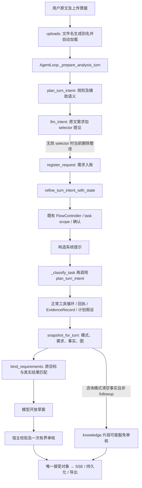

# P5 真实批次：原需求对标、根因诊断与方案讨论

日期：2026-10-08。状态：**诊断保留；D1/D2/D3产品行为已获用户确认，进入结构化合同及实施准备；不是第二份执行计划，不代表修复或验收通过。**

诊断轮先整理问题、对标原需求、讨论不确定项，未修改产品或测试代码，未发起 Provider 调用。2026-10-08用户已确认D1/D2，补充要求用历史结果辅助验证、以结构化系统处理模型输出变化；当前仅更新需求、设计和验收合同，尚未实施产品修复。唯一执行计划仍为 [可信发布重建计划](../superpowers/plans/2026-09-22-analysis-agent-trust-reset-plan.md)。[本批执行收据](2026-10-08-p5-real-882df1c-r1.md)及原始失败记录保持不变。

## 1. 基线、目标与证据边界

- 重建树：`C:/Users/duguy/.codex/worktrees/trust-rebuild/data-agent`；分支 `codex/trust-rebuild-20260927`；候选 `882df1c4c217e71320fdc43336d537851a3d721a`。
- 供体固定 `b181646ff66ea9ea3b0e6a38ffcd3d16b6687312`。供体同名计划不作为执行依据。保留已有 dirty/untracked 文件；stage 为空。
- 本批身份：`tmp/p5-real-20261008-r1`，冻结 SHA `4bc1e3a761c8902195e311f5fbacd3ab95852308032a30f59a22a705430763ce`，`local_http_api`，`openai/deepseek-flash`，`https://api.deepseek.com`。
- 133 次物理调用均 dispatched 并结算：61 completed、72 stream_exhausted；Provider/stream/记账失败均 0。18 个原提示及一次冻结业务恢复，共 19 个 SSE 回合。六场景均 `failed`；总体 `executed_failed / not_accepted`。
- 16 个接受对象的原正文、公开持久化消息和 SSE 组合已核对。M04 失败 notice 是单独消息，不能把最后一条 notice 当作原答案全文。
- 上传 picker、浏览器视觉和真实刷新未测，仍 `unassessed`。未触发的失败上传、取消/超时等负例也不能用 P4 本地结果冒充本批自然通过。
- 原批已关闭，剩余 47 次不续用。当前诊断新增 Provider 调用为 0；正式默认、部署、外部 Git 授权独立。

目标仍是：无文件时能咨询；执行时每个明确问题都有当前、可核事实或具体缺口；保留完整证据、竞争假设、解释、条件行动与实际风格变化；局部错误不吞掉独立正确结果；图表、正文、导出、历史保持同一答案权威。结构化 claim 是事实权威，模型分类标签、散文或审核自报不能代替它。

原需求来源：

- [VP 原验收矩阵](../superpowers/validation/2026-09-06-analysis-value-preservation-acceptance.md)：能力、价值、范围、证据完整性及竞争假设。
- [IC 原验收矩阵](../superpowers/validation/2026-09-07-intent-clarification-acceptance.md)：真实业务歧义、决定复用、范围和版本。
- [CP 原验收矩阵](../superpowers/validation/2026-09-08-answer-content-acceptance.md)：逐题交付、算术、表达和表面一致性。
- [产品 PRD](../product/data-agent-product-requirements.md)及[发布 PRD](../product/trusted-answer-publication-requirements.md)：继承与已确认替代决定。原 CP 的零新增审核调用约束已由已确认的一次有界审核替代，不重新恢复旧实现。

下文的 VP I05 等表示该原矩阵的 I05 行，IC Q04 等、CP AC16 等同理；不是新 oracle 编号。

## 2. 逐场景对标与因果判断

| 场景 | 原需求及现行 PRD | 实际问题与已保留能力 | 根因判断 | 对应方案与验收重点 |
| --- | --- | --- | --- | --- |
| M01 无文件咨询 → 执行 | VP I03/I05、S08；PROD-I02/I03、PUB-11；IC 仅真实执行口径才阻塞的原则 | p 值咨询正常；留存方案咨询被 scope_confirmation 暂停，字段/步骤/限制未交付。后续 12/120 和七日 AND 行动未启动，属未评估 | **已证实**：完整第3调用明确 analysis_consultation，却列口径、窗口、场景歧义；随后实际暂停。另两次300-token分类截断。**尚未证实**：两次截断分别对暂停的因果贡献 | 一回合使用同一意图与需求；区分“可以给通用方案的咨询条件”和“实际执行缺口”。缺条件先交付适用分支与限制，只有真正影响所请求执行的口径才阻塞。验收咨询完整交付，再同会话切换执行；行动要保留原完整 AND 条件 |
| M02 曲线与 D30 | VP I09/I10、N01/N03、E04；CP AC11/16/18/19/28；PROD-A02、PUB-03/04/06 | 原 .55/.42/.31/.24/.18/.13/.10 与未知单位保留；三个拟合族及未验证情景真实存在，独立数学重算一致。需求却标未计算，解释不交付 | **已证实**：原第7调用四项需求被保留，但三个 result 无 selector；最终草案 claim refs 被宿主正确拒为绑定权威。**接口缺口**：“计算并解释”只归 result 时没有解释用途，不应通过放宽任意解释解决 | 原问题先保全；执行阶段补可核目标及结果关系，区分计算结果、未计算和证据不足；解释绑定同一结果与边界。既不将 .10 自行改写为已知百分比，也不把 D30 情景升级为预测。测试同时要求正确数值和正确逐题交付 |
| M03 六来源、六图、续问、压缩 | VP E01/E04/E06、I11、B03；CP AC10/19/33/36；PROD-I04/A04/S01、PUB-02/10/11 | 六源原值及六份真实图产物存在；首答 artifact_refs=0。续问经 consultation/claims=0/uses_result_context=false/audit=not_applicable 发布逐源事实及未请求总量210→231。真实压缩保留接受对象 | **已证实且最高优先**：原第21调用四项需求因两个 selector 缺 tool，只保留两项 presentation；“好的，继续。”的实际上下文仍含分析，宿主却仅凭咨询路径清空事实集合并接受 knowledge 文本。不是加总算错，而是无权事实发布及跨源范围扩张 | 封闭结果续问与原答案/当前未完成任务关系；纯知识问答隔离数据结果上下文，继续保留无文件和有文件纯咨询能力。逐源变化由宿主核实推导；图必须有当前权威引用；跨源业务汇总仍需真实需求和范围。压缩不能改变权威 |
| M04 竞争假设与换版 | VP H02/H03/H05、B04；IC Q06/Q14、R05；CP AC03/19；PROD-E02/C01、PUB-09 | 两个实际计划、8条证据、4组假设存在；v1内部 supported1/inconclusive3，v2内部 refuted1/inconclusive3。首答竞争状态不完整；新文件成为 M04-hyp-v2，被旧 task scope 拒绝，终局 stale_draft，换版回合 failed | **已证实**：第31调用三个需求变一个 presentation；v1/v2实际不同别名与旧 scope 冲突。**待定位**：stale_draft 的具体快照变更源；不能直接结论“所有版本失效机制都坏了” | 同业务对象换版要先形成明确对象映射，再更新相关 scope/plan/证据依赖，保留隔离约束；当前竞争状态按真实计划版本呈现。对不唯一映射使用已有对象确认，不凭 v2 文件后缀猜测。失败上传不替换旧版本的负例继续验收 |
| M05 六轮风格变化 | VP S04/S07、B05；CP AC20/30/31；PROD-I04/O01、PUB-05/07 | 六轮保持同版12/120、时期、单位；中间确有业务/分析师/管理者表达差异。旧分析师要求约束后来大白话；旧摘要被错误提示没有原答案。无据上线/对账候选被正确扣留 | **已证实**：非咨询快照带入未完成旧 presentation，且 result_followup 对所有无 source_answer_id 的 presentation 套追问缺口。**待核**：每个 replace/withdraw 的原文语义合法性；审核中过度逐字要求与真实约束的逐条分界 | 风格变化只替换对应表达偏好，保留未完成事实问题；首轮摘要与有原答案追问分开处理。审核评价当前完整答案的边界和局部解释，不让旧风格或内部字段措辞成为事实要求。保持对无据上线、因果和外部对账的拒绝 |
| M06 缺数据、成本确认、同版复用、换版 | VP I12/B06；IC Q04/Q05/Q06、R01/R05/R07；CP AC18/19/20；PROD-C01、PUB-03/08 | missing_orders 缺具体下一步；一次真实成本问题恢复完整，但缺口归属不清。用户指定 m06_promo 未落实，实际自动别名 M06-promo。第3轮无要求的 typed 确认；第4轮未交付86；第5轮重问实际 M06-promo-v2，冻结驱动正确拒绝，不恢复，96未交付 | **已证实**：上传自动按文件名分配唯一别名，未落实请求中的精确业务名称；确认绑定实际别名因此不匹配冻结范围。**待核**：第3轮无 typed 问题的完整控制原因。不能归咎算术或驱动不肯选择近似选项 | 上传票据→明确数据对象→版本→任务→公式确认贯通。仍只用原型确认和一次恢复，不允许名称近似、成本猜测或列名因果。分别呈现缺数据可行动入口、未算净收益、缺增量证据；精确验收86、同版复用及相关换版重判后96 |

## 3. 跨场景根因：职责没有闭合，而非六个孤立补丁

### 3.1 实际调用关系

这是默认入口的责任图，不声称图中每个节点都在每个回合调用。源码锚点：`loop.py:973,1093`、`prompts.py:485`、`intent.py:198`、`llm_intent.py:216`、`publication/runtime.py:26,61,153,187`、`publication/requirements.py:190`、`publication/service.py`。

**R1 单一回合决策缺失。** `_prepare_analysis_turn` 已建立意图/需求，系统提示层又分类；两条调用并不共享相同上下文、客户配置和失效语义。53次JSON辅助调用中26次300-token均截断，27次大预算完整。M01完整分类也有咨询歧义误用，所以提高上限不能证明咨询修复。预算与结构协议应在唯一用途下决定；不增加隐式重试。

M01还有明确的直接入口证据：第6调用主动提问口径、粒度、已有字段，`confirmation_type=scope_confirmation`，自报“用户尚未提供数据，需要先确认方向”；`loop.py`随后使用 direct candidate 进入现有确认服务。`confirmation/runtime.py`在未给 affected_operations 时可回填 agent_turn，`confirmation/decision.py:176`核查的是决定类型、missing_value、affected_operations 非空。该形状校验不能单独证明通用咨询方案确实被阻塞。具体咨询意图与候选问题的关系仍需按当前需求核验，不能扩充口径词表来判断。

**R2 原问题、执行目标和事实交付错误耦合。** 分类器在工具未运行时需要提议 dataset/tool/metric 等具体 selector，且错误目标会删除真实需求；后续无法补目标。宿主拒绝终局草案自报覆盖是正确保护，但没有形成可用的需求→实际执行→结果关系。保护正确不等于已完成内容交付。

**R3 咨询标签被当成了上下文授权。** `uses_result_context` 当前由 `mode == result_followup` 设置，不能证明真实模型上下文不含结果。M03就是反例。仅扫描最终正文中的数字、金额词或来源名，或给所有带文件会话强制走分析，都会破坏既定要求；必须在输入上下文和原答案关系处确定边界。

**R4 生命周期缺少维度边界。** 事实问题、当轮组织要求、跨轮风格偏好、数据对象版本共同进入 active/unanswered 集合。旧风格与旧摘要缺口因此干扰当前表达；上传别名又没有与用户的业务对象/旧任务范围贯通。需要修改所属规则，而非再加“不许 analyst 拒 plain”的特殊提示。

**R5 审核不能补未建立的关联。** M03第28调用只审核一个图表交付解释；输入 claims=[]、artifact_ids=[]。审核拒绝无据交付具有依据，但它同时引用另一个不属于该 part 的 requirement，违反当前协议，故全回退 unavailable。此例不能推断其他正确片段被吞；它证明“语义拒绝”和“协议非法”须分开记录。M05还有全篇边界已保留却要求表达片段逐字复述内部术语的观察，须逐条核对，不能把所有拒绝算误拒。

### 3.2 测试控制诊断

| 判断 | 证据 | 处理 |
| --- | --- | --- |
| 本批执行控制有效 | 精确冻结、串行全矩阵、133账本结算、19终态、实际范围不匹配不恢复、没有重试或补跑 | 保留机制和全部失败；不因内容失败重写原 oracle |
| 本地出口覆盖有缺口 | P4固定分类/目标/审核输入通过；本次完整自然JSON仍被解析删除，真实短续问走另一模式 | 本地测试证明合同在选定输入下成立，未证明模型实际提议与入口组合。是测试设计缺口，不是“所有本地测试无效” |
| 模型自然提议有错误 | selector缺字段、咨询歧义、无据上线/对账、审核越过片段证据集 | 系统应保全问题并局部限制；不能以模型错误解释宿主授权绕过，也不能只靠提示模型完美 |
| 导出存在判据误报 | 四份下载字节与本地文件相同；LF正文直接比较CRLF导出失败；仅归一化行尾后正文完整 | 后续在既有driver分开核字节身份与文本内容；真实遗漏负例仍须失败。原failed记录不改，不把文本核对说成视觉通过 |
| 批次尚不足以覆盖所有退出条件 | M01依赖提示未启动，M06缺必要typed确认；多项live负例/视觉未触发 | 保留 unassessed，不强行补跑，不把“未测”升级为产品失败或通过 |

结论：已证实的是接口职责与默认入口缺陷，以及部分本地测试过于理想化；没有证据表明工具计算或全部证据系统整体失效。继续叠加门和理想候选测试，会掩盖这一接口缺口，应先把职责与独立验收固定下来。

## 4. 有界重构方案与已确认产品行为

在现有 AgentLoop、计划、工具回执、确认和 publication 单链内调整职责；不新增 Planner、审核服务、账本、测试框架或兼容路径。保留原证据系统的完整结果/摘要/谱系/假设测量/压缩恢复能力。

| 所属职责 | 建议改动 | 预计模块范围 | 必须保留的边界 |
| --- | --- | --- | --- |
| 当轮意图与原需求 | 一个回合决策供路由、提示和执行消费；分开原文问题与尚不完整的执行目标；咨询条件不当成执行阻塞 | `intent.py`、`llm_intent.py`、`prompts.py`、`loop.py`、`publication/runtime.py` | 九类既有意图可达；咨询不强制上传；分类失败显式受限；不删除真实问题，不隐式多次调用 |
| 执行目标与真实结果 | 由已有执行/计划步骤提议 requirement→目标关系，收到真实回执后宿主核验工具、字段、参数、对象/版本、计划与推导；原问题保持不变；既有一次审核看语义对应与开放解释 | `analysis_plan_contracts.py`、`tools/analysis_flow.py`、`publication/requirements.py`及既有结果合同 | 不把草案claim_refs当覆盖权威；未能确定的目标保留具体缺口。具体字段协议需离线验证，尚未宣称存在可直接复用接口 |
| 咨询、续问与生命周期 | 结果续问先锁原答案/当前任务；纯知识输入排除数据结果权威；风格偏好按对应维度替换；首轮摘要不强求 prior answer | `publication/runtime.py`、`requirements.py`、`loop.py`及当前history读取入口 | 有数据纯知识仍可回答；未完成事实需求保留；不重算已核事实，不引入新业务指标；分支仍聊天继承、父答案仅历史 |
| 上传对象、换版与确认 | 票据及用户明确对象映射先确定，再使版本/scope/计划/确认同步；不唯一时才问已有对象确认 | `web/blueprints/uploads.py`、现有chat/context、FlowController、workspace/确认入口 | 不凭文件后缀或名称相似授权；失败加载保留旧版本；只让相关变化使决定重判；精确公式授权 |
| 一次局部审核与交付 | 当前有效需求及完整冻结事实/限制作为上下文；part只裁决其解释、条件、语义对应；技术身份全局错误与可定位part错误分开；有效图产物需有绑定 | `publication/service.py`、`audit.py`及既有展示合同 | 一次有界审核不变；事实不能被审核改写；错误原因逐项定位；不靠逐字复述内部术语验收 |
| 原验收driver | 换行归一化只用于正文文本核对，下载SHA仍按字节 | `scripts/testing/run_p08_http_matrix.py` | 保留冻结输入和独立oracle；缺正文/错范围/错版本仍失败；不另建同功能driver |

这些是可能涉及的现有文件，尚不是授权修改清单。实际设计应先标明哪些重复责任可删除，再核算核心三文件、publication包、替代helpers合计行数；不靠移到新文件隐藏增长。不恢复已退役模块或双路径。用户2026-10-08最新裁决取消固定净增上限，以架构约束修复：仍逐文件合并核算，明确唯一责任及重复责任退役；不得用拆文件、并行路径或词表补丁隐藏膨胀。此前400行上限已被此裁决替代。

### 4.1 已确认产品行为（2026-10-08）

**D1 “好的，继续。”承接部分完成的答案，已获用户确认。** 采用：有唯一当前任务时继续该任务的未完成交付，复用当前可核事实，仅在确需补算时执行缺口；不自动新增汇总、指标或方法。若多个任务/答案可能被指代，询问具体对象。备选：短“继续”只重述最近接受答案的已交付内容，未完成工作要求明确指令。用户选择前述承接未完成任务的规则，参考成熟智能体的持续会话设计；备选不实施。

**D2 明确的“同一业务对象新版”映射，已获用户确认。** 采用：本轮唯一上传票据与唯一当前对象且用户明确说新版时，以明确关系替换该对象版本；精确命名请求须落实；缺任一唯一性条件则只问对象映射。备选：即使关系唯一也先询问替换还是新建，代价是额外业务确认。禁止凭 v1/v2 文件名猜测。M06的精确名称本身已是既定要求，不重新询问是否保留。

**D3 风格改写如何保留限制？已获用户确认（2026-10-08）。** 采用：审核看完整答案，宿主事实/来源/限制块已有的必要边界不要求每段逐字重复；有可能脱离上下文误导的解释仍须在对应段附近加必要限定。备选：每个解释段都重复全部适用限制，表达更长。两者都拒无据因果、外推、上线和对账；差异是可读性与边界的呈现位置，不是放宽事实权威。已写入发布PRD §6；当前修复提供全篇事实/限制背景并保持片段引用边界，相关离线反例已开始复验，尚无新自然模型验收。

用户此前已确认的“不兼容重构”“保留咨询”“证据及三项原需求能力”“聊天分支继承范围”“一次审核”“历史重放unassessed”继续有效；不再请求重复批准。D1/D2/D3均已确认。用户另要求历史结果辅助验证、模型可变输出经结构协议处理；对应合同见产品PRD §16、发布PRD §10及技术设计 §18。技术未决项继续零网络定位；涉及新产品取舍仍先讨论。

### 4.2 仍需技术验证、不能提前宣布根因修复的内容

1. M01两次重复截断调用各自的作用、主提示如何使方案咨询转为问执行口径，以及确认策略是否只验证问题形状而未核对当前咨询需求的真实阻塞依赖。实际挂起由主模型第6调用主动 `ask_user_question`，不能写成分类器直接生成了暂停。
2. M04 stale_draft 的原快照、计划、需求、receipt变化明细，和同业务对象范围更新的提交顺序。
3. M06第3轮为何没有 typed 公式问题：按原请求、实际load、已有确认/公式状态追踪，不能先断言只修别名即可。
4. M05每次 replace/withdraw 的原文授权、旧风格误拒与合理语义拒绝的逐项分界。
5. 拟议执行目标接口如何避免“真实值正确但答了另一问题”，如何覆盖首轮摘要、图、竞争状态、条件行动和混合咨询，不追加模型judge。

这些是本次已有材料可以继续零网络定位的技术工作。若材料无法排除多种产品含义或方案要求改变功能/授权边界，再带具体反例讨论；不把推断作为事实实施。

## 5. 修复验收应如何避免再次失控

产品行为已经确认，实施继续使用唯一执行计划和相应PRD，不把本文件当第二任务路线。实施按职责切片，在每片先记录原反例、预期新行为、近似错误负例及应保留能力：

1. **先形成真实输入反例。** 复用本批自然JSON、原用户消息、原工具/确认/审核材料，在既有离线测试与AgentLoop入口重放；不得先补正确selector、删歧义或换理想审核。当前 `natural-parser-replay.json` 仅证明解析删除反例，不是完整重放。
2. **明确可替换与不可替换的模型材料。** 产品协议改变后，旧格式材料只证明旧故障；新增目标提议需标为固定离线合同输入，不能冒称模型自然通过。事实oracle仍取原数据/原请求；新自然行为仍由下一完整授权批次证明。
3. **同时断言有用交付与事实边界。** M02三个族正确值不能抵消未计算误报；M03拒跨源汇总同时要交付六源及六图；M05保留事实同时要实际改变表达；M06确认正确且86/96及缺口归属正确。
4. **检查相邻能力。** 无文件咨询、有文件纯知识、咨询转执行、当前答案追问、部分任务继续、用户撤回事实问题、风格替换、同名换版、无关新文件、失败加载及确认复用必须区分；继续使用已有回归入口和原验收映射。
5. **停止补丁循环。** 同一责任的反例再次出现时先复查接口设计与原需求，不增加第二条路径、散文词表、额外审核或同型测试计数。
6. **再过相关本地完整出口。** 报告当前源摘要与具体用例结果，核对核心合计行数及旧门退役。不以旧P4绿灯代签 changed source，也不因文档诊断重跑付费模型。
7. **最后新冻结完整M01—M06。** 当前稳定候选、全部输入/oracle、模型/端点、预算与账本重新冻结，重新精确授权。批内失败照实继续/停止，不改标准，不局部重跑拼通过；独立完成所需视觉证据。

进入下一真实测试的条件是上述责任和本地反例封闭，不是“再多跑一些测试”。2026-10-09当前源的完整离线r6及完整HTTP r5本地出口已通过；新候选、完整冻结与精确批次授权仍待准备，自然质量未评估。

## 6. 当前实施边界（2026-10-08，非自然验收）

- 意图分类只在正常回合准备入口运行；主提示复用已准备对象，移除两个重复调用点及隐含300-token预算。历史115/116调用finish_reason=length且正文为空，配置超时仍由LLMClient负责；不以增加预算代替结构化验证。
- 无效执行selector不删除原需求；目标登记原子核验原文、revision、真实工具、可读数据身份，已登记指标/范围不能被完善接口改成另一问题。目标不产生事实、授权或完成状态。
- 续问只为登记且未完成的目标执行数据操作；表达复用原接受答案，未绑定的新指标不经宿主恢复块发布。无文件知识/方案咨询保留，旧数据散文不进入知识上下文；压缩后读取宿主字节绑定的原咨询历史，预算不足明确提示。
- 上传关系是语义候选，宿主核验本轮票据、SHA、原文命名、当前唯一对象；不依据文件名猜版号。现有workspace重标别名保留数据身份，换版沿archive_version保存历史。失败与多对象映射负例保留；补偿/提交及对象选择→公式→实际值的HTTP协议链已验证，包含AgentManager重启恢复；完整47组正常app矩阵仍待当前源复验。
- M06第3轮根因已有进一步直接证据：115/116分类/辅助输出截断；117—121主模型直接derive_field/transform_data计算两种成本公式，未调用typed问题，随后record_evidence_record自称“已确认”。这只能说明此回合绕过了当前版本的公式提问，不能将旧选择升级为授权。当前语义候选接入既有host_measurement_mapping确认，主模型计算前暂停；闭合事实仍依赖原SUM与durable选项，不信任模型自报86/96。
- 审核全篇背景来自当前冻结宿主事实/限制与有效草案节点；不能用背景给某part制造引用。身份/传输失败全局未评估，行级无效裁决局部未评估。闭合事实保留，单次审核预算不变。
- 导出比较只归一化CRLF/LF；下载与本地文件字节必须完全相等，真实删改正文仍失败。旧四项失败原记录不改写。

当前回归失败、通过和源摘要在新修复收据对账；固定协议测试只能验证结构边界与正常路径，不能预测Deepseek下一次自然输出或替代独立内容oracle。原真实133调用及791文件封存保持。

### 6.1 进一步材料核对与实施结果

M04第66请求下发`sha256:9ec1a7596658be1debb5ef1f6b7835b96a2f0fef235936fb8f05887f5c67114b`，该响应typed草案复制同一摘要；拒绝材料却要求`sha256:ad8cdedd3d4d1d36df736173e10a5f9c466993fcae1ed38925ea10873021476a`。不能将这次stale归咎于模型复制错误。旧调用顺序在发布提示下发后、publish重新快照前运行`_verify_before_publication`并可持久化假设投影；当前将此刷新移到下发前，sync/stream均用实际下发摘要验收，不松动stale检查。原材料没有完整前后状态变化trace，具体差量仍未完全评估；顺序缺陷与修复协议已有独立可复现证据。

确认恢复字段从业务`resolution_params`分离到宿主`continuation_context`。业务参数/选项/数据/spec匹配保持精确；现有ConfirmationStore和action registry保存对象选择及公式选项，不新增队列或授权账本。所有material mappings依次在主计算前确认，重启仍恢复同一原文需求和回合意图；加载数据后复用准备好的意图，仅更新实际可执行状态并登记首个加载版本。

对象选择只更正尚未登记的语义候选。若同一候选别名被用户分配到多个对象，原需求保留`invalid_selector`缺口，歧义公式候选不计算，不擅自猜其中一个对象。当前版本切换同时退役旧task scope和当前analysis_plan/spec投影，原计划保存在现有历史字段。Workspace拥有命名/元数据/血缘/变换日志事务，上传adapter负责票据和workspace_meta原字节补偿；重启恢复原票据身份和archive字段。

完整离线r1和r2失败保留，后续测试修订只按只读审核协议及真实首次加载revision调整断言，原自然短语、数学、事实身份和reject控制未变。最新验证身份、合并规模及当前出口详见[修复收据](2026-10-08-p5-repair-implementation.md)。本地HTTP首次准备的冻结头继承错误已停止并标记invalid，不将其部分绿灯拼成完整批次。

完整正常app的r2末组暴露知识说明已有数据示例selector与首次加载版本登记的组合缺口：现按已有精确目标版本登记及新知识目标授权分别验证。原表格/公式/图需求和数学oracle保留；数据引用判定包括明确selector，不能自标knowledge豁免。当前新完整离线/HTTP身份见修复收据，旧r3离线通过不代签该新变更。

当前结构修复完整出口为3427 passed/2 skipped的离线r6及47组/90回合、0检查失败的Provider禁用HTTP r5；原真实133调用和791材料不变。该出口证明固定结构协议、事实/版本/授权边界与相邻app路径，不证明新模型自然交付。具体源摘要、旧失败、规模及未评估视觉列在修复收据。
