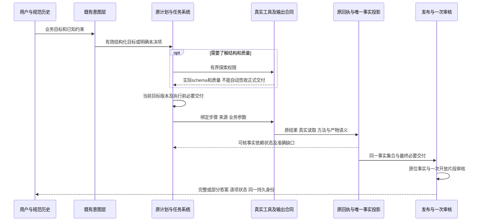

# 需求驱动的系统代码审查与已确认方向

日期：2026-10-09。状态：**已完成关键断点审查，尚未完成系统根因闭合。用户对此前多次根因判断提出质疑后，已补§5.1的因果纠正。Q1—Q3仍是已批准设计边界，不是根因已证明或方案已验证的证据；源码实施前须完成唯一计划§0.8的因果核验。**

唯一执行计划仍为 [可信发布重建总计划](../superpowers/plans/2026-09-22-analysis-agent-trust-reset-plan.md)。本文是问题、依据与裁决材料，§8 是方案追溯摘要；正式阶段与状态只在唯一计划§0.8，不是第二份执行计划。新会话入口见 [交接说明](2026-10-09-system-review-handoff.md)。

## 1. 判断与审查边界

现有证据支持：**需求、模型可见合同、执行状态机、工具产物语义和验收输入之间存在系统性不一致；多次重构主要封闭了事实安全和局部状态，没有证明完整用户任务在同一合同下可完成。** 不支持“项目已经不可修复”，也不支持继续按单个自然回答逐项补丁后直接重跑付费矩阵。

本次发现的关键问题可以在没有 Provider、没有随机回答的条件下复现。因此，模型随机性会改变先撞到哪个断点，但不是这些断点的原因。此前本地绿色是真实证据，但作为进入自然验收的充分条件，覆盖不足；“重构完成”应限定为当时已列出的本地出口完成，不能解释为架构已闭合或产品已达到原需求。

### 1.1 精确身份与保护

- 实施/审查树：`C:\Users\duguy\.codex\worktrees\trust-rebuild\data-agent`；分支 `codex/trust-rebuild-20260927`；HEAD `f7210e170d4dd1945abec15d57e364e04942eae4`。
- 供体：`D:\Project\Daily\data-agent`，`main@b181646ff66ea9ea3b0e6a38ffcd3d16b6687312`，只读；同名计划不是当前计划。
- 审查前已有 dirty：唯一计划修改；未跟踪 `docs/audit/2026-10-09-p5-real-f7210e1-r3.md`。原字节及状态备份在 `tmp/system-review-20261009-r1`。
- 本次 Provider 调用 **0**，无应用服务启动，无生产/测试源码修改，无外部 Git、正式默认或部署变更。
- 审查前索引 580 个相关资产：src 173、tests 202、scripts 10、docs 195。索引是材料目录，**不表示逐行审查了全部文件**。
- 对照稳定本地出口的 408 项源/测试/运行资产，当前摘要 0 不符。四批封存原材料共 2,468 份，当前逐份摘要 0 不符。

### 1.2 阅读深度与结论强度

重点审查：原 VP/IC/CP 验收、现行两个 PRD/技术设计/唯一计划、历次控制复盘与四批自然收据；正常 AgentLoop 的意图登记、计划/作用域、派发绑定、回执、目录、DAG、发布与审核链；来源血缘、确认、假设、历史和导出的关键权威入口；现有工具家族和脚本应用测试的构造方式。

未完成也不声称完成：77 个工具的所有算法与统计方法逐一独立数学复核、所有 UI 操作、新模型自然运行、生产环境、全部历史长日志逐行审阅。材料完整性核验不等于内容均正确；静态索引不等于动态全覆盖。下文将“真实材料”“本地真实工具复现”“合成解析器输入”“静态风险”分别标明。

## 2. 需求基准与已有可用基础

需求不是让 LLM 每次给同一句话，而是无论采用哪条合法路径，都能交付有来源和边界的专业结果；不能完成时准确指出未执行、数据/方法不足或内部接口问题。

| 原要求 | 当前代码责任 | 当前判断 / 尚欠证据 |
| --- | --- | --- |
| VP I01—I06、IC Q01/Q07：无文件知识/方案咨询，九类意图，混合任务 | `intent.py`、`llm_intent.py`、`analysis_entry.py`、`publication/runtime.py:register_request` | 咨询路径存在，最新 M01 前两轮实际可用；结构化提议被部分过滤时仍有范围丢失，不能只验证 intent_type |
| VP I07—I12、IC Q04—Q06/R05：真实数据范围、必要业务确认和版本 | `uploads.py`、workspace、execution_scope、confirmation/* | 来源身份、实际读取、确认版本保护应保留；业务命名/换版/计划退役历史上反复断开，新候选完整自然链尚未测完 |
| VP C01—C08、CP AC22—AC28：精确样本内事实与方法适用边界 | 真实分析工具 → receipt/result_reference → publication/facts/native | 已有摘要、当前版本、闭合算术、未知单位等保护；真实工具输出到业务交付的语义不完整，见 F3 |
| VP E01—E10、CP AC01—AC21：保留全部必答项、完整值、逐项覆盖 | canonical requirements、必要交付、catalogue、service | 目标原文、ID、结果原文件可追溯；ID/原文一致不能证明模型分解完整；范围字段存在静默删除，见 F5 |
| VP H 系列、IC Q14：竞争假设及支持/反证/冲突/未决 | hypotheses、native.resolve_hypothesis_claims | 当前计划、真实测量与关系谓词重算保留；不能把普通趋势当竞争假设完成，M04 全链需保留独立验收 |
| VP N/S 系列、CP AC16—AC32：有用解释、条件行动、风格变化、局部失败 | service、audit、renderer | 结构化事实和一次局部审核已分离；解释交付与执行 DAG 混放出现确定性阻塞，开放语义本身仍有模型误拒/漏放风险 |
| CP AC33—AC40：图表、历史/压缩/分支、同一答案导出 | public_messages、history、compact、report、Web | 接受对象、哈希、引用、唯一终态有可用基础；HTTP 和固定模型验证不等于浏览器/自然专业交付 |
| 已批准多输入与 Python 边界 | independent 显式 1—16 输入；synthesis 仅证据；Python 参数/实际读取 | 保留这些批准，不恢复 raw synthesis。参数声明只能证明执行前声明，不能证明任意代码业务算法正确 |

证据系统并非整体失效。`publication/facts.py:21` 要求唯一回执、真实结果文件摘要、明确来源身份与实际读取；`native.py:307` 之后按当前注册假设、回执和原测量重算关系；`verification.py:304` 明确 EvidenceRecord 注解不授予最终事实权威。`runtime.py` 的提交校验与 `report.py:283/303` 消费同一接受对象。应保留这些能力，而非再写一个发布系统替代全部代码。

但要区分五个层次：**字节/来源身份正确 → 工具确实算过 → 算法实现正确 → 方法前提适用 → 业务解释成立。** 当前前两层较强；后几层需要方法合同、独立 oracle 和开放语义评审，不能由一个 checked、模型 confidence 或结果哈希跨层证明。原 PRD 已承认 Python 探索性计算和一次审核的边界，不能将其包装成绝对正确。

## 3. 历次失败不是同一分母下逐渐变多的独立 bug

| 身份与证据 | 实际覆盖 | 同类问题的演化 |
| --- | --- | --- |
| 9 月旧 R 系列、ddb9daa / 71e23d0 摘要 | 只有现存审计/提交可查；两指定批原始重放材料缺失，用户批准 unassessed | 旧顺序 builder、散文门、整体拒答和重复决定权导致正确事实/行动丢失；不能拿缺失原材料做自然重放 |
| 882df1c / 20261008-r1，133 次 | 六场景均未达到交付要求，部分依赖提示未执行；并非每项 oracle 都已评估 | 咨询误确认、需求解析丢项、数据续问被按无事实咨询发布、别名/换版及表达生命周期 |
| 3e079b7 / 20261009-r1，132 次 | 六场景 failed；20 原提示发送，M06 非冻结对象确认处未完成恢复 | 真实值和图已存在，但目标映射冲突、阶段不可读被误报缺数据、六图只绑定部分、合法派生公式和同对象选择未贯通 |
| 69035ed / 20261009-r2，111 次 | M01—M05 未通过；M06 部分执行后余额不足，其余 unassessed | 技术 selector、统计键/路径猜测；多目标去重、reuse 宿主注入、综合阶段登记接口；并非余额不足造成此前所有产品失败 |
| f7210e1 / 20261009-r3，18 次 | **只运行 M01 部分**：前两轮咨询完成，turn3 产品失败，turn4 Timeout；M02—M06 blocked_not_started | 5 个真实工具先执行，6 次计划登记均失败；模型 schema 允许而实际 validator 拒绝。不能把本批报告成六场景失败或上轮问题都已解决 |

原 13 CSV、20 提示及硬 oracle 在相邻自然批次保持；不同候选代码与途中阻断改变了可观察路径。现有材料不支持“验收标准随机变严”是主要原因，也不足以计算一个可比较的 bug 数下降曲线。Timeout/余额是批次停止原因，与在此前已经发生的确定性产品失败分开记账。

这轮完整离线 `3530 passed / 2 skipped` 与正常 app 固定脚本 `47 组 / 90 回合 / 0 failed checks` 仍有效地证明其原断言。它们没有证明模型能从当前公开接口自行构造可接受的业务交付、处理合法顺序变化或完成所有能力族。

历史来源：[9 月控制复盘](2026-09-30-trust-rebuild-control-review.md)、[10 月 8 日需求诊断](2026-10-08-p5-requirements-diagnosis.md)、[3e079b7 批后诊断](2026-10-09-p5-real-3e079b7-r1.md)、[69035ed 批后诊断](2026-10-09-p5-real-69035ed-r2.md)、[历史综合](2026-10-09-trust-pipeline-historical-synthesis.md)、[最新部分批次](2026-10-09-p5-real-f7210e1-r3.md)。历史问题已退役的实现不当作当前缺陷；当前判断另有下节代码或复现依据。

## 4. 当前代码确定缺陷与设计冲突

严重度表示对原需求交付的影响，非安全漏洞评分。F1—F5 为当前可定位行为；F6—F8 是验收/设计风险。修复方向尚未实施；Q1—Q3已在本轮审查后获用户逐项确认。

### F1 / 高：模型可见协议与宿主协议不是同一个合同

- `tools/analysis_flow.py:214` 的 plan schema 把 quantity 定义为任意字符串、parameters 定义为任意对象，未公开全部业务范围约束；`analysis_plan_contracts.py:202` 与 `publication/deliveries.py:11—32` 却有封闭种类、必需条件、集合上限和参数白名单。
- 最新真实 6 份失败计划均通过当时模型可见 JSON schema，调用实际 validator 后重现相同错误。原证据 `tmp/p5-real-20261009-r3/zero-call-plan-replay.json`，不是本轮人为构造的无效模型回答。
- `registry.py:153—220` 对这些错误大多按英文错误文字匹配通用恢复类别；把 cannot/type 等解释成数据类型问题，或让模型请求用户补上下文。机器已知的合同问题再次交给自由推断恢复。
- 建议：同一有类型定义产生工具 schema、运行校验和机器错误字段；业务事实语义映射见 F3。错误携带原字段位置、允许类型和可执行的修订范围，使用既有有限恢复预算。不能逐个扩充 quantity 别名或自然语言恢复关键词。

### F2 / 高：计划对执行可选，对交付必需；重规划又过度冻结

- `prompts.py:290` 写“可选 record_analysis_plan”；`publication/runtime.py:180` 的发布指令要求执行前必要交付。`execution_scope.py:223` 无 active plan 返回 legacy scope，`317` 非 active scope 可读数据；`loop.py:461` 的 scope guard 没有统一“正式计算尚未声明交付”的拒绝。
- 真实 r3 顺序已经发生：工具成功后才补计划，执行前交付 ID 不存在。晚绑定不能证明原始归属，正确的末端拒绝把上游流程缺口暴露成“未计算”。
- `analysis_plan_contracts.py:304` 使用 existing != deliveries，实际不止禁止缩小/替换，也禁止完全保留旧交付后追加一项。R-replan：首次及同一计划通过；保留 mean 再添加 table 被 `necessary_delivery_change` 拒绝。现行 PRD 写“技术候选可细化、原必要集合不缩水”，没有解释探索发现新交付应如何继续。
- Q1已批准的方向：明确咨询、探索和正式执行的状态；有限探索提供 schema/质量/上下文，正式计算派发前绑定原目标与必要交付。允许同目标有版本记录地追加必要交付，原范围变化仍走目标变更；新交付执行前绑定，不把探索回执事后补成已完成。
- 这不是建议全开无计划执行，也不是让用户审批技术工具。是否允许追加、哪些操作属于探索，要在 PRD 明确再实施。

### F3 / 高：宿主“有类型目录”尚未拥有完整工具业务语义

当前已消除让模型填写原 result_path 的登记接口，但部分目录类型仍由 JSON 的 dict/list/scalar 和局部字段名决定。`deliveries.py:35—47` 推断 kind；`49—99` 推断 metrics/quantity、过滤参数。`native.py:184—246` 主要保留工具顶层原值；`runtime.py:collect_products` 固定传空 result_paths。这不是散文数字解析，却仍然让结构形状代替了业务产物含义。

本次通过实际工具、真实计划登记、派发前绑定、原回执及相同交付投影做零调用复现；未使用测试 execute helper 补写交付 ID：

| 复现 | 工具真实结果 | 目录 / 用户交付判定 | 结论 |
| --- | --- | --- | --- |
| R-distribution | `distribution_analysis(amount)` 的 count=30、mean=15.5 | 整个 amount 结构被当 table；metrics 变为 count/mean/std 等统计字段，quantity=value；原 amount/mean measurement 无候选 | 工具计算可用，但对应测量不能通过当前正常目录闭合；不是模型没算 |
| R-forecast | `forecast(periods=3)` 实际返回三条 31/32/33，parameters.periods=3 | 业务 scope.forecast_periods=3，目录 parameters={}；最终提示“没有实际预测序列” | 参数词汇没有生产者映射；错误归因又把接口不匹配说成缺结果 |

这两例不证明所有统计工具都失败，也不证明预测方法已被外部验证；它们证明工具名保留、原值保存和交付合同可达是三件不同的事。当前工具家族测试多用宽泛 table/fit/value，无业务指标或窗口，不能覆盖这些缺陷。

建议：每个现有工具族在其生产者/封闭适配边界声明可提供的业务产物类型、测量、单位、窗口及有效性条件；同一合同生成模型可见能力和目录映射。通用 Python 保持有界结构化结果及探索性边界。目录继续从原回执重建，不新增事实库；不通过放宽 sources/quantity/parameters 的比较让结果“匹配”。

### F4 / 高：开放解释与计算依赖共用完成条件，合法计划不能正常推进

- schema 允许一个 step 同时包含 measurement 与 interpretation，也允许依赖该 step。
- `workflow_projection.py:172/200` 将所有 required_delivery_ids 放入任务；`deliveries.py:130` 跳过 OPEN_KINDS；`task_manager.py:217—221/783—792` 又要求全部 ID 存在且无 gap 才 completed。
- R-open-dag：第一步“记录数＋解释”，第二步依赖第一步；真实 describe 得到 30 条，记录数投影已闭合，但解释没有投影。第一步保持 in_progress，第二步 pending/blockedBy=[1]，显式 completed 返回 None，reconcile 无推进。
- 最终发布可以把任务关成 closed_by_publication；显式 failed 也可解除依赖。这些是终止/失败行为，不能替代正确完成第一步并正常计算第二步。仅最后一步是解释的计划不等同于此反例。
- Q2已批准的方向：计算 DAG 依赖只消费已核事实/产物/结构化关系；解释、限制和行动的完成属于最终答案覆盖及原一次审核。中间分析判断若确实影响计算，应以明确结构化决策/证据表达，不用“解释文字已写完”授予数据权限。

### F5 / 高：意图归一化仍可能静默丢失约束

`llm_intent.py:267—271` 对 business_scope 验证异常直接 pass，其余输出仍被接受；多项 requested_outputs 不合法时也逐条 continue。`runtime.py:register_request` 仅在整个 proposals 为空时以整句兜底，不能发现部分条目被遗漏。

本次 R-intent 合成输入通过真实 classifier parser：原提议有 orders、amount、mean、window=7，因 window 不是允许的参数名，输出仅留下 exact_span/kind/op，**全部 business_scope 丢失，未形成结构化 issue**。这是解析器边界反例；没有将它冒称最新自然批次的已观察原因。

原文仍保留是重要保护，但后续 exact-span 校验只证明文字来自用户，不证明 7 日等业务约束已被正确执行。建议非法结构保持原目标及明确 unresolved 原因，禁止在未解决约束下当作无约束执行；合法独立目标保留。语义提议仍由已有模型负责，不增加用正则理解用户所有语义的第二系统。

### F6 / 高：验收缺少跨接口“可构造、可推进、可交付”门

具体依据：

1. `tests/support/plan_inputs.py:declare_goal_deliveries` 直接构造合法 plan 和必要集合；这是单元测试隔离方法，但绕过自然计划构造。
2. `tests/test_trusted_publication_semantics.py:execute` 在 fixture step 下显式补入 plan/step/requirement/delivery 身份。它证明绑定后的发布，不是证明正常入口必然产生绑定。
3. `scripts/testing/run_p7_browser_rehearsal.py:661—697` 按场景生成正确产品声明，提前插入 record_analysis_plan；应用回归覆盖了预设顺序，未覆盖实际模型可见 schema 允许的其他构造与顺序。
4. `test_trusted_publication_native_families.py:114—116` 多数工具用宽泛种类和空业务约束签收。原值存在的检查必要，但不能替代 amount/mean、预测跨度、全部假设、六来源六图的具体交付断言。
5. 原 9 月 30 日控制复盘已经要求：若下一批仍发现零调用本应发现的静态缺口，就停补丁并重审。当前 F1/F3/F4 均可零调用发现，说明该停止条件没有变成充分的前置门。

因此本轮不能以新增几个反例、全量重新绿色作为最终出口。需要在现有框架中加跨边界行为验收：公开 schema 与实际 validator 的结构一致；合法业务目标经实际 tool/receipt/catalogue/DAG/publication 全路径闭合；状态顺序/多目标组合/业务窗口/开放片段的独立 oracle 保持。保留有价值的单元测试，不按函数名数量证明行为迁移完成。

### F7 / 中：单次开放审核与模型视图预算仍是有用性的风险边界

现有一审/局部拒绝设计优于旧整答随机门；审核不拥有事实值。`publication/audit.py` 仍依赖一次模型语义判断，缺失/超限/异常使开放片段 unassessed。`runtime.py:model_publication_context` 有 60,000 字节预算、审阅有 64,000 字节上限，超限不会自动获得专业解释。

历史存在合法行动/解释被扣留，也有无据样本阈值通过审核。结构化引用只能证明引用对象，不能证明周围每句自然语言都由它推出。建议保留一次审核，分报事实完整度、解释接受/拒绝/未核及其原因，按全篇边界和局部误导评估；不新增审核链或词表，不声称零语义误差。当前未做新自然实验，误拒/漏放率未知。

### F8 / 中：当前状态文档和完成口径仍有漂移

审查开始时，唯一计划首页仍写 HEAD69035ed+dirty、D5等待自然测试；同文件 §0.7 已记录 f7210e1/r3 停止，而尾部又写“无待讨论裁决”。历史段有重复 0.4 和旧下一步。文档正文可以保留历史，但必须有一个明确的当前指针。产品 PRD 也将已批准规则与实施回执逐次追加，读者容易把“批准/本地通过/自然完成”混在一起。

此次仅修正当前状态和讨论入口，历史事实不删除。后续正式方案批准时，在原 PRD/设计内整合当前合同；旧设计标明替代关系，实施账留 audit，避免继续把时间流水当规范。技术规模约束应核查责任归属和死路删除。loop 当前 3928 行、analysis_flow 659、task_manager 880；这些数字说明审查成本，不能据此判每一行无效。上轮净减884行也不能证明接口一致。

## 5. 为什么多次重构仍没有收敛

核心闭环一直存在缺口：下游为避免错发而增加校验 → 上游没有同样清晰可构造的接口/状态约束 → 正确计算无法获得交付资格 → 测试脚本补齐理想声明后通过 → 自然运行在另一条合法或未明确禁止的路径撞到同一类断点 → 再为这次样本修复。

过去的改善是真实的：旧散文门和两个膨胀模块已退役；事实/开放解释分离；来源/版本/回执、局部保留、一次审核和接受对象统一都值得保留。不足是重构多按模块内部责任和历史样本推进，没有把**生产者能提供什么、消费者何时可以要求它、模型能看见什么、测试到底替模型补了什么**作为同一个出口。

LLM 的随机性主要作用于意图/交付分解、工具选择和顺序、解释措辞、审核裁决。宿主不应理解任意散文来恢复事实；它应让合法结构输入有确定行为，非法结构有明确的局部处理，范围冲突不能悄悄降为无约束。对语义本身的分解质量仍需自然对照，不能靠更严格 JSON 或更多测试数量消灭这个问题。

### 5.1 用户质疑后的因果纠正：不能把缺陷清单称为根因闭合

复核9月30日控制审计、69035ed架构审计及69035ed→f7210e1实际提交差异后，需纠正上轮“系统审查完成、直接转S1”的推进判断。上轮证明了若干当前反例，没有证明所有反复失败由何种共同机制产生，也没有证明拟议方案足以收敛。

**已证实的过程问题：**此前分析经常从最新失败点出发，找到直接原因后即扩成“架构根因”，随后用按新协议构造的固定测试作为进入自然验收的充分条件。9月30日已经指出前置门未贯通需求/实际路径/默认配置/可见oracle；这次仍复现类似遗漏，说明原停止规则没有有效执行。保存材料和保护事实门有价值，但不证明设计与验收完整。

**本次新增的历史归因：**

| 当前断点 | 提交差异证明的来源 | 不能再使用的解释 |
| --- | --- | --- |
| F4事实＋解释卡DAG | f7210e1新增deliveries.py，跳过OPEN_KINDS；同一重构新增TaskManager完成门，要求全部required_delivery_ids有投影。这组矛盾相对69035ed新引入 | 不能只说是模型另一种回答揭示的旧问题；这是重构制造的确定性冲突 |
| F1模型schema允许、validator拒绝 | 该重构新增严格quantity/parameters规则，同时新增的工具schema未表达同等结构限制 | 不能归因模型未遵守已经公开的完整合同 |
| F2计划可选与前置绑定 | 新增执行前必要交付约束，但69035ed已有的prompts“可选record_analysis_plan”保留，原无计划许可未一并收敛 | 是新旧接口集成遗漏，不能只在终局继续加强拒绝 |

因此，持续出现的问题至少包括“未发现旧缺陷、修复遗漏相邻入口、重构新引入错误、模型语义波动、Provider外部故障”五类。尚未逐项完成全部历史问题的分类，不能声称一个技术原因解释全部批次。

**更深的设计解释目前仍是待验证假设：**系统没有充分区分业务目标、可执行计算、证据证明和最终回答各自的语义与生命周期。结构化ID证明关联身份，回执证明执行/来源，但不会自动证明工具结果实现了业务目标；同一必要交付集合又被用于计算依赖和回答完整性，造成混用。各层分别校验局部对象，缺少对“一个合法业务要求确实存在可执行且可交付的路径”的验证。F2/F3/F4支持这一解释，但还不足以证明它是全部历史失败的唯一根因。

**宣布根因闭合之前必须补齐：**①按原需求将历史失败归为仍在/已修/新引入/材料不足，标明引入与修复身份；②为上述共同机制列支持与反对证据，明确哪些失败不由它解释；③用既有真实材料及最小零调用反例检验边界设计，证明安全拒绝和正确任务可完成能同时成立，且不靠测试补计划/绑定。此阶段不改源码，不准备Provider批次。Q1—Q3保留，但不能凭用户认可方向就宣布技术因果和方案有效性已经得到证明。

## 6. 需完善的功能与追溯清单

| 项目 | 完善目标 | 主责任位置 | 验证依据 |
| --- | --- | --- | --- |
| 意图/混合任务 | 九类路线不丢；坏结构保留原需求和原因；等价续问/风格变更不增算或丢目标 | llm_intent / intent / requirements / runtime | VP I、IC Q/R，历史多目标/reuse原响应；R-intent |
| 探索/正式计算/重规划 | 操作阶段明确；执行前绑定；追加与替换不同；版本相关变更原子 | loop / execution_scope / analysis_plan_contracts / analysis_flow | F1/F2，原咨询→执行→续问序列；scope负例 |
| 工具产物语义 | 全部现有能力族有明确输入/输出/业务量/窗口/方法边界映射；未知即准确报告内部缺口 | registry capability、原工具、native / deliveries | 真工具独立数值oracle；R-distribution/R-forecast；原77工具能力清单 |
| DAG / 交付 | 事实依赖与最终解释完成分开；允许合法组合和失败的局部保留 | workflow_projection / task_manager / service | R-open-dag；跨源推进/失败/循环/来源失效负例 |
| 数据来源 / 派生 / 确认 | 多源全部实际读取、父源、当前版本；同版决定复用，换版适用性重判 | workspace / uploads / data_io / Python工具 / confirmation | M06 86/96及复用；M04换版；错源/错公式反例 |
| 证据 / 假设 / 方法 | 研究注解与证明分层；完整竞争关系；合法统计方法的能力和限制明确 | hypotheses / evidence_statistics / native / verification | 原H系列，支持/反证/冲突/未决；统计结果不是因果背书 |
| 专业输出 | 必答事实、图、解释、条件行动完整；局部错误不吞独立结果；缺口原因准确 | publication service/renderer/audit | VP N/S、CP AC16—32；M01未来AND、M03六图、M05表达 |
| 连续会话 / 产品界面 | 当前答案、分支历史、压缩、刷新、导出同一身份 | history / compact / public_messages / report / Web | CP AC33—40、原浏览器/HTTP矩阵；父答案不成为分支事实 |
| 验收和文档 | 区分控制成功、事实正确、任务完成和自然质量；合同一致性前置 | 现有tests/scripts、唯一计划、PRD/设计 | F6/F8；原matrix/oracle保留，历史unassessed不变 |

本表是能力待完善清单，不授权删除未充分验证的能力。适配能力尚无证明时标明未评估，不能把工具从清单中拿掉以降低验收范围。

## 7. 三项边界与用户确认结果

**Q1：探索与计划演化。用户已确认推荐项。** 推荐有限探索可先读取 schema/预览/质量；正式计算先登记业务交付；在原目标和范围不变时允许有版本记录的追加，不能缩小或把旧探索回执事后补成完成。替代方案是所有数据计算/查看均先冻结完整计划，代价是探索性分析和渐进咨询更易停滞。哪些操作属探索应在原工具能力合同中列出，不能看工具名猜。

**Q2：DAG 与开放解释。用户已确认推荐项。** 推荐 DAG 的成功依赖仅为可验证事实、产物和结构化关系；解释、限制、行动继续是必要用户交付，但其完成归最终答案及一次审核。替代方案是允许中间解释成为 DAG 节点，则须先定义独立的中间产物身份/完成条件，复杂度和审核时点都会扩大。推荐不增加中间语义审核。

**Q3：工具产物语义与范围。用户已确认推荐项。** 推荐保留现有工具能力，在既有生产者和封闭适配层建立共同业务语义合同，逐家族证明输入→真实工具→目录→DAG→答案可达；先证明六条核心用户链，再完成全部声明能力的映射/限制清单。未验证家族不算整体重构完成。替代是只支持六个自然场景需要的子集，这会缩小产品能力，未经用户明确决定不能做。

无需重新讨论的已批准原则：无兼容双路径、不猜模型散文事实、一个任务系统/事实权威/账本、一次局部审核、明确来源/版本/确认、多输入与探索性 Python、旧会话只读、分支仅继承聊天历史。新调用授权与上述设计讨论分开，本报告不准备付费批次。

## 8. 已确认方向的工作分解摘要（正式计划见唯一计划§0.8）

不建议再做一次“全面重写后跑几千测试”的大包。按一条完整用户链完成生产者与消费者合同，再扩展能力；每阶段同时证明可用交付、错用拒绝和邻接能力保留。

| 建议阶段 | 内容与退出条件 | 失败时处理 |
| --- | --- | --- |
| S0 需求裁决与合同统一 | Q1—Q3记录进原PRD/设计；在唯一计划替换当前下一步；列出每状态可用操作、合法输入/输出、缺口种类、旧责任删除表 | 尚有边界冲突就讨论，不改成技术补丁 |
| S1 一条最小完整链 | 无文件咨询→上传→明确订单计算→解释/行动→续问；相同字段定义导出schema/validator；真实派发绑定；当前R反例转既有行为测试 | 任一正确值不能交付/错误值可冒认，都不扩场景、不跑付费 |
| S2 全能力与多轮 | 按族接通描述、比较、派生/多源Python、拟合/预测/统计/假设、图表文件；M01—M06业务合同均满足；换版/确认/压缩/分支/导出及故障路径闭合 | 未适配家族明确列出；不能用table/value宽泛输入代替具体业务量 |
| S3 验收系统验证 | 保留原数值/业务oracle；现有框架覆盖公开schema边界、不同合法顺序、混合开放/事实、多目标/窗口组合；原自然材料做可重放边界重放；完整本地和既有app矩阵 | 区分原材料重放与新协议合成；无法重放保持unassessed；不通过放宽oracle迁移 |
| S4 自然验收准备 | S1—S3稳定同源通过且没有已知静态断点，再冻结完整原M01—M06；自然鲁棒性使用预先固定的等价表达/顺序变化方案和有限预算，原核心oracle不变；具体规模单独讨论授权 | 原批失败不覆盖；新增同类静态失败立即回审共同合同，禁止循环补词表后续跑 |

每阶段收据至少列：原需求、公开输入、实际状态/读取、结果/方法证明、用户可见完整交付、错误反例、证据级别及源码身份。观察“每条原要求是否被满足”和“同类合同断点是否减少”，不以通过测试数、保留函数名、调用数或净减行数作为完成标准。

此图是已批准目标，不是已经实现的流程。

## 9. 本次复现、材料与审查结果

- `tmp/system-review-20261009-r1/diagnose_contracts.py`：一次性有界审查脚本；使用现有隔离 engine 设置、真实 record_analysis_plan、真实注册工具、派发前绑定和持久回执；没有测试 helper 的执行后注入。四项 R-replan / R-distribution / R-forecast / R-open-dag 均得到上述反例。结果 `diagnostics.json`，完整输出 `diagnostics.log`。
- `diagnose_intent_assets.py`：固定合成模型响应进入实际 classify_intent_llm；Provider client 未构造。结果 `intent-scope-diagnostic.json`；408资产核对 `current-assets-check.json`。
- `verify_history.py` / `history-integrity.json`：四批791/823/734/120份原文件分别逐一哈希一致。不是新自然运行，也不改变原批结论。
- `inventory.before.json`、`git-status.before.txt`、`plan.before.md`、`r3-audit.before.md` 保存入口身份；最后封存 `review-receipt.json` 记录命名文档改动、源码/历史材料不变和本次 Provider=0。

本轮未重跑完整测试：没有修改已通过408资产，完整离线绿色不能回答这次提出的合同问题；以上复现已覆盖当前审查的具体疑点。保留原的最新自然失败、早期不可重放、未启动场景和视觉未核状态。

**当前动作：Q1—Q3保留；先按§5.1完成因果核验，再决定何时进入S1。当前源码未改，无新增Provider授权。此前可直接转S1的交接已纠正。**
