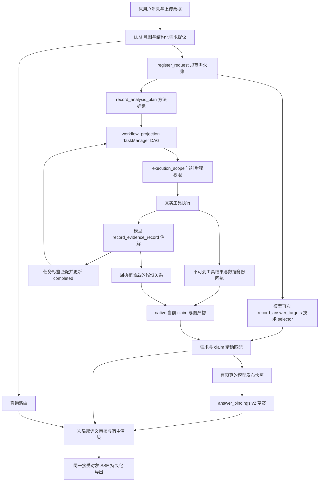
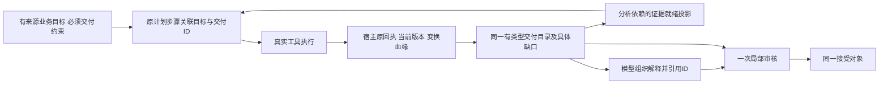

# 可信发布链架构审计：需求、执行 DAG 与事实交付

日期：2026-10-09；审计源码：`codex/trust-rebuild-20260927@69035eddcfc0dfeb52017928fea3567d6a206498`；唯一实施树：`C:\Users\duguy\.codex\worktrees\trust-rebuild\data-agent`。供体 `D:\Project\Daily\data-agent@b181646` 不用于当前实现判断。

## 1. 结论与边界

存在已证实的架构接口断层，不能把连续失败主要归因于模型随机性。当前有实际 DAG、原始回执验证、结构化 claim 和统一接受对象；问题是这些设施没有共享贯通的业务目标与交付身份。计算成功、EvidenceRecord 登记、任务完成、原生 claim 生成、需求绑定和最终发布使用不同判据。局部防错机制有价值，但相互失配后，常以未交付或缺口结束。

不能据本次审计断言整个项目都不可用、工具统计算法都错，或每次失败都来自同一个原因。余额不足是独立外部停止条件；M06 未执行部分仍 unassessed。现有严格事实门继续保留；接受对象中保留原事实不等于用户已经收到专业完整答案。

本报告初始审计阶段只做只读代码核对、隔离零调用诊断和文档修订，当时没有修改生产源码、测试源码、原批材料，也没有启动服务或 Provider 调用。用户后续批准实施，进度见唯一计划§0.7及历史综合报告；初始源码摘要不能签收后续dirty实现。重新核对冻结清单 385 项与封存材料 734 项，摘要均一致，详见 `tmp/p5-architecture-audit-20261009/integrity-check.json`。

规范依据：[产品 PRD](../product/data-agent-product-requirements.md)、[发布 PRD](../product/trusted-answer-publication-requirements.md)、[唯一总计划](../superpowers/plans/2026-09-22-analysis-agent-trust-reset-plan.md)、VP 的分析价值保留、IC 的业务澄清和 CP 的完整表达。旧文件中的历史实现路径不作为当前调用链。

## 2. 当前实际调用链

入口核对：`loop.py:1213` 登记需求；`analysis_flow.py:428` 登记计划；`workflow_projection.py:133` 投影步骤；`execution_scope.py:138` 解析权限；`loop.py:1709` 附近保存工具回执；`analysis_flow.py:585` 绑定证据的当前回执；`analysis_flow.py:739` 更新任务；`publication/runtime.py:67` 构造事实快照，`:213` 给模型发布合同；`loop.py:1834` 发布，`:1826` 持久化。咨询也进入同一接受对象，不应增加无数据回执门。

**实际存在三种图：**步骤依赖图、数据版本/派生血缘图、claim 证明/需求交付关系图。三者承担不同职责，无需强行合成一个通用调度器；当前缺的是跨图的稳定身份和一致的就绪条件。

## 3. 发现、需求差异与修复方向

### A01 高：业务目标与执行交付没有稳定贯通

- 需求：PUB-03/04、PROD-T01/O01，每个原问题有自身交付或具体缺口；六来源不能以一个结果代替。
- 实现：`requirements.py:152–162` 创建业务目标时先给空 business_scope，只有模型可选 selector 存在才建立范围；`analysis_plan_contracts.py:157–174` 只要求文本 goal/expected_output/evidence_requirements，没有必需的原需求/有类型交付关联；`runtime.py:221–224` 又要求模型填一次工具/统计键/结果路径。
- 真实表现：M01/M02 有实际30/107及19个 claim 却没有 delivery_targets；M03/M05 提交 selector 后仍因原统计键、叶路径、派生对象和图路径不匹配而无交付归属。
- 根因：系统要求模型重复重建宿主已知的技术事实关系。JSON 化并没有消除这类随机接口风险；宽松别名或为每种猜法打补丁会继续扩大错误面。
- 方向（已获用户确认）：原需求进入既有计划/步骤，必要交付在执行前确定，宿主按真实回执生成有类型目录，模型引用目录 ID。缺结果保留必要交付的未完成状态，不能只登记已经成功的产物从而制造“全覆盖”。直接替换 record_answer_targets 技术 selector 路径。

### A02 高：任务完成可推进 DAG，但未证明必要证据已就绪

- 需求：PROD-T01 明确模型 task_update 完成不构成事实证明；综合步骤消费真实证据。
- 实现：`task_tools.py:380/408` 可直接更新状态；`task_manager.py:198–200` completed 即释放依赖，`:238–245` 启动下一步骤。自动证据路径 `:770–825` 校验计划/步骤/合同 ID 与 evidence_requirement 标签，随后计入 satisfied；不核该 measurement 是否来自原结果或 statistical_projection_gaps 是否阻断。`analysis_flow.py:739` 确实调用该路径。
- 上游已有当前成功回执/版本校验，不能忽略；但“曾运行一个工具”与“本步骤需要的测量已验证”仍有差别。最终 publication/facts 会再次严格核验，所以这不是已证实的无据事实发布漏洞。
- 隔离复现：现有 TaskManager + workflow_projection，匹配标签但无 receipt 的注解就能使 measure 完成并进入 explain/synthesis。材料 `tmp/p5-architecture-audit-20261009/boundary-reproduction.json`。这验证方法边界缺少证据判据，不是整条 app 允许无 receipt 登记的证明，也不能倒推历史批次都曾提前完成。
- 后果：DAG 允许的进度与实际可交付结果失配；原始数据在 synthesis 阶段不可读后，模型可能难以补齐缺口。M04 另有已实证的综合登记权限失配，不能把本复现直接冒充其唯一根因。
- 建议待裁决：保留一般任务的进度管理；分析依赖用宿主已核的必要交付状态决定就绪。完成、明确失败/不可计算均可形成终态，但下游必须收到具体缺口；模型完成声明不能伪造证据就绪。不新建调度器。

### A03 高：模型写文件再载入能切断原数据派生血缘

- 需求：PROD-E01/A04，六来源/派生计算需保留真实父版本；模型表述不提供来源权威。
- 实现：`file_ops.py:71–86` 允许写当前会话产物；`data_io.py:100` 附近允许读取本会话 output，`:460` 将所读文件作为新 raw 快照。`workspace.py:140–143` 新 raw 身份独立；已有 `derive_multi:258–270` 可保留多父血缘，但文本写文件与重载不是这条链。
- 真实表现：M03 模型从 preview 拼写 combined CSV 后 load_data，再计算比较。它可以证明“新文件上的实际计算”，不能自动证明其完整代表六个上传源、且所有记录转换正确。
- 不夸大：未证明该文件每个值错误，也未证明当前发布门已把它升级为六源权威；本批最终没有完整交付。问题是已有工具可用性不等于可信分析的来源闭环。
- 建议待裁决：保留 write_file 的导出/探索能力；模型生成数据作为独立探索性输入。要用于完成原上传源的交付，必须走已有执行能力保留可重放变换与父版本证明；没有证明就拒绝该来源升级并说明缺口。不能用值相等、名称相似或模型写 source 字段恢复血缘。

### A04 中：EvidenceRecord、综合策略与发布 claim 仍有重复的内容控制

- 实现仍有散文启发式：`analysis_flow.py:43–77` 用“显著/最受欢迎”等词推断统计推断；`:122–172` 用方法文字、样本30/100、观察60天等自动生成限制；`:176–211` 降模型置信度。时间窗口也接受文本正则。它们进入真实 record_evidence_record 工具响应（`:664–721`），不是只存在于旧文件。
- `synthesis_policy.py:78–99` 又根据 EvidenceRecord 是否存在、confidence 和文本不确定词决定综合指引，而当前发布事实来自原生 receipt/claim。这些提示可改变表达或执行倾向，但本审计没有证明其直接批准事实。
- 正面边界：`verification.py:305–307` 已明确诊断性；`maybe_verify_turn_claims` 在当前生产源没有外部调用者。`hypotheses.py:384–389/824–841` 文本相似只关联候选，支持/反驳还需原测量验证；不能把它说成仍在靠相似文本批准假设。`:727` 的 changed/trend 来自宿主模板文本，但仍应改成显式 predicate 以免内部文案改变语义。
- 诊断复现说明文字能触发不同自动限制，不表示两条语义不同的句子应获得相同审核结果。真正缺陷是开放语义与统计充分性判断被硬编码成通用文字/阈值规则；n<30 不是所有推断或建议通用的停止标准。
- 建议待裁决：EvidenceRecord 保留研究注解和候选假设；执行就绪、事实可信范围与必要限制读取同一宿主结构。删除通用词表/阈值裁决责任；按工具方法合同、样本设计和实际验证状态提供限制。开放语言仍由已有一次局部审核判断。禁止增加新的置信度总分或第二事实批准者。

### A05 高：主机协议自相矛盾及局部失败放大

- `llm_intent.py:243–247` 同 span/kind 去重丢不同目标 ID；`runtime.py:44–54` 两次自动补 presentation 来源（包括 reuse）；`requirements.py:132–134` 又拒绝 reuse 额外字段。原 M03 响应6→2与宿主注入造成拒绝已有真实代码零调用重放。
- `contracts.py:275–287` 一个坏 purpose 抛整体异常；`service.py:35–39` 清空模型 sections。宿主保底 `:136–148` 仍保留已绑定事实，所以不是原事实删除；但 A01 未绑定时保底也无交付可发布。M03 两缺陷叠加。
- 已获用户确认的修复：判别操作合同按目标 ID 处理；局部可定位错误只拒对应片段；全局摘要/身份失配或整体不可解析拒整草案；目标变更原子拒绝；版本/确认/血缘失配拒相关事实。保留宿主事实权威，不通过放松校验“修好”。

### A06 高：完整证明图与可消费的交付目录混用，模型视图易丢关键项

- `runtime.py:228–252` 把含逐 claim 证明的快照放入60KB模型上下文，超限按遍历顺序装入能放下的 claim，记录 omitted IDs；没有按每项必要交付保证覆盖。极端分支可将模型可见 requirements 清空，宿主原快照仍保留。
- 真实原请求结构解析：28份包含实际 omitted claim 清单；M01后段42可见/65省略，M03最后33可见/21省略，最后0111为38可见/179省略。没有观察到本批进入 requirements 全清空分支。材料 `tmp/p5-architecture-audit-20261009/model-context-omissions.json`。
- 省略不是宿主丢证据，也不能单凭计数证明所有对应失败原因；但缺少交付归属时，模型更难正确补映射/解释，固定理想回包不覆盖这种压力。
- 建议纳入已确认目录设计：完整证明图留宿主；模型看到有界业务交付视图，必要目标、状态、来源/限制及可用引用不能因中间事实膨胀静默消失。超预算要给明确分批交付/局部未核边界，不增加任意工具读权限或付费审核轮次。

### A07 高：本地验收覆盖了合法部件，漏了自然响应组合

- 3470通过/2跳过与47组90回合是真实本地结果；不是自然模型兼容性证明。固定模型回包预先提供正确 selector/叶路径，reuse 测试没有接通宿主补字段。没有验证“省略可选 selector → 原计划执行 → synthesis → 真实目标登记”的完整链。
- 本批原13CSV/20提示/硬 oracle 与前批相同，当前不支持把失败解释为验收标准随机漂移；历史标准变更仍需独立核对，不能由这一结论推及所有数月记录。
- 改进：在现有入口接入只读历史自然结构材料作为反例；组合覆盖需求变更/多目标继续、权限切换、派生血缘、目录预算、局部坏片段和实际完整交付。正例可变措辞/顺序/合法方法，负例错源/错版/错范围/无据因果，断言语义不变量。新协议历史材料只证明结构回归，不冒充新自然通过。

### A08 中：文档与核心责任持续累加，增加维护与接续偏差

- 当前 `loop.py`3964行，publication包1981行，`analysis_flow.py`834行，`hypotheses.py`910行，`task_manager.py`1013行，`synthesis_policy.py`421行。行数不证明无效；旧5417/903行两个模块确已退役，不能继续按其规模指控当前实现。
- 已发现的具体重复责任包括 runtime 两次来源注入、综合指引与发布需求的重复约束、任务完成与交付完成多套判据。单纯拆文件不能修复。
- 唯一计划顶栏还显示3e079b7/132批次而§0.6已有69035ed/111；两个PRD头部也停留882df1c。当前修正文档最新入口，保留历史证据；不可继续只追加更新而让首部误导下一轮。
- 结构约束：每个决策有唯一生产者/消费者；接口变更删除原责任；每项真实故障关联业务目标、缺失关系和回归边界。同根因两轮不收敛就先复盘，不以增加测试数/补丁数代替交付质量。

## 4. 建议的重构范围与验证出口

已确认范围保持：`llm_intent`、既有计划接口、`publication/requirements/native/runtime/contracts/service` 和 host workspace 元数据接线；loop 只编排。新增建议是把相连的 `workflow_projection/task_manager/execution_scope`、`evidence_contracts/evidence_statistics/analysis_flow`、`synthesis_policy/hypotheses` 中重复决定权一起梳理，否则目录只会成为第四套完成判据。

这仍是一个运行时、一个原计划/DAG和一个事实权威；任务视图、模型视图、发布视图都是同一宿主状态的投影。咨询知识不要求数据交付证明。低强度解释可以明确标注保留，但未知事实不能被“低置信度”洗成结果。来源可追溯、数值正确、方法有效、推断强度和目标覆盖需要分别记录，不合成一个笼统可信分数。

实施前需与用户确认的新增裁决：是否将**分析依赖就绪、模型生成数据来源边界、遗留置信度/综合启发式退役**纳入本次现有模块重构。推荐纳入；不取消通用工具/咨询/任务能力。没有批准前不扩改这些源码。

建议出口（纳入唯一计划后实施）：

1. 原需求逐项映射唯一责任与已核来源，保留76/77工具能力及所有既有保护。
2. 用本批原材料在真实组合入口零调用重放，先看到反例确实失败，再替换接口；不为随机措辞加别名。
3. 正常app Provider禁用完整矩阵验证任务/DAG/权限/证据/发布/持久化；本地完整回归只做必要一次及针对剩余风险修复复验。
4. 以最终答案、原图产物、必要交付和具体缺口验收，不能用 receipt数/task数/格式合法代替。
5. 本地门通过后再准备完整自然P5；余额恢复、新冻结和精确授权独立进行。111旧账本不续跑。

## 5. 已确认与尚未实施记录

最新用户“按上述方式确定”已批准：计划/执行接入宿主交付目录，以及局部片段/全局身份/目标原子变更/相关事实拒绝边界。此前需求三层设计也已确认。该批准不自动覆盖本次新发现的执行就绪和模型生成数据裁决；用户要求先审计讨论，因此当前生产源保持69035ed。新功能是否真正实现和验收只由唯一总计划及对应实际收据更新。

## 6. 用户批准实施（后续更新）

用户已认同本次分析与建议，并明确要求综合历次问题后按建议实施。新增三项范围已批准，取代§4/5的待确认状态；后续新歧义仍先讨论。执行仅见唯一计划§0.7，本审计原发现与隔离复现范围保持。

## 完整重构实施与验收边界：arc-final-r1

当前C重建树HEAD69035ed加在途修改；编辑前600项完整字节保存在tmp/arc-final-r1/before。D供体未编辑，所有历史Provider授权均关闭，本轮Provider0。用户批准的两项补充：independent显式有界多输入；通用Python执行前结构化业务参数。未追加新模式、规划器、事实账本、模型审核轮次或散文猜义规则。

### 根因与替换

| 原问题 | 当前架构处理 | 保留的反例/限制 |
| --- | --- | --- |
| 多层重复猜工具、键、路径，随机回答难以绑定 | 原需求v4业务scope→原计划v2必要交付→真实回执→有类型宿主目录，模型引用ID | 类型/来源/版本/窗口/缺项逐项拒绝；初次业务分解完整性仍由独立oracle及自然验收判定 |
| 工具成功、任务标签和结论间断层 | 原DAG与发布消费同一已核产品投影；派发前归属保留 | 模型completed和EvidenceRecord注解不证明交付；失败保留具体缺口 |
| 换版仍让后续模块按历史同名文件重猜 | 旧执行计划退役；新计划复用解析后的物理合同ID | 原旧目标/关系保持stale；真正文件歧义、业务确认及质量门保留 |
| Python回执无法区分窗口 | 执行前business_parameters随计划和实际读取绑定；native验证一致 | 不读代码猜窗口；声明不证明任意方法正确或预测有效，探索限制仍展示 |
| 自动方法建议覆盖可执行计划 | analysis_spec与analysis_plan职责分离；计划/任务/需求保存事务 | 保存故障原子恢复；建议本身不创建事实权威 |
| 模型生成文件被当成原源 | 原source_origins、父版本、实际读取及派生闭包核验 | 相同CSV或值不能冒认上传源；仍允许独立探索/导出 |
| 文字阈值重复改变可信度 | 删除通用文字、样本数/天数及置信度裁决；方法合同与一次局部审核各自负责 | 无据因果/外推继续拒绝，审核不能盖过确定性事实失败 |
| 多来源模型预算膨胀 | 原证明保留，单一视图去重/整体值外置；只展示事实已匹配交付 | 不截断事实组，预算超限明确拒绝开放解释并保留宿主事实 |

### 验收控制

旧诊断r1—r18、两次完整诊断及所有原失败保留，不拼接通过。当前完整离线身份tmp/arc-final-full-r1与应用身份tmp/arc-final-http-r1独立；应用控制local_http_api，原47组90回合输入/数值oracle不变，固定脚本不是自然模型。

新HTTP控制器仅将M04旧假设定位从“当前执行计划”改为首轮原计划ID，保留原13状态序列、原需求归属、旧版本不授事实三个断言，并增加换版后执行计划退役断言。新合同要求旧执行权限退役，不能为了测试定位把旧执行计划恢复。原控制器字节与摘要保留。

本地HTTP首轮发现六来源元数据预算超限后脚本继续读取完整视图字段，导致KeyError；控制器在无接受答案时访问source_snapshot又停止。原运行保留为失败/中止，未执行部分unassessed。修复模型视图重复投影及演练/控制器异常处理后，须新目录完整重跑。视觉picker/正文/图表/刷新/console及自然生成/审核质量仍分别unassessed。

最终状态只由唯一计划§0.7及机器收据签收；本节实施描述不替代验收。

### 稳定复验前最后两项实际接口核对

多输入对齐失败的实际原因是原工具datasets参数按逗号传输，而作用域把字符串当单个数据集。现复用ToolCapability.input_contract声明dataset_argument_separators，唯一封闭守卫按此原工具协议逐输入核验，不从名称或散文猜列表；没有该声明的标量名称保持原样。移除加载后必被封闭实现覆盖的六个旧作用域函数副本225行，不删除封闭校验及其防篡改保护。原对齐实际值及派生全部父源正反例继续核验。

演练中的原“含首尾日期天数”是独立业务需求，现执行前单独登记measurement而非宽表；原12及result_data/inclusive_days证据断言保留。三个控制检查按已批准合同迁移：显式换版重新分析使用不同的当前版本计划；换版退役原计划但允许后续新计划；导出链允许执行前record_analysis_plan，仍不允许分析工具。原13假设状态、supported/空/refuted、旧版本不得授事实、原源及全部原数值/导出字节oracle不变。

arc-final-http-r3整批47组/90回合检查0失败、Provider0，service exec8159/PID7088已停止，driver62623退出0，8783已释放。源码408项全资产在应用结算后重核0变化；最终全量离线r3仍需完成后共同签收。真实原生工具登记77个；没有新增工具。r2离线3527通过只作运行中源码变更的诊断，不能拼接为最终通过。

### 最终本地结算：完成重构，等待自然测试

最终同源完整离线arc-final-full-r3：3530通过/0失败/2跳过/17警告、507.43秒；正常app arc-final-http-r3：原47组90回合检查0失败、90唯一durable终态、78接受对象及引用导出一致，Provider0。408运行资产前后0变化；600备份完整、2729原测试函数0丢失、77工具集合不变，历史2348原文件0不符。生产合并净-884行（保护备份）、净-609行（HEAD），包含新目录及全部替代helpers，逐文件对账见机器收据。服务与端口已关闭，未暂存/提交或修改D供体。

机器收据tmp/arc-final-r1/final-receipt.json SHA256 62c20c6603700943068e06570f7a54b4f870f16be1de8c36f0dea308bbc6ef33；当前唯一计划§0.7签收D2—D4本地出口，D5等待自然测试。旧自然失败和缺材料unassessed不改写；视觉/自然语义仍unassessed，新真实批次须重新精确冻结及新身份授权。正式默认/外部Git/部署未授权和执行。本节为结算记录，前述在途状态均为当时历史，不能用作当前下一步骤。
