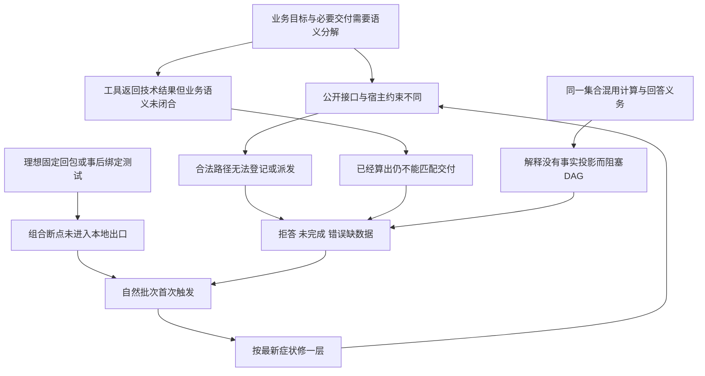

# 项目系统回顾：失败机制、需求冲突与重构依据

日期：2026-10-10。源码f7210e170d4dd1945abec15d57e364e04942eae4；C重建树、codex/trust-rebuild-20260927。本轮仅整理文档和只读核验，Provider调用0。实施进度只见[唯一计划](../superpowers/plans/2026-09-22-analysis-agent-trust-reset-plan.md)，本报告不另建阶段。

## 1. 结论强度与责任纠正

现有证据足以证明：**公开合同、执行阶段、工具业务产物、DAG依赖和最终回答义务之间存在确定性失配；固定理想输入的局部测试没有约束这些组合，部分重构还引入了新的矛盾。** 这些机制能够解释已复现的持续失败。尚无证据证明整个项目不可修复，也没有完成对所有历史失败和所有算法的唯一根因归因。

此前多次诊断把“最新失败的直接原因”扩成系统根因，并把按新实现构造的测试通过当成重构完成。这个结论范围超过证据。不同批次说法变化，包含了三个实际不同的过程：原有缺陷被进一步暴露、相邻入口未一同修改、重构制造新回归；还混有模型语义变化与Provider外部故障。需要承认并分别归因，不能用一个不断扩张的根因标签解释一切。

本次输出是**可审查的有界重构依据**，不是“全部根因已证明解决”。S1检验已定位的合同闭环；S3核全部能力；S5核自然质量。批准设计意味着允许实施验证，不意味着技术效果已被证明。

## 2. 本次审查范围和证据

- 对照：现行两个PRD、原VP/IC/CP需求/设计/180行为编号、表达规范、唯一计划；9月控制审计及最近四批自然诊断。
- 代码：意图/原目标、公开schema、计划validator、scope/派发绑定、原回执、目录、DAG、发布/审核/覆盖、历史/确认/来源的关键权威入口；本轮再次核对具体矛盾及69035ed→f7210e1差异。
- 只读重新取得全部77注册工具的公开schema、签名、说明及30份能力元数据；其中input_contract有1份非空、output_contract均为空。这说明现有能力描述尚不足以作为共同业务输出合同，**不等于所有工具都没有内部方法实现或证据保护**。
- 原零调用复现见tmp/system-review-20261009-r1/diagnostics.json、intent-scope-diagnostic.json；本轮未篡改或重跑其输出，不冒充新实现GREEN。
- 原四批共2468份材料按封存manifest核对；408项源码/测试/运行资产与稳定基线核对；本轮收据位于tmp/project-review-20261010-r1。摘要一致只证明完整性，不证明语义均正确。
- 未完成：每个统计算法的独立数学审查、全部声明模式的动态执行、新的自然批次、当前全部UI操作、生产/部署验证。目录清单不是逐行全仓审查。

## 3. 可重复失败的机制

模型随机性会改变路径、字段和解释，因而改变先撞到的断点。上述结构/状态矛盾在Provider禁用时也能复现，不能要求模型恰好走某条理想路径来补齐产品合同。

证据系统较强的来源/字节/执行证明，必须接上业务测量语义及最终必答义务；仅增加ID不能完成这个连接。系统应分别证明：输入/来源正确、实际执行、算法输出、方法适用、结论范围、用户可见交付。当前“已核事实”与“完成用户问题”之间仍有接口缺口。

## 4. 已证实断点及来源

路径相对src/data_agent，行号对应f7210e1；源码下一轮修改后重新定位。

| ID | 当前证据 | 实际后果 | 归因/修复边界 |
| --- | --- | --- | --- |
| F1 | tools/analysis_flow.py:224—226 的quantity/parameters宽松；agent/analysis_plan_contracts.py:206—212及publication/deliveries.py:11—30更严格。r3原6次计划提议过公开schema、均被validator拒 | 模型未得到足够可遵守的正式合同；坏格式反复尝试 | 69035ed→f721新增严格规则同时新增不完整schema，属于本轮引入的不一致；统一结构源，动态身份另验 |
| F2 | prompts仍提示directed_analysis可选计划；execution_scope的无active路径允许执行；runtime签收须预绑定；analysis_plan_contracts.py:302—304拒全部集合变化 | 先算后无法交付；合法新增交付也失败 | 旧可选路径未接新前置条件；Q1解决阶段和追加边界 |
| F3 | publication/deliveries.py:35—47按形状/工具猜类型，64—84按键和白名单投影指标/参数 | amount/mean=15.5实际算出但未签收；三期31/32/33因periods映射丢失被说成无预测序列 | 当前目录的业务语义缺口；生产者合同承接，不放宽来源/值验证 |
| F4 | workflow_projection.py:172/200传全部交付；deliveries.py:134跳过OPEN_KINDS；session/task_manager.py:217—221、782—792要求全部投影存在 | 合法事实＋解释前序永远不能正常完成，依赖计算不启动 | 同一重构新增矛盾，不能归成旧问题或随机性；Q2分开计算依赖与最终义务 |
| F5 | llm_intent.py:267—270对非法business_scope except pass；实际classifier固定反例的window=7整段scope消失 | 原文在，但执行约束丢失；可误变无约束任务 | 合成反例证明解析缺陷，不冒充本批自然观察；保留原目标与结构错误 |
| F6 | tests/support/plan_inputs.py手工置规范计划；test_trusted_publication_semantics.py:101—113在部分fixture中执行后补绑定；rehearsal预设理想声明 | 单元隔离有用，但正常构造/顺序缺陷不被测出 | 验收覆盖与实现同源风险；正常app硬门不得倒填，独立预期不来自产品匹配器 |
| F7 | 一次语义审核、上下文预算、自然目标分解仍有不确定性 | 无据阈值可能通过、合规行动可能误拒 | 不由F1—F4完全解释；开放内容独立人工评分与自然正反例，保留已批准一次审核边界 |
| F8 | 多份“唯一计划”及旧阶段状态、兼容/审核约束与已批准现规范并存 | 后续会话可能照过时步骤实施、误读历史完成 | 本轮通过现行规范+原字节归档处理；不表示代码缺陷已修 |
| F9 | tools/ml.py:81接受auto/backtest/simple/prophet，91—92全部调用backtested_forecast；公开说明只称auto/backtest | 别名看起来像保留多个算法，实际不同含义未实现 | 本轮用户确认退役simple/prophet，保留真实回测能力；不新增算法 |

另外核到regression_analysis(method=linear)实际ElasticNet，rf实际RandomForest，gbrt/auto实际GradientBoosting。此处先精确描述已实现方法，不能凭参数名推断普通最小二乘，也不在接口重构中顺便换算法。

上述负例修复后还须有合法正例和危险相邻例；只把拒绝门改松，会把来源/方法保护一同破坏。

## 5. 历次失败的可比性与当前处置

| 历史身份/范围 | 观察与后续演化 | 本次结论 |
| --- | --- | --- |
| R7—R21、R11/R16及旧多builder/散文门 | 合法描述/行动被误拒、局部错误扩大、隐藏绑定/多入口分叉；旧publication_synthesis/audit已按授权删除 | 历史定位有实际价值，旧模块退役事实可核；不能据此宣布所有新链问题解决 |
| ddb9daa/71e23d0 | 原指定目录缺逐调用/会话原材料；仅审计摘要 | 保留原失败，自然重放unassessed；用户已批准新链自然验收，不伪造重放 |
| 882df1c，133调用 | 咨询/路由、需求丢项、续问、业务别名/换版/表达生命周期；六场景未接受且部分依赖提示未执行 | 历史原材料反例；当前这些功能仍须正常完整链签收 |
| 3e079b7，132调用 | 真实值和图存在，但目标映射、综合权限、六图绑定、公式/对象选择断开；M06非冻结对象确认未恢复 | 技术执行成功与业务交付脱节；旧“已修复”不自动转当前GREEN |
| 69035ed，111启动/110返回/1余额失败 | M01—M05产品失败；M06部分后外部余额停止；selector/键/路径猜测与reuse集成问题 | 原技术selector已被目录替换；新的目录仍有F3，属于责任迁移后未闭合，不是所有旧代码还在 |
| f7210e1，18启动/17返回/1Timeout | 仅M01部分：前两轮咨询可用、第三轮5个真实工具后6次登记失败、第四轮意图Timeout；M02—M06未启动 | F1/F2有自然证据；其余场景未评估，不能声称六个都失败 |
| f7210e1本地出口3530 passed/2 skipped；47组90回合 | 所执行的固定断言真实通过，没覆盖F1—F5的关键构造/顺序组合 | 保留原结果，修正其外推范围；测试总量不是架构质量证据 |

相邻自然批次保留13CSV、20原提示和原硬oracle，但源码与实际到达路径不同；不能计算“同分母bug数递增/递减”。本轮不重写各批结果，不把Timeout/余额算作业务算法根因，不把未启动项当产品失败。

历史定位出处：[控制复盘](2026-09-30-trust-rebuild-control-review.md)、[882诊断](2026-10-08-p5-requirements-diagnosis.md)、[3e批报告](2026-10-09-p5-real-3e079b7-r1.md)、[690批报告](2026-10-09-p5-real-69035ed-r2.md)、[历次综合](2026-10-09-trust-pipeline-historical-synthesis.md)、[f721部分批](2026-10-09-p5-real-f7210e1-r3.md)、[上次系统审查及因果纠正](2026-10-09-requirements-system-review.md)。这些是原身份历史资料，其旧“下一步”不覆盖新计划。

## 6. 对共同机制的支持、限制和可证伪检查

| 解释 | 支持证据 | 限制/不能解释 | 下一阶段必须看到 |
| --- | --- | --- | --- |
| 合同无单一语义来源，层间各自设门 | F1/F2/F3/F9，公开允许与执行/交付含义不同 | 不证明每个工具算法错；确认/来源/AcceptedAnswer仍有可用保护 | 同一公开合同经正常registry、派发、实际结果可完成合法任务；错误邻例仍拒 |
| 业务/计算/回答生命周期混用 | F2/F4；同一集合被当依赖与终局义务 | 不能解释全部自然开放文字误判 | 探索→追加→真实计算可达；解释待核不阻计算且最终不假报完整 |
| 验收未约束生产者与消费者组合 | F6及9月已提出却未有效执行的停止规则 | 不是所有测试无效；事实/隔离/持久化的测试仍重要 | 红例穿公开接口；同业务多合法结构路径通过；单元注入不签app出口 |
| 模型随机输出触发不同路径 | 各批计划/解释形态不同 | 确定性断点不需要随机模型；不能把错误schema归责模型 | 固定不变量正反例＋同候选两次自然完整通过，不要求逐字相同 |

这是实施假设及验证设计。若S1仍需模型猜技术路径、测试事后补绑定或以缺口替代可算结果，假设没有在实现中落地，应停在该关口；不得直接进入下一付费批。

## 7. 文档冲突与裁决台账

| 冲突/缺口 | 本次现行决定 | 依据与保留内容 |
| --- | --- | --- |
| 三旧计划各自唯一进度、D供体路径和旧完成状态 | 唯一C树总计划；旧主题plan变需求基线，技术design变追溯入口 | 当前用户明确要求最新计划、删除冗余阶段；全部原字节归档 |
| read-old/write-new、旧审批迁移、回滚兼容 | 旧协议只读；新协议全生命周期保留 | 用户大改不兼容及分支继承聊天决定；原事件/正文不丢 |
| 零新增模型审核、修订后再复核 | 数据相关开放内容默认一次有界审核，已有一次格式恢复不增语义轮次 | 已批准发布设计；预算/账本/局部保留不变 |
| 旧selector/隐藏绑定/自由图标记 | 宿主有类型目录和结构claim/artifact，单一路径 | 用户已批准接口重构；原数值/源/图合法性行为保留 |
| 计划可选、发布预绑定；交付集合不可变 | 有限探索、正式计算预绑定、同范围记录追加 | 已批准Q1；不追认探索完成，不缩小原要求 |
| 开放解释必须完成才解锁计算 | 成功依赖只消费事实/产物/结构关系，解释保留最终义务 | 已批准Q2；不新增中间语义审核 |
| 六场景或工具名字保留就称全部能力 | 77入口及所有声明模式逐族验收 | 已批准Q3；非事实工具验证合法效果，不缩小功能 |
| 宿主checked/receipt可能被理解为全部业务正确 | 来源/执行/算法/方法/解释五层证明分开 | 原VP方法边界及Python探索性批准；合法高级方法仍可用 |
| “结果或缺口覆盖100%”可掩盖可算项拒答 | 响应覆盖与可计算完成分别100%；错误缺口失败 | 原VP价值、CP完整内容的明确化，不改历史oracle结果 |
| 硬行数限额与必要接口代码冲突 | 无机械净增上限，唯一责任及删除被替代规则约束膨胀 | 用户明确放开；逐文件对账不替代行为验收 |
| VP软分建议与CP正式量表并存 | 统一CP五维0/1/2硬门；VP价值落实到对应内容要素 | VP原阈值是待冻结建议，不另建竞争评分；原要求不删 |
| 一次自然通过无法观察重复波动 | 同候选同M01—M06连续两次完整通过，各批单独授权 | 2026-10-10用户直接确认；不筛批、不继承额度 |
| forecast误导别名与保留全部能力 | 保留auto/backtest实际能力，明确拒绝simple/prophet，不新增算法 | 2026-10-10用户直接确认 |

本次已发现并影响实施的产品边界已明确。后续逐方法审查如发现新估计量/范围/权限取舍，必须先讨论；没有以“文档统一”授权未知功能删减。原15项DoD和R3/R4/R5的联合目标归入统一验收：事实可用、合法开放内容保留/错误不升级、旧责任退役共同满足。

## 8. 重构选择与防止重复失败

保留：意图路由、原工具算法能力、原工作区/版本/血缘、确认、不可变回执、结构claim、当前假设关系、AcceptedAnswer、会话与导出。改造：共同合同、阶段权限、业务结果语义、计算与回答义务接口、准确错误。删除：被替代同义规则、形状猜业务量、错误关键词恢复、事后绑定和相应旧私有实现依赖。

先贯通真实最小用户链，再六链，再全部能力族；每阶段联合验证生产者/消费者/公开接口及用户可见结果。单模块重构和几千个测试通过均不得跳过这些出口。过去的退役工作和证据保护继续保留，不恢复同功能双链。

每次失败记录原要求、触发路径、第一不符边界、引入身份、可重现性、影响范围及相邻反例。连续两轮同类修复仍未逼近预定行为，停止第三轮同型补丁，列出设计取舍讨论。新的静态跨接口矛盾在本地发现即阻止付费验收；模型语义质量和外部故障分开诊断。

本轮文档整理、差异检查和原材料完整性核验不能当产品测试通过。新会话按[交接](2026-10-10-rebuild-handoff.md)从S1开始实施；当前没有启动服务或新的Provider批次。
