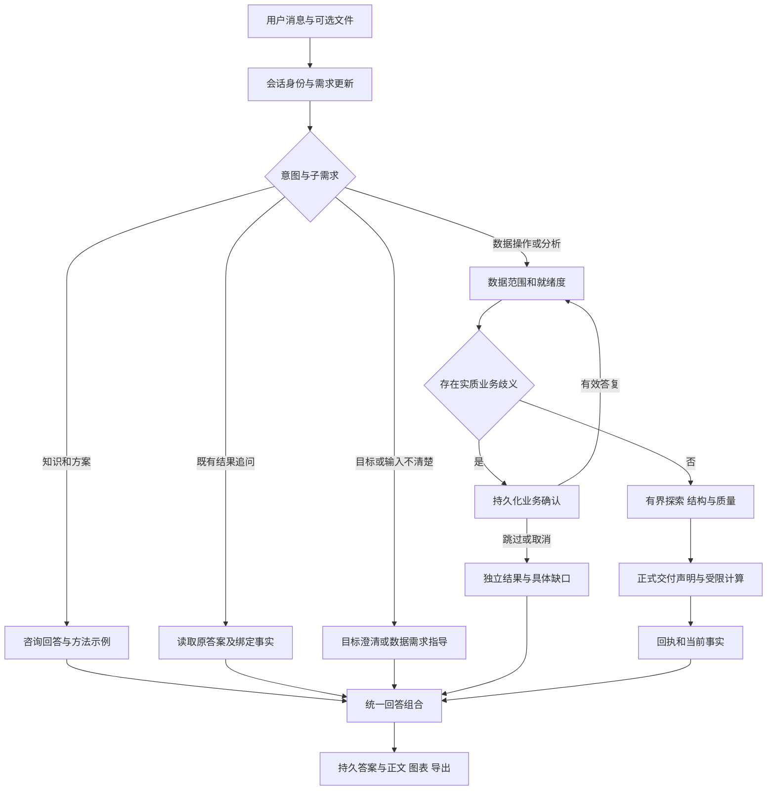
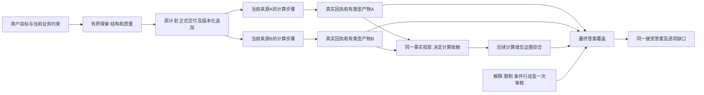
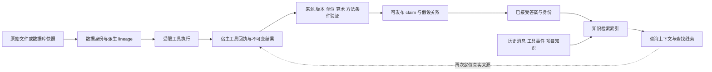
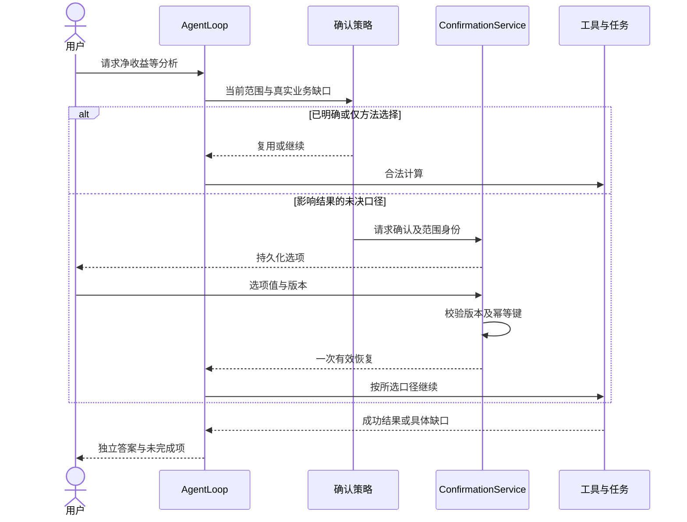
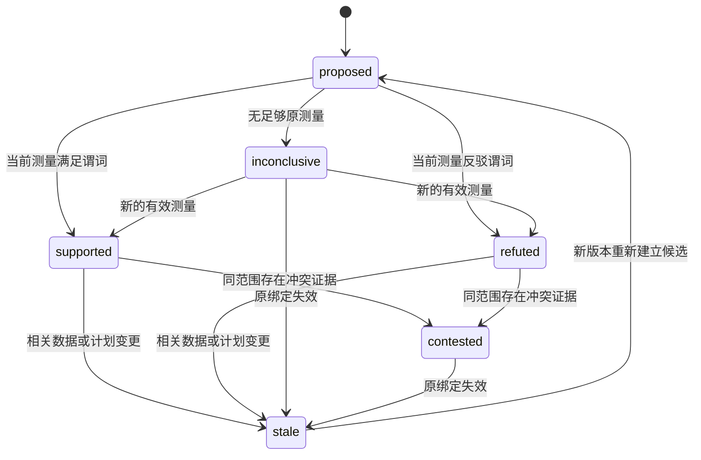
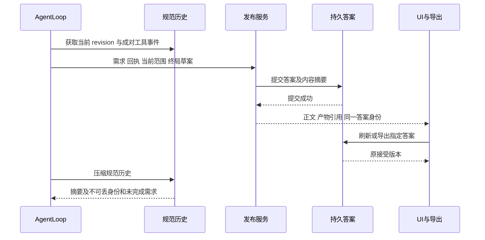
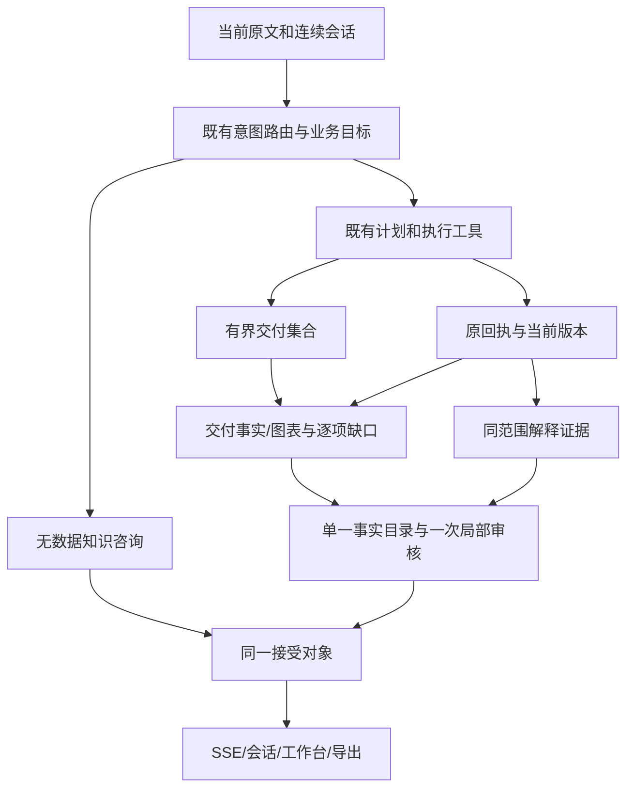
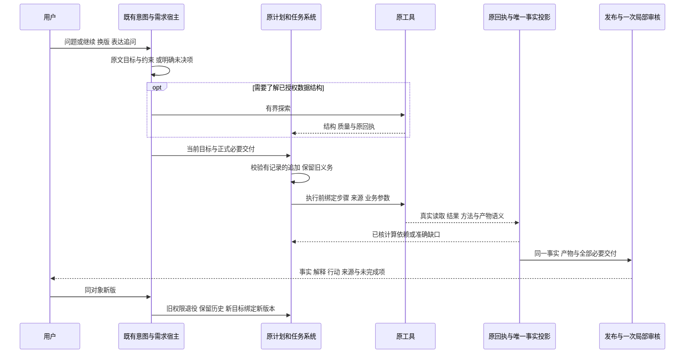

# Data Agent 产品需求

版本：1.7；初版需求整理：2026-09-30；本次修订：2026-10-09；需求基线：用户确认的单路径重构及咨询、能力保留、流程可追溯补充。

本文定义产品能力与用户行为，不记录执行进度。进度只在[唯一总计划](../superpowers/plans/2026-09-22-analysis-agent-trust-reset-plan.md)。当前实施树为 `C:/Users/duguy/.codex/worktrees/trust-rebuild/data-agent`，代码身份与阶段见唯一计划，审查基线 `codex/trust-rebuild-20260927@f7210e1`；`D:/Project/Daily/data-agent@b181646` 为只读供体。

关联：[可信回答 PRD](trusted-answer-publication-requirements.md) · [技术设计](../superpowers/specs/2026-09-30-trusted-answer-pipeline-redesign.md) · [验收契约](../superpowers/validation/2026-09-30-trusted-answer-pipeline-acceptance.md) · [源码能力清单](../audit/2026-09-30-core-capability-source-map.md)。

## 1. 产品目标与范围

面向需要理解数据分析、制定分析方案、处理数据及完成实际分析的用户。没有文件的咨询是完整用户旅程。文件存在不表示用户已请求执行分析；用户从咨询转为执行时重新判定任务、数据和业务口径。

产品交付应同时满足：有用、可信、完整、可追溯。已有可核事实、合理解释、条件建议和独立正确结果均应交付；不能因局部失败退化为整篇拒绝或只剩事实摘要。需求数量、语言、词序、表达偏好不得改变事实与证据门槛。

本次重构覆盖发布权威及其调用边界，不另建规划器、任务调度器、证据数据库、Provider 账本或浏览器测试框架。被重构的协议和旧运行路径直接替换，不提供兼容分支。旧会话保留原正文、事件和产物供只读查看；不把旧运行状态转换成新协议后继续执行。新会话的多轮、压缩、确认、恢复和导出能力必须保留。

## 2. 用户旅程与意图

现有九类意图来自 `agent/intent.py`。它们属于能力契约；现有启发式实现和提示文本可重构。

| ID | 意图 | 用户目标与应有行为 | 数据与执行边界 |
| --- | --- | --- | --- |
| PROD-I01 | simple_response | 问候、简短交流 | 不制造分析任务；问候加实际任务按完整请求处理 |
| PROD-I02 | knowledge_qa | 概念、公式、统计方法、适用条件 | 无文件可答；示例明确为示例，不宣称已计算用户数据 |
| PROD-I03 | analysis_consultation | 如何分析、指标方案、实验设计、方法选择 | 无文件可给可执行方案、所需字段和局限；不强制上传后才回答 |
| PROD-I04 | result_followup | 解释或改写既有结果 | 绑定原答案及来源；只有表达变化不重算、不重问口径 |
| PROD-I05 | intent_negotiation | 目标不明确，协助聚焦 | 只询问影响交付的目标差异，不强迫多指标任务只选一项 |
| PROD-I06 | data_requirement | 需要何种数据、字段、粒度和窗口 | 具体说明输入需求；已有可回答的咨询内容直接交付 |
| PROD-I07 | data_operation | 导入、预览、类型修正、清洗、变换、导出 | 对实际数据执行并保留来源与变更记录；不默认启动完整报告 |
| PROD-I08 | directed_analysis | 针对具体问题计算与解释 | 自动选方法，必要业务歧义才确认；逐问题给结果或缺口 |
| PROD-I09 | comprehensive_report | 多指标、多源综合分析与行动建议 | 完整覆盖、保留各来源，禁止未声明的跨源加总和因果升级 |

共同要求：中英文等价；保留否定、条件、范围和时间窗；“怎么分析，顺便计算当前文件”可包含咨询和执行子需求，不能让单个意图标签吞掉其中一项。路由失败应有可区分的原因和受限回退，不能把失败伪报为成功分类。意图建议不能授权越界工具。

### 2.1 目标流程图

这是目标产品流程，不代表当前所有路径已经通过验收。确认与工具循环属于控制流；下述 DAG 只表达无环的数据依赖。

## 3. 核心功能清单

“源码存在”不能换算成“当前可用”。每族需保留注册入口、真实执行、输出含义、失败行为和用户入口的证据；详细文件及静态缺口见源码能力清单。历史能力账本仅作追溯线索。

| 需求 ID | 能力族 | 保留的用户行为 | 重点约束 |
| --- | --- | --- | --- |
| PROD-D01 | 输入与工作区 | CSV/TSV、Excel、JSON/JSONL、SQL，列举/预览/描述/质量与就绪度 | 上传票据、文件 SHA、数据版本、会话/项目隔离；不能把格式支持等同环境依赖齐全 |
| PROD-D02 | 清洗与变换 | 类型建议/转换、清洗、派生字段/特征、聚合/透视/连接、数据导出 | 原始数据不可变，变换有 lineage；连接核对键、粒度、基数与缺失 |
| PROD-A01 | 描述与探索 | 时序、时期比较、分布、相关、分组、Top N、分解、漏斗、cohort | 同一事实组保留指标、对象、数值、单位、窗口；独立任务局部失败 |
| PROD-A02 | 统计与建模 | A/B、因果方法、回归、归因、分类、预测、SHAP、模拟、曲线拟合 | 计算完成不等于推断成立；记录假设、验证方式、样本与适用范围 |
| PROD-A03 | 开放计算 | 原生工具不足时使用受限 Python | 保留代码/回放与来源；可打印的任意文本不是已验证统计量 |
| PROD-A04 | 多源分析 | 独立分析后综合，可表达冲突和不可比性 | 显式数据合同与依赖；不能因一项坏数据阻断无依赖的其他项 |
| PROD-T01 | 任务与预算 | 唯一当前计划、任务依赖、进度、停止、超时和受限恢复 | 不以模型自报或任务完成状态证明事实；执行预算与调用账本可核 |
| PROD-C01 | 必要业务确认 | 分母、窗口、成本范围、对象等实质歧义 | 一个生命周期；范围有效时复用，相关版本变化重新判断；skip 不授权 |
| PROD-E01 | 计算证据 | 成功工具回执、原始结果、摘要、数据身份、校验与可追溯 claim | 结构化事实权威；来源/单位/算术/版本/范围由宿主验证 |
| PROD-E02 | 竞争假设 | 提出、检验、支持、反驳、争议、证据不足、过时 | 当前计划、真实 ID、原测量决定关系；描述性方向不能变成因果证据 |
| PROD-K01 | 知识与记忆 | 项目规则、知识检索、记忆候选与确认 | 检索索引供回忆，不授予计算事实 verified；拒绝候选不得进入已接受答案上下文 |
| PROD-X01 | 工具与扩展 | 工具发现、文件工具、Skills、MCP、模型设置、CLI | 从真实注册入口验证可达；权限、配置和范围边界保留 |
| PROD-O01 | 回答与表达 | 多问题覆盖、解释、条件建议、简短/标准/详细及受众改写 | 事实不变，表达确实变化；不能用同一摘要冒充所有风格 |
| PROD-O02 | 图表与导出 | Markdown、表格、公式、适用 Mermaid、Plotly、会话/数据导出 | 图表绑定真实产物；数值图不得改用捏造的 Mermaid 图代替 |
| PROD-S01 | 会话生命周期 | 新建、读取、回退/重发、停止、续问、压缩、刷新 | 新协议会话保持身份和未完成义务；回退重发按新轮次执行，不能重用失效审批 |
| PROD-W01 | Web 与工作台 | 上传、SSE、确认卡、任务、项目、知识、配置和工作台 | 正文、侧栏、刷新和导出读取同一已接受答案；前端投影不重判事实 |

历史会话分支能力曾有基础接口而未完整证明 UI。2026-10-02 核实用户确认的继承范围：只继承聊天记录，分支可继续咨询或重新加载/分析；父答案保留为历史，不能直接充当分支事实。新协议分支保存独立会话身份、原聊天来源和经摘要核实的规范压缩记录；不复制父数据、工具回执、分析状态、证据、确认或接受答案权威。旧协议分支仍只读，不能借分支转成可执行旧会话。基础接口和 UI 验收分别记录；外部连接真实可用性另有配置和授权条件。

PROD-A02 的曲线拟合可在明确请求时输出原参数计算的情景值：scenario_points 显式给出，默认不外推。未验证参数情景保留原负值和计算限制；非有限/溢出记录为不可用。未来真实值未知，没有 holdout/backtest 或外部有效性证据时不得标成已验证预测，情景结果不能替代真实预测需求。

## 4. 分析执行与依赖 DAG

本节为2026-10-09系统审查后用户确认的目标合同，尚待新会话实施；不将f7210e1当作已符合。继续使用原AnalysisPlan、TaskManager及单一当前步骤，不新增规划器或调度器。

- PROD-T02：依赖必须属于当前计划且无环。independent显式绑定1—16个当前输入，逐一验证实际读取、父源和版本；synthesis仅消费声明证据，不读原表。失败和部分完成必须准确传递，独立可核事实保留。
- PROD-T03（Q1）：咨询不要求文件或计划；数据探索可以在正式交付计划前查看授权对象的结构、预览和质量。探索范围仍受来源和版本约束，不自动完成正式分析目标。正式计算须在派发前登记原目标、必要交付及业务参数；不允许事后把探索回执补成完成证明。
- PROD-T04（Q1）：同目标、同来源和业务范围可以有版本记录地追加必要交付，保留旧ID/历史及未完成项。替换、撤回、缩小或修改业务窗口仍走显式目标变更，原子校验；不能用重规划绕过原义务。
- PROD-T05（Q2）：计算DAG的成功依赖仅消费已核事实、产物和结构化关系。解释、限制、条件行动仍是用户必答项，其完成属于最终答案覆盖和既有一次审核；不能因解释尚未发布阻断已满足事实依赖的下一计算，也不能因数据步骤完成声称解释已交付。
- PROD-T06（Q3）：全部现有工具能力保留。逐工具族定义结果的业务类型、测量、单位、窗口、有效性和限制，串联真实生产者与交付；不能从dict/list形状或宽泛value标签推定业务语义。工具名称存在不是能力已验收。
- PROD-T07：非法意图/范围提议保留原问题及明确未决原因；不得静默删除约束而当作无约束执行。独立合法目标继续。技术格式问题不能变成无必要的业务确认；中间判断如影响计算，应明确为结构化决策/证据，不以自由解释文字授权。

探索、计算、最终解释是原流程的不同职责，不增加第三种AnalysisPlan组合模式。当前框架仍只有independent/synthesis。用户不需要审批内部方法名称；真正未决分母、成本、业务窗口或对象歧义沿原确认状态机处理。

## 5. 两类证据职责

`knowledge/evidence.py` 的 EvidenceStore 是消息/工具事件检索索引；`agent/analysis_state.py`、工具回执及验证模块保存分析证据。两个用途均保留，但前者的标签或文本相似度不能成为后者的验证结果。对旧结果的检索只有再次解析到精确身份、允许范围与原始结果后，才可作为当前数据事实；历史事实可带历史版本直接展示，不能冒充当前。

PROD-E03：清洗、比较、派生、统计推断、模型评估、假设与知识引用各保留其原语义。不能将所有返回 JSON 的字段一律升级为统计事实；也不能仅因无通用 rows 字段就丢弃已有合法结果。

## 6. 业务确认时序

确认改变业务定义，不创造缺失数据、预测验证或因果依据。同范围换措辞/消息数量变化不重问；相关版本变化重新判断适用性，无关文件变化不自动使全部决定失效。旧版本重复答复、取消、过期和跳过不恢复计算。

## 7. 假设与版本

该图概括产品关系，不定义存储迁移。已有 `unsupported_by_data` 表示输入本身不能检验，应显示具体缺口。历史 v1 状态保留，v2 重新计算；公开答复需要给出假设、状态、依据及局限，而不能只把正确状态藏在内部。

必要成本口径通过同一业务确认生命周期表达：宿主选项明确原数值列、SUM 与成本差式；所选成本不代表因果或增量。决定绑定规范原消息、当前数据/规格版本和真实选项；重复原文不能复用另一消息决定。skip/未确认/相关版本变化不授权计算。确认后的账面结果仍须来自真实原聚合回执，不能用选项说明代替计算。

## 8. 会话、压缩与输出时序

PROD-S02：压缩从规范历史读取，保留工具调用/结果配对、来源摘要、有效决定、需求撤回与版本变化。压缩文本不生产新事实。持久化失败不能先发成功终态；被拒草案不进公开正文。旧会话只读与新会话内的压缩/恢复是两项不同要求。

## 9. 原始需求追溯

| 原需求 | 保留目标 | 当前规范位置 |
| --- | --- | --- |
| VP：价值保留、事实强度、语境、意图、表达、假设、执行/UI | 合法内容不误伤；未验证内容不升级；既有工具与流程可达 | PROD-I/D/A/E/O/S/W 与可信回答 PRD |
| IC：必要提问、决定复用、主目标、恢复、可观测性 | 只问实质业务歧义；多指标不丢；恢复一次；确认非证据 | PROD-I/C/T 与可信回答确认规则 |
| CP：终局快照、事实组、覆盖、算术、表达、产物、局部修复 | 每项有答案或缺口；前后端同一身份；错误局部处理 | 可信回答 PRD PUB-01—PUB-12 |

[验收契约](../superpowers/validation/2026-09-30-trusted-answer-pipeline-acceptance.md)逐组映射原 VP/IC/CP 编号，并明确被本次“不兼容、只读历史、默认有界审核”决定替代的旧规则。原文档保留历史，不用旧阶段状态证明本轮完成。

## 10. 迭代规则

每次能力变化更新需求 ID、设计理由、调用入口与正反行为验收。两轮同根因失败时回到需求和责任边界，不增加散文词表。产品取舍若会删除上述用户能力、改变业务含义或拓展授权范围，先列具体影响再与用户讨论；内部模块拆分和已确认路径替换按总计划实施。

本 PRD 是需求基线，不是产品通过声明。完整重构、新协议运行、自然模型质量和 UI 验收均以新收据为准。

## 12. 咨询与缺数据交付补充（2026-10-02）

咨询可以形成可追踪的数据方案和任务待办，并在业务范围确有歧义时提出具体问题；这不表示已经执行数据分析。用户只咨询知识时，即使已有文件也不执行未请求的计算；混合咨询和计算分别交付。

用户明确指定的数据不存在时，应说明缺少哪份数据并给一个具体上传动作。数据存在但未计算、口径待确认和比较证据不足分别说明；不能把它们统一叫作“缺数据”，也不能编造文件名。

## 13. 原方法与业务名称承接核对（2026-10-02）

PROD-A/E/C：数据预览返回实际行与完整列身份；画像不能丢列信息。训练模型的实际训练/测试样本数与交叉验证记录应与原metrics保留，不能把缺协议当成验证成功。SHAP可解释当前匹配的回归或分类模型，必须核模型目标与当前数据版本；不要求两类模型同时训练。

用户明确确认业务名称对应原数值列、并选择原单位未知口径时，可以交付该列实际分组SUM及业务名称。绑定规范原消息、当前确认与每个原分组操作数；未确认、跳过、比例选项、旧源或新消息不能借用原映射。该映射不授予币种、增量、因果含义或未来行动执行许可。成本定义由已有业务选择决定，不猜列名。

这些是原能力的具体承接规则；23族局部行为/持久化与203联合验收不签收全部模式、自然判断或浏览器。

## 14. 重复执行与局部交付完整性（2026-10-02）

PROD-E/O、PUB-03/05/06：同源、同版、同参数、同计划和同原结果的重复比较不应重复交付为多份结果；执行回执仍全部保留。不同窗口/版本/来源不能因为数值相同而合并，显式引用原接受答案仍须保留该原来源身份。

同一需求的一部分解释通过，不代表另一部分被拒或未核的内容已经交付。保留正确解释与宿主事实，在该需求下说明剩余局部缺口，不能无条件标为全部完成。审核不新增事实，也不为这一缺口触发第二次调用。

## 15. 聚合源粒度、比较合并范围与审核输入（2026-10-02）

PROD-E/O、PUB-02/03/04/08：分组结果同时保留原始记录数和派生行数，正文明确真实派生表名；记录数单位为条，业务金额单位仍按原证据决定；count、size、nunique分别为非空值数、组内行数、非空唯一值数。全缺失SUM保持未知。源表的类型化日期列各自记录实际端点并核算含首尾日数，不把它们猜作业务窗口、采集截止时间或未来可观测范围。源表与派生表均绑定原回执的数据版本；任一相关版本变化不得沿用旧结果。

两期比较保留原工具的合并记录数与日历并集日数。重叠窗口不能重复计记录或日数；不相交窗口的合并日数也不能用最早至最晚的连续跨度代替并集。时期、指标、组名和原精度仍分别保留。

局部审核输入只带开放片段明确引用的当前claim，保留规范原需求和原操作数/确认依据。没有引用的宿主事实不占开放审核预算，也不会从接受答案丢失。64KB限额和本轮一次审核不变；真正超限仍未核，不加第二次调用或散文猜配。固定审核通过只证明定位、上下文和预算编排。

## 14. 完整事实与模型上下文预算（2026-10-02）

宿主快照的既有2048事实manifest限额适用于其claim_ids；模型草案/开放片段引用仍受既有128限额约束。365天原观测不得因模型限额丢失。模型上下文按完整事实组、有来源摘要的引用和明确省略信息控制60KB；宿主原快照和已接受正文保留完整组/末组/原值，不截断一个业务组或静默删除需求。预算不足时相关开放内容未核，不能自报覆盖、猜来源或增加事实。

两旧发布源码已按用户精确授权退役，原测试文件及全部原字节备份保留；旧实现状态不是现行产品路径。用户确认原历史自然材料缺失时重放unassessed，失败不倒填，新链自然行为在P5签收。当前本地/正常app/视觉/自然等级分别由唯一计划及收据记录。

## 15. 无原答案追问与完整咨询控制（2026-10-02）

无文件知识/方案、有文件纯知识都应直接交付且不执行数据分析。已接受结果改写必须引用那个原答案及其当前原回执；找不到原答案的表达需求给具名evidence_insufficient与定位原答案动作，不能因生成一段通用解释便把该结果需求标answered。相邻独立knowledge仍可回答。

意图层可复用当前已经校验的语义requested_outputs：无歧义result_followup且仅knowledge/presentation时，presentation表示原结果表达，不能被分析主题词的fast route改回计算。明确result/工具执行需求保留原计算路线；无需新的语义调用或关键词例外。单纯计算属于data_operation或directed_analysis时按实际用户行为签收，不按枚举名制造失败。

## 16. 持续多轮、明确换版与模型可变输出（2026-10-08用户确认）

本节细化PROD-I04/D01/C01/E01/O01/S01/S02，依据用户对D1/D2及历史验证、结构化系统的补充。需求确认不代表当前候选通过。

1. 用户只说“继续”时，有唯一当前任务就承接其尚未完成的交付；复用同版本可核事实，仅为确需补算的缺口执行工具。不新开指标、不暗中跨源汇总，不把短确认当新业务授权。多个任务/答案可能被指代才问具体对象；没有真实可执行任务时按已有咨询/交流能力响应。
2. 只改表达的追问仍绑定原接受答案；部分任务继续与纯表达改写是不同操作。追问过程中用户改窗口、口径或撤回需求，先应用真实变更，再判断可复用事实。压缩/刷新/会话恢复保留当前目标、未完成需求和真实来源；摘要和检索记忆不能成为当前事实权威。聊天分支的既定继承范围不变。
3. 用户明确新上传文件为同业务对象新版，且本轮唯一上传票据与唯一当前对象对应时，直接映射该对象的新版本；用户指定精确名称须落实。只要映射不唯一，先问对象映射。不能用文件名后缀、大小写近似或模型自报决定身份；新版本验证加载成功后才替换当前引用，失败保留旧版。相关scope/计划/证据/确认适用性同步更新；无关对象变化不使全部决定失效。
4. 模型可提出意图、原文需求、执行目标与解释，但必须经明确结构协议交付；原文需求、执行目标、事实证据与开放解释职责分开。缺字段或坏目标不能删除真实原问题；保持可追踪需求与具体未完成状态。宿主验证真实数据身份、工具回执、字段/参数、版本、算术、图产物及授权；单个路由标签或审核通过不能授予事实。
5. 允许同一请求得到不同的合法措辞、组织、分析路线和假设候选；每个结果必须满足相同专业要求、方法边界、需求覆盖与溯源合同。确定性门不猜散文意思，不按本次回答新增关键词/正则，不要求重复一个标准答案。
6. 历史测试结果用于定位回归、保留能力与独立oracle；明确原版本/模型/输入/单位/路线/证据等级。原自然失败是反例，原自然成功是旧身份的通过；均须在当前入口重新验证才可签收当前源。缺原材料保留unassessed；不重写原批结果、不拼接历史通过替代新批。

参考[Codex官方多轮压缩说明](https://developers.openai.com/cookbook/examples/gpt-5/codex_prompting_guide)中保留前态以延续长任务的思路；[官方可靠智能体示例](https://developers.openai.com/cookbook/examples/agents_sdk/building_reliable_agents_memory_compaction)区分工作上下文与可引用产物。用于本项目的具体需求、任务及事实身份合同由上述用户决定定义，不据参考文档宣称已复刻Codex内部实现，也不要求更换当前Provider或引入OpenAI压缩API。

## 2026-10-09 用户确认的需求—执行—发布职责调整

用户已确认按[可信发布PRD](trusted-answer-publication-requirements.md)的职责调整直接替换相关规则。九类意图、咨询/执行路由及原证据、假设、确认、工具能力保留。意图登记原文业务目标与范围，既有执行环节登记交付集合，发布分别验证完成与解释证据范围。验收必须包含正常计划→执行→综合阶段权限；等价续问显式复用目标，唯一对象换版不因其他对象增加澄清，真实歧义仍确认。阶段状态只在唯一总计划维护。

### 核心流程补充：交付、解释与审计

咨询路由继续支持方法、步骤、限制和条件说明；数据存在不自动触发计算。数据相关解释与风格改写按全篇边界及必要局部限定审核，事实仍由原工具证据和宿主绑定决定。压缩和聊天分支继续保留已确认的历史范围，父答案不自动成为分支事实。

架构对照入口：[2026-10-09代码与需求审计](../audit/2026-10-09-trust-pipeline-architecture-audit.md)。已确认接口裁决见发布PRD；新增执行/证据边界已经后续讨论批准，当前合同见可信发布PRD文末。

### 已批准的连续会话目标时序（2026-10-09系统审查后）

计算DAG唯一职责见§4；下图为批准目标，不是当前源通过声明。

多源实际读取及Python执行前参数绑定继续保留；Python参数声明不证明算法或预测有效。父聊天历史不能自动成为分支事实；压缩、恢复、工作台和导出继续引用同一接受对象。新会话先实施最小完整业务链，再完成六条核心链及全部能力族，阶段只在唯一计划§0.8维护。
