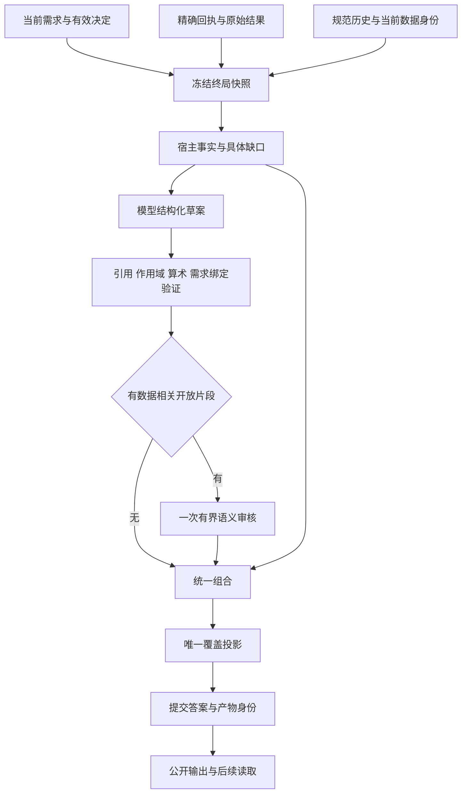
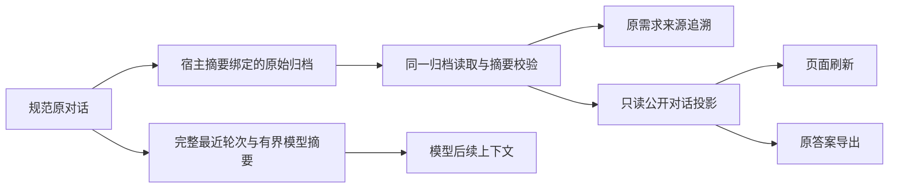

# 可信回答与发布产品需求

版本：1.4；初版：2026-09-30；本次修订：2026-10-09；从属于[产品 PRD](data-agent-product-requirements.md)与[唯一总计划](../superpowers/plans/2026-09-22-analysis-agent-trust-reset-plan.md)。当前基线f7210e1的自然r3只执行M01部分后停止，未通过；系统审查后三项边界已确认，文末是目标合同，尚未实施。进度只见唯一计划§0.8。

## 1. 问题与成功定义

最近真实批次说明：工具、传输和封闭事实的局部通过，不能证明回答有用且完整。M01 行动被扣留，M04 假设状态未公开，M05 六种表达退化为同一摘要，M06 未计算与证据不足未区分。这些问题共有终局组合责任分裂这一根因。[控制复盘](../audit/2026-09-30-trust-rebuild-control-review.md)保留证据。

成功定义：每轮根据已接受需求和当前证据，形成一个可追溯答案，保留独立正确事实、解释与合规条件建议；无法交付的部分明确说明原因及下一步。知识咨询无需先执行数据分析。错误不得通过换措辞、尾注、用户同意、模型自信或审核通过升级为事实。

## 2. 需求契约

| ID | 必须实现的行为 | 不得替代为 |
| --- | --- | --- |
| PUB-01 | 终局只调用一个发布服务；同步、流式和确认恢复共用 | 多个按工具/场景顺序尝试的终局 builder、旧自由正文回退 |
| PUB-02 | 结构化 claim 是唯一数据事实通道；宿主验证并渲染 | 从散文猜数字/单位/来源；模型自报 verified |
| PUB-03 | 需求有来源轮次、生命周期和绑定；每项有答案或具体缺口 | 一段相关文字、一个总体覆盖布尔值、固定挑最近几条 |
| PUB-04 | 完整事实组及可恢复原结果：对象、指标、值、单位、窗口、版本、方法限制 | 只留最大数值、把多个文件混算、丢掉第六个来源 |
| PUB-05 | 局部错误只影响其依赖片段 | 审核超时或一个坏 claim 清空整篇正确答案 |
| PUB-06 | 保留解释、竞争假设与条件行动；数据相关开放片段有一次有界审核 | 正确内容一律 withheld、随机整篇审批、追加措辞词表 |
| PUB-07 | 简短/标准/详细、受众和语言只改变表达，保留必要覆盖 | 六种风格固定输出同一宿主摘要，或为详细而编造事实 |
| PUB-08 | 封闭算术、单位、日期、作用域、确认由宿主核验 | 把这些问题交给 LLM 审核裁决 |
| PUB-09 | 假设关系从当前原测量核验后公开状态、理由和限制 | 仅内部状态正确、文本相似就支持、描述性证据升级因果 |
| PUB-10 | 正文、SSE、持久化、工作台、图表、导出、刷新同一答案身份 | 导出 latest 猜测、工作台重新凭 confidence 判验证 |
| PUB-11 | 咨询可直接回答；结果追问和数据解释重新解析精确绑定 | 全部无回执答复阻断，或把咨询标签当数据事实豁免 |
| PUB-12 | 默认配置下的可达路径先离线证明，再冻结真实调用 | 用试验开关测试结果证明默认行为，用不同场景同名替代 |

明确子问题必须绑定其自身原测量字段；已算原值、日期端点或整段结果对象不自动证明另一个“含首尾天数”子问题完成。缺字段给具体未计算状态，并保留独立正确结果。续问只接受当前计划的精确身份声明，不能默默改成另一任务或引用历史事实。

## 3. 权威与职责

| 输入或角色 | 可决定 | 无权决定 |
| --- | --- | --- |
| 用户请求/有效业务确认 | 目标、范围、口径、表达偏好和真实授权 | 缺失数据是否存在、因果是否成立、预测是否有效 |
| 工具宿主与不可变回执 | 执行成功、参数、来源、版本、结果内容摘要 | 用户没有表达的业务目标 |
| 封闭事实验证器 | 引用存在且唯一、值/单位/范围匹配、合法派生与方法前提 | 自然语言质量、尚无证据的现实原因 |
| 模型终局草案 | 内容组织、解释、假设候选、条件建议 | 自行生成事实值、修改需求身份、授予 checked |
| 有界语义审核 | 定位开放片段的无据强断言、因果升级、条件遗漏、价值损失 | 修改事实、增加来源、覆盖确定性拒绝、批准整篇 |
| 渲染器与持久化 | 原位输出接受的内容和可追溯身份 | 再做一次意图判定、证据选择或语义审批 |
| 知识检索/历史摘要 | 提供查找线索和咨询背景 | 将相似文本、记忆或压缩摘要升为当前计算证据 |

### 3.1 单一组合流

草案生成属于现有 AgentLoop 的终局模型轮次，不新增独立写作 Agent。模型只能引用当前宿主提供的事实标识；数值、来源、单位、日期和数据窗口由宿主填入结构节点。文本片段可表达一般知识、解释、局限或建议；事实引用穿插原位，不能把事实全堆在末尾作为免责附录。

## 4. 需求覆盖与缺口

每个用户显式问题先记录为 requirement，含原消息身份和内容范围。整体目标保留；多个指标不能因主方法选择只保留一个。继续、改口、撤回、窗口修改和纯表达改写各有可追溯变更。模型可提议需求拆分，宿主只接受来自真实当前/有效历史请求的身份，不能从模型总结凭空增加已完成需求。

覆盖只能从最终接受内容投影一次，结果为：

| 结果 | 用户含义 | 例子 |
| --- | --- | --- |
| answered | 所需事实/解释已经交付且相应校验满足 | 当前 12 条记录合计 120 |
| partial | 一部分已交付，剩余部分有逐项缺口 | 描述结果已算，因果效果仍不能证明 |
| not_computed | 所需计算没有成功执行 | 成本文件不存在，未计算净收益 |
| evidence_insufficient | 已有材料不能支持所问结论 | 仅有前后对比，不能证明干预造成提升 |
| needs_confirmation | 尚有实质业务口径阻塞相关计算 | 成本范围未定；独立订单统计仍可交付 |
| failed | 已尝试但工具、校验或交付失败 | 工具超时或内部结果合同不匹配；说明原因并保留其他结果，不误称用户缺数据 |
| withdrawn | 用户撤回，不再当本轮交付义务 | 用户明确不再要求预测 |

这些是最终答案对需求的结果，不是第二套任务状态机。`answered` 对知识咨询不要求数据回执，对数据结论必须有相应事实/证据。范围身份缺失时只能保持未核，不能用空对象、相似表述或默认零补齐。

## 5. 封闭事实与算术

- 数值、对象、分组、单位、粒度、窗口、分母、来源版本一起绑定；百分比与百分点、金额与数量不可混用。
- 派生值由批准的封闭运算重算，操作数必须来自有效事实；校验模型给出的等式不等于校验操作数真实。
- `22400 × 5.1% = 1142.4`、`22400 × 1.417% ≈ 317.408`，不能渲染成 1.14 万或 3200。展示舍入与计算精度分开。
- 9 月 1—12 日含首尾为 12 天；区间端点及是否含首尾由结构化规则决定。日期、版本号、列表编号和引用别人错误的例子不能被普通数字扫描误判为新事实。
- 零分母、负基线、缺失、NaN/Infinity、混合单位必须具体处理；已观测零与未知/未成熟 cohort 不等价。
- D1—D7 观测可解释 D7、拟合观测范围；D30 没有验证依据就不发布预测值。其他来源确有 D30 时可以按其独立身份交付。
- 同会话历史事实若再次使用，要核查所引用数据是否仍适用；换版本不借用旧回执为当前值背书。明确展示历史比较不删除旧记录。
- run_python 保留探索能力；仅可将带来源、可解析、可重放的结构化结果纳入闭合事实，不从任意 stdout 挑数字凑答案。

## 6. 开放解释、行动与有界审核

默认对数据相关解释与行动片段启用审核；每轮至多一次审核请求，沿用现有 Provider 预算与账本。纯概念咨询且未引用具体结果时不强制增加审核调用。审核适用范围由宿主路由和实际引用上下文确定，模型不能将数据结论自标为 knowledge 绕过。

审核看到同一冻结快照中的 requirement、允许 claim、事实强度、明确条件、片段 ID 和文本。finding 必须定位片段与已知上下文；无定位、未知 ID、版本不符或擅改事实的返回无效。审核可以接受片段或指出需限制的语义，不输出替代数值或新事实。

**2026-10-08用户确认（PUB-05/PUB-07）：**风格改写按完整答案核对事实与必要限制，同时检查局部解释是否会误导。宿主来源/限制块已经交代的内容，不要求每个表达段逐字重复全部术语；可能脱离上下文造成误解的解释，仍须在对应段附近保留必要限定。当前有效表达偏好决定组织方式，不得由旧风格要求拒绝合法新表达。无据因果、总体外推、上线或外部对账断言仍拒绝；全篇上下文不授权新增事实、修改宿主值、越过当前版本/范围或增加审核调用。该澄清的诊断依据见[本批原需求对标](../audit/2026-10-08-p5-requirements-diagnosis.md)，代码与自然验收尚待实施。

本次取代旧的“修订后再复核”循环：一次请求只做局部裁决；被拒片段由宿主保留可核事实并生成具体缺口。没有二次审核、反复改写或隐式重试。允许保留已有单次协议格式恢复，但不能借它再次调用语义审核或更换证据；具体预算在技术设计中固定。

审核不可用、超时、预算不足或返回不可用时，相关开放需求标明未完成原因；宿主事实仍发布。纯咨询不因没有计算回执进入此降级路径。审核通过不保证自然语义完全正确，仍需要独立自然正反例验收。

条件建议应说明适用对象、未来窗口、触发条件、建议动作和验证方式。数字阈值只可来自用户规则或已核事实；模型可建议一个明确的假设示例，但不能把示例阈值当成当前数据已满足的决策规则。当前观察和未来行动分开渲染，不能把未来条件套回本期。

## 7. 版本、历史与表达

用户已同意本次大改不兼容：旧自由正文+隐藏绑定协议、旧 packet reader、旧发布 fallback、试验分支在切换时退役。旧会话原始文件、正文、图表与事件保留只读；不得加载旧运行状态后继续，也不新建迁移写回链。用户要继续历史分析时新建新协议会话并重新提供/选择数据；历史文本仅作为显式背景。

新协议会话的正常续问、有效确认、压缩、风格改写、刷新和导出必须完整保留。同事实六种表达需要有可观察的组织/深度差异，必要结论和缺口保持一致；审计与风格不能互相抵消。

## 8. 原规则的明确替代

| 旧规则 | 本次决定 | 仍保留的目标 |
| --- | --- | --- |
| read-old/write-new、旧 schema 往返兼容 | 旧会话只读；新运行只收新协议 | 历史原文不丢、版本未知不覆盖 |
| answer_bindings.v1 原结构不断补充 | 新版结构协议一次替换，仍只有一个 claim 通道 | 宿主事实权威、原位渲染、绑定可核 |
| 审核试验默认关闭；最多一次修订一次复核 | 新链对数据相关开放片段默认一次审核 | 局部保留、预算上限、事实不可被改 |
| CP 中不新增审核调用的旧性能约束 | 一次审核计入原账本和预算；咨询按适用范围豁免 | 无隐藏调用、无新账本、成本可追溯 |
| IC 历史审批迁移后续跑 | 旧会话只读，新会话保留正常确认生命周期 | 原事件不重写、skip 不视为批准 |

这是用户对新实现方案的确认，不授权启动任何新 Provider 批次、修改正式服务配置、部署或外部 Git。批次仍按 AGENTS.md 精确冻结并授权。

## 9. PUB-10 的压缩与公开历史要求（2026-10-08）

压缩减少发送给模型的早期上下文，但不删除用户已收到的原答案。完整早期分析轮次、短续问和原工具消息不得拆散；只有单个分析轮次时保持原历史。存在可归档早期轮次时，不能把“保存归档但没有缩短”当作压缩完成。

页面刷新、答案导出与原需求追溯都读取同一份宿主摘要绑定的原始归档；页面不显示模型压缩摘要代替原答案。公开历史还原不扩大模型上下文，不重算事实、不改变原reply或接受答案身份。归档不可核时明确限制相关历史片段，不能让摘要冒充原值；新回合的独立正确内容保留。分支中父答案只作继承聊天历史，归档还原也不能取得分支事实权威。

面向使用者的图表导出保留数据来源、版本、计算状态和可见范围；原内部JSON、本地文件路径不直接混入报告。原元数据和原接受答案仍留在各自不可变产物中，支持追溯。

本节明确原PUB-03/04/10与VP-B03/U07、CP-AC14/37的承接，不新增产品路径或授权。阶段结果仍由唯一总计划及实际收据决定。

2026-10-08调用入口核实：API页面、侧栏标题、指定回答与整段会话导出全部使用本会话同一已核归档的公开投影；模型规范历史不展开。实际完整早期轮次压缩、原正文/图形及两种导出保持分别签收，详见10月8日P4联合收据。自然质量仍P5，进度仅见唯一总计划。

## 10. 可变模型内容的结构交付与历史验证（2026-10-08用户确认）

本节细化PUB-02/03/05/06/10/11。模型可变性不降低专业结果的事实、方法和覆盖要求：

- 需求从真实原文及当前会话身份建立；目标提议与原文需求分开校验。协议错误或缺少执行目标时保留原问题和明确缺口，不从散文重建绑定，也不让模型自己批准已回答。
- 事实块、派生计算、假设状态与图表使用可核结构引用；模型解释/条件行动仍可丰富变化，通过现有一次有界审核按完整上下文及局部片段裁决。JSON格式合法本身不证明语义目标正确或内容可信。
- 咨询与结果续问的权限由本轮真实需求、任务/原答案关系及实际提供的上下文决定。纯知识路径不接收可以被无绑定转述为当前结果的上下文；数据相关文本不能自标knowledge免除权威约束。数据存在不自动强制分析或额外审核。
- 同题不同回复允许结构顺序、措辞和方法变化；闭合的来源、版本、数值、授权、必要方法边界、需求结果/缺口及图产物关系必须成立。测试以这些不变量和独立业务oracle验收，不逐字匹配自然回复。
- 原答案的不可变字节/SHA、同一接受对象在SSE/持久化/导出中的身份仍严格核对；这与不要求两次模型回答文字相同是两项不同规则。
- 历史真实响应可在既有离线入口作为记录的反例重放。旧协议材料不冒充新协议自然生成；固定合同输入仅证明结构/编排，新的自然可靠性仍由新冻结完整批次证明。保留原失败与未评估范围，不追加付费judge或散文词表门。

## 2026-10-09 用户确认的需求—执行—发布职责调整

用户在132调用新批封存后批准按本批诊断推荐方案实施及零调用重放。咨询路由、原证据/版本/确认/假设、全部原工具及单一claim权威保持。以下直接替换被指出的原规则，不保留兼容运行路径：

1. 业务目标身份与原文需求分开：原文仍独立保存，等价续问显式复用目标；不同业务目标独立覆盖。原文字符串不同不构成目标冲突证明，相同工具映射也不构成等价证明。
2. 意图负责原文业务目标/范围/用途；既有执行阶段登记有界交付集合。单一工具selector不得永久锁死六来源图表或合法派生计算路径。提议仍不授予事实/完成权威。
3. 完成目标的交付事实和同范围解释证据分别核验；解释引用不能宣称另一个目标已完成，跨源/跨版不得扩大。咨询可正常提供知识、步骤、限制及必要条件说明，显式数据引用仍走事实验证。
4. 宿主发布验证读取只读存在性/身份验证能力；模型综合阶段仍禁止访问原数据。不可读不能变成不存在。版本失效继续拒绝。
5. 本轮已有票据/原文唯一对象映射，不因会话有其他对象强制澄清；真正多候选才复用既有ConfirmationService。派生公式通过限定的原算术/血缘证明，不能用列名、散文或任意派生表授权。
6. 保底按授权交付集合组织，内部原回执完整可追溯；局部审核一次有界，范围/单位/限制按整篇保留。窗口成本每单为SUM(cost)/SUM(orders)，不累计逐日比率。

验收须重放本批真实结构材料并覆盖正常计划→执行→synthesis权限切换、多个已有对象的唯一换版、同目标多表述与不同业务目标错误共用。新候选完整离线及原app矩阵通过后才重新冻结自然批次；旧132账本不续跑。具体实施状态仅在唯一总计划记录。

### 交付与审核的唯一职责

- 同一业务目标的等价续问使用显式目标引用，并保存该次原文位置；不同目标有独立的完成结果。模型提议不能自己证明语义等价或事实完成。
- 一个目标可登记1—32项执行交付，每项仍按工具、字段、参数、当前来源/版本验证；六图缺一项时保留已有五图及具体缺口。技术候选可细化，原业务对象、窗口与统计口径不可静默改变。
- 完成交付的事实和允许解释引用的当前证据分别登记。解释可以引用同范围当前观察来说明未完成原因，但不能据此把预测、另一来源或未测假设标成完成。
- 一次审核采用单一事实目录；目录保留值、单位、来源范围和限制，全篇节点与原交付关系引用其身份。完整回执与证明图留在不可变快照，不在审核请求重复传送。原64,000字节上限、一次额度和逐片段裁决保留。
- 原假设未测、无有效关系或当前版本失效时逐假设说明原因；已验证关系独立保留，整体可为部分完成，不自动授予因果或统计推断。
- 当前限定的公式承接只支持可核的一次derive_field原列保留边：原列、行数、父版本与来源摘要须一致；覆盖原列、过滤或任意派生链不能借用该证明。窗口比率须显式登记ratio_of_sums与真实分子/分母；零分母或缺失原值保持未知。

## 2026-10-09 用户确认：业务目标、必须交付与约束分层

状态：需求三层、计划/执行接入宿主交付目录及局部失败策略均已获用户确认；当前接口实现见文末，验收状态只见唯一计划§0.7。

- **业务目标**描述用户希望解决的分析或咨询问题，保留稳定目标身份及各轮原文引用。咨询目标不因会话已有数据而自动变成数据执行。
- **必须交付**描述完成该目标所需的结果、图表、解释或行动说明；必须逐项覆盖或说明具体缺口。一个已计算事实不能替代缺失预测、另一来源或竞争假设关系。
- **约束**限定口径、范围、表达、证据强度或行动条件；继续独立追溯和验收，但不自动转化为另一项待计算指标。约束未满足时，相关交付不能签收为完成。
- 原文每项要求仍须可定位，并明确归属目标、交付或约束；分层不能删除原要求、缩小必要交付或降低验收。

例如：M01的业务目标是比较两个七日窗口并给出条件行动；必须交付包括金额、成本、净贡献、订单数及其比较和行动说明；单位未知、不推断因果、未来两个条件同时满足属于约束。M03六来源/六图是完整交付要求，不能只完成一个；M04竞争假设关系是必须交付，不能由普通趋势替代；M05表达偏好改变不新建计算目标；M06成本口径确认约束当前计算，选择本身不提供缺失证据。

分层的验收以原输入和独立oracle为依据；仅调整表达不应重复计算，必要数据/口径/版本发生变化时仍须重新验证。

### 2026-10-09 接口与局部失败裁决确认

用户已确认：业务目标和必须交付进入既有计划/步骤，宿主根据真实回执产生有类型交付目录，模型引用目录身份；直接替换技术selector重复登记。可定位的局部坏片段只拒对应部分；全局身份失配或整体不可解析拒整草案；非法目标变更原子拒绝并保留原目标；来源、版本、确认和血缘无效只拒受影响事实。咨询、工具、专业解释及一次审核能力保留。

用户随后要求先对照需求分析架构。新增分析依赖就绪、模型生成数据来源和遗留置信度启发式建议见[架构审计](../audit/2026-10-09-trust-pipeline-architecture-audit.md)，已获后续批准，裁决见下一节。

### 2026-10-09 架构边界批准

用户已明确批准将架构审计建议一并实施：分析依赖消费宿主已核必要交付状态，模型声明完成不提供事实证明；模型生成文件可探索/导出，用于完成原上传源任务必须有真实可重放父源血缘；EvidenceRecord保留研究注解，通用文字/样本阈值不决定事实强度或发布。方法限制取真实工具合同及验证状态，开放解释由既有一次局部审核负责。咨询、一般任务、原工具和版本/确认保护保留。不增加可信总分、调度器或第二事实权威。

前述待讨论状态作为历史记录；当前实施状态以唯一计划§0.7为准，批准不代表实现通过。

### 事实目录预算和独立探索来源

必要目标及可用事实引用不能因逐条证明挤占预算而静默消失。完整证明由宿主保存；模型视图可以去重相同元数据、整体外置超大值并明确未读状态，不能截取事实组。元数据仍超限时，交付全部可核宿主事实，明确开放解释本轮未核及缩小单次范围的下一步，不以失败草案覆盖正确事实。

文件内容相同不证明业务来源相同。上传/外部文件和会话生成文件的宿主身份分别登记，真实变换传递父版本与根来源；会话生成数据保留探索能力和局限。未具备原父源及实际变换证明，不签收其为原上传源完整交付。普通模型来源文字不提供血缘权威。

### 计划与回执身份接口（2026-10-09 实施切片）

当前新登记的执行计划使用 `stage3c0b.v2`，携带精确 `requirement_revision`。既有 `method_plan` 每步声明 `required_deliveries`：首次声明含原 `requirement_id`、交付 `kind` 和业务 `label`；宿主生成稳定 `dl_*` 身份。重规划以 `{id}` 引用已登记交付，不要求模型逐字重新表达标签。允许的类型覆盖测量、表、序列、拟合、预测、情景、假设、图表、产物、知识、解释、限制和条件行动；类型声明不授予事实能力。

必要交付保存在原需求账本，计划和任务只引用其身份。原需求须仍有效且原文可从规范历史核实；已撤回/未知目标、旧revision、技术selector字段、重复交付和缩小原必要集合均拒绝。咨询目标不能被计划变成数据计算，表达需求不能承接新的计算指标。原任务管理器及其DAG保留；没有第二规划器或完成账本。

派发前捕获计划内容摘要、步骤、任务、需求/交付ID及宿主作用域身份；工具返回后沿用这份身份登记真实回执，避免任务推进后错记到下一步骤。计划内容摘要不依赖无关需求revision或生成时间；相同声明可重复投影复用任务。

**历史切片边界：**以上记录只签收当时的声明与执行身份；现已由下述完整接口直接替换。必要集合是否完整仍由原输入及独立oracle验收，宿主ID不能证明模型的业务分解正确。

回执来源身份与步骤身份一并在派发前捕获。切换到另一数据集步骤后，宿主仅使用既有 `_receipt_identity_matches` 验证原身份仍等值，不开放旧数据读取；执行期间源被替换则不能将旧结果登记到新身份。载入文件产出的新版本仍从实际载入结果登记，不借派发前旧别名身份。三条正常执行入口的同源、跨源、源被替换正反例已覆盖。

## 当前目标合同：业务需求、执行与交付（2026-10-09用户确认）

本节直接替代原文末运行合同中未闭合的探索/重规划、开放内容DAG及通用结果形状映射安排；当前源码缺陷见[系统审查](../audit/2026-10-09-requirements-system-review.md)。批准不代表实现完成。旧v3技术selector等历史接口不是可选路径；原材料保留。

1. **原需求权威。** 原文、业务目标、来源/窗口/统计口径及生命周期保留在既有需求账本。模型提出语义分解；宿主ID、schema和原文位置校验不能证明分解完整。非法范围不能静默删除后执行，保留未决项与独立合法目标。
2. **探索与执行。** 无文件咨询正常完成；有界探索只获得当前授权对象的结构、预览和质量，不自动签收正式业务交付。正式计算在派发前声明必要交付、原目标、来源版本、业务参数和步骤。不能执行后倒填归属；产品不能一处提示计划可选、另一处要求所有结果预绑定。
3. **计划演化。** 同目标、来源、业务范围不变时可有记录地追加交付，旧ID、已核证据和未完成义务保留。删除、替换、缩小、换窗口或来源版本必须走显式原子目标变更。既有每目标32项、步骤64项、批12步、independent的1—16输入界限保留；超限明确失败或分批，不截断。
4. **唯一产物语义。** 工具生产者/封闭适配合同声明业务类型、原测量、单位、粒度、窗口/分母、方法限制及产物。宿主从原回执重建目录，模型只引用目录身份；不猜散文，也不从通用JSON形状推定业务量。工具参数与业务参数由同一明确合同映射，未知不默认丢弃。保留全部工具，非事实工具只记录其合法效果，不强制伪造claim。
5. **依赖与最终覆盖分开。** 计算DAG成功依赖消费已核事实/产物/结构化关系；最终答案另外核验解释、限制、行动等必答项。开放解释不能进入必须有事实投影才能完成的依赖集合；计算完成也不能替代完整答案。两者共享事实投影，不新增完成账本或调度器。
6. **精确来源与方法边界。** 来源、实际读取、版本、父源、确认和闭合算术逐项核验。Python执行前business_parameters与真实读取进入原回执，仍为探索性计算；声明不证明方法正确。synthesis不读原表，independent保留显式多输入。合法统计结果、情景和验证预测各保留其真实能力，不能一律提升或一律降成不可用。
7. **局部错误与准确缺口。** 真实未执行、已有证据不能支持结论、内部合同/执行失败分别解释；有三期原结果但跨度映射缺失不能说“没有预测序列”。可定位的局部错误不吞独立正确事实；全局身份错误仍拒整草案。对应用/算法失败不伪造可用结果。
8. **一次开放审核和同一答案。** 全篇边界及局部误导按原一次审核处理；审核不创造事实，不覆盖确定性拒绝，也不保证零语义误差。事实完整度、开放片段接受/拒绝/未核和专业价值分别验收。聊天、压缩、分支历史、工作台、图与导出引用同一接受对象。

对应原需求：VP I/N/S/C/E/H、IC Q/R、CP AC16—40；结构化合同不降低原业务oracle。工具链、生命周期和发布均完成后，才允许在唯一计划中签收整体重构。
