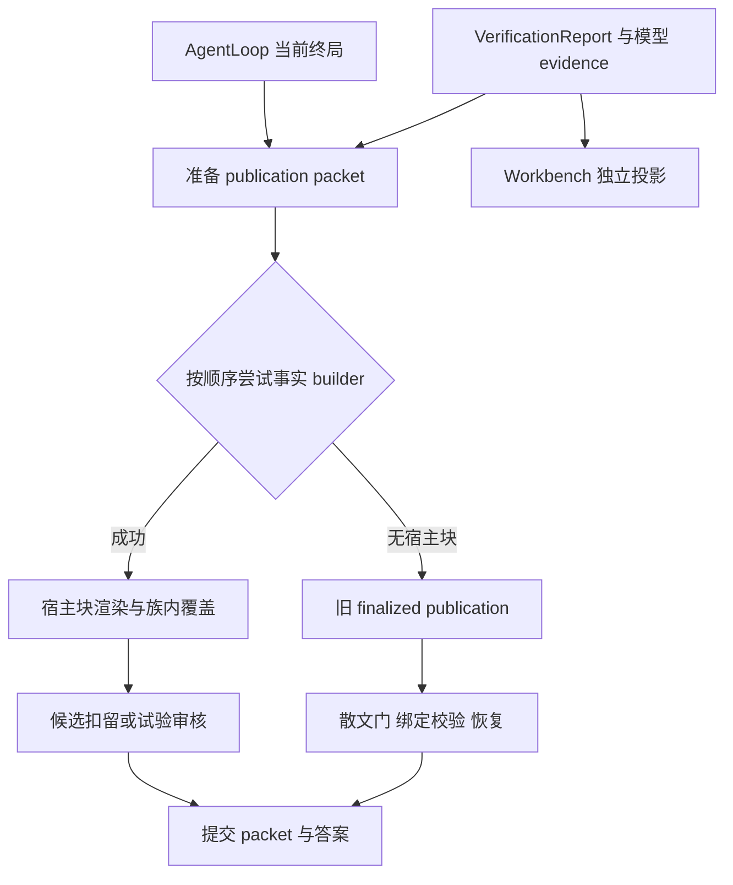
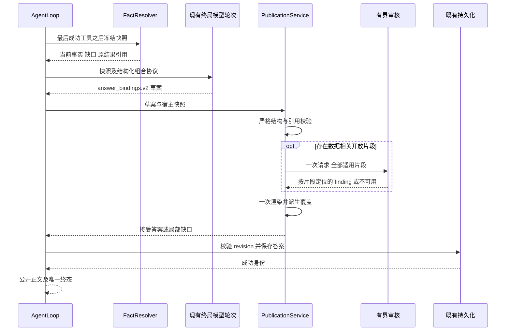
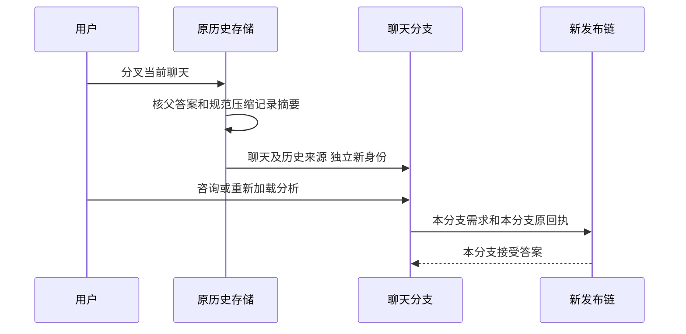
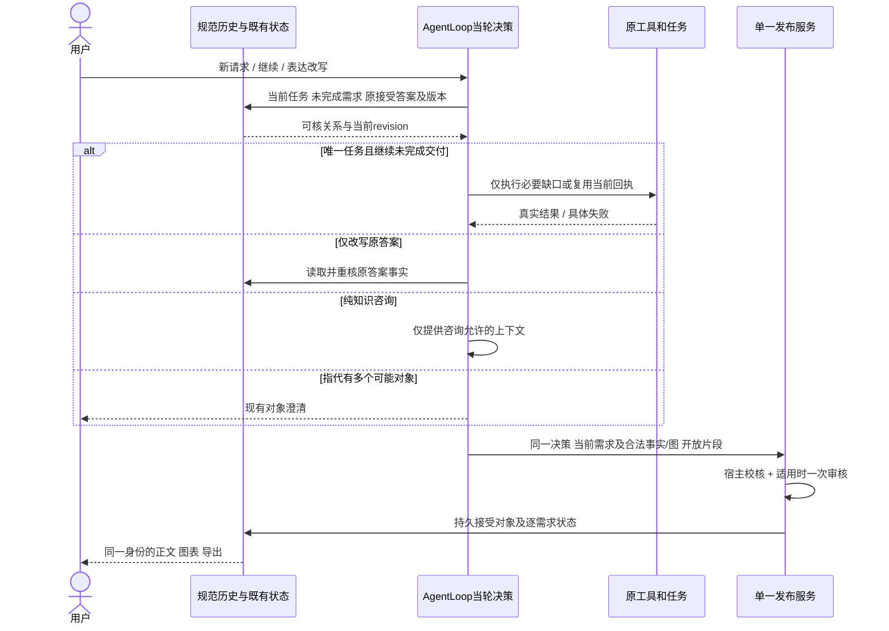
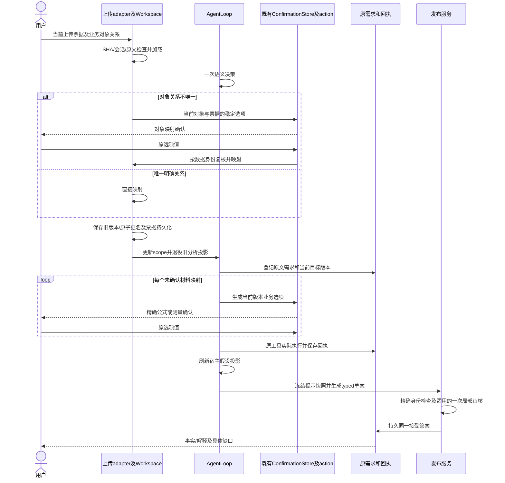
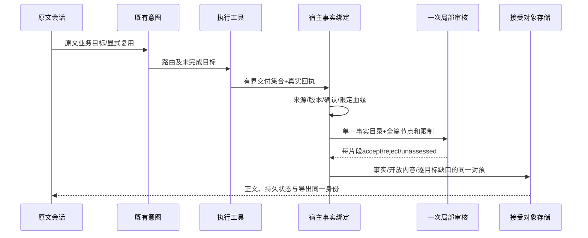
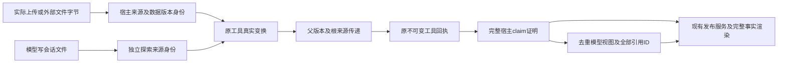
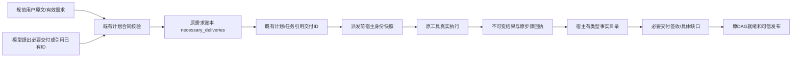

# 可信回答单路径重构设计

初版：2026-09-30，历史基线71e23d0；2026-10-09系统审查基线f7210e1。当前批准目标以文末“唯一实现责任与状态合同”及原PRD为准，尚待新会话实施；中间旧v3/selector/切片段落只作设计演化记录。状态唯一来源：[总计划§0.8](../plans/2026-09-22-analysis-agent-trust-reset-plan.md)。依据[产品PRD](../../product/data-agent-product-requirements.md)、[发布PRD](../../product/trusted-answer-publication-requirements.md)与[系统审查](../../audit/2026-10-09-requirements-system-review.md)。

## 1. 基线控制流与问题



`publication_synthesis.py` 5417 行、`publication_audit.py` 903 行、`loop.py` 4647 行。行数是范围指标；问题在两条终局、顺序 builder、重复覆盖及开放候选的早返回。仅拆文件无法解决。旧 `verification.py` 还有无明确证据 ID 时文本相似关联，以及以模型 confidence 参与报告强度的规则；工作台又投影该报告。必须从输入到显示收敛权威，不能在发布包旁再留一个事实批准者。

## 2. 保留与替换边界

| 模块/责任 | 决定 | 保留行为与必须移除的决定权 |
| --- | --- | --- |
| intent / llm_intent / intent_refinement | 保留能力并补整链验收 | 九类意图、否定/混合请求；咨询不被“无回执”阻断 |
| analysis_entry / controller / method_playbooks | 保留业务入口，收敛工具暴露 | 自动方法、真实缺口、主目标；工具分组不是越界授权 |
| confirmation/* | 保留现有唯一状态机 | 幂等恢复、scope/version、skip/cancel；新链不迁移旧会话 |
| analysis_plan_contracts / workflow_projection / task_manager | 保留唯一计划和任务系统 | 明确依赖存在性、无环性与 scoped execution；不新建调度器 |
| workspace / data_io / transforms / registry | 保留数据工具并核对实际注册入口 | 身份、票据、lineage、回执、失败分类；未结构化结果不冒充事实 |
| evidence_contracts / evidence_statistics / result_reference | 提炼复用封闭校验 | 原内容摘要、精确回执、数据版本、单位、算术与方法条件；删除可授予当前身份的模糊回退 |
| verification / trust_workflow_runtime | 重构事实验证边界 | 统一输出宿主校验结果；文本相似/自报置信度只可作线索，不授予 checked |
| hypotheses / relationship_validation | 保留两种不同职责 | 前者为假设关系；后者为连接关系校验；真实测量决定描述关系 |
| publication_synthesis / publication_audit | 替换并删除旧模块 | 事实族行为迁移到单一服务；不保留旧函数转发或散文门 |
| loop / prompts / synthesis_policy | 精简并接入新协议 | 一次终局、预算、停止、SSE；移除场景终局分流及重复审核恢复 |
| analysis_state / workbench_view | 新协议及统一投影 | 当前需求与答案身份；旧 packet/模型 confidence 不作为新事实批准 |
| compact / session.history / public_messages | 保留规范历史，替换发布引用 | CAS/revision、工具事件成对、义务保留；压缩摘要不是事实来源 |
| tools.report / Web 会话与导出 | 消费同一接受答案 | 指定 answer_id，移除 legacy latest 猜测；旧会话读取原文本/产物 |
| knowledge.evidence / retrieval / memory | 保留检索能力 | 拒绝草案不进入 accepted context；查找线索不升级为计算证据 |

## 3. 协议与所有权

使用 `answer_bindings.v2` 一次替换 v1。不存在 v1 兼容读取、v1/v2 双写、自动转换或切换开关。这里的版本标记属于同一个 claim 通道；不可新增平行 evidence publication 数据库。

### 3.1 单一快照

宿主冻结 `session_id / turn_id / history_revision / requirement_revision / active_scope / plan_id / data_identities / confirmation_refs / receipt_refs`，产生 snapshot digest。没有分析计划的知识咨询允许 plan_id 为空；数据结论需要的字段不能因咨询许可而省略。使用完整身份，不以文件名或当前 latest 推断来源。最终化之前的新回执或相关数据变化使旧 preview 失效，终局重建一次；提交时再次校验 revision，不能偷偷把旧草案绑定到新快照。

事实记录来自既有成功 receipt 及可核原始结果：`claim_id, basis_refs, metric, value, unit, grain, population, time_scope, method, limitations`。已知不存在的字段可显式表达未知，不能由模型补齐。派生 claim 记录运算与 operand refs，宿主重算。假设状态从既有结构化关系验证结果产生。确认只作为口径输入，不作为数值来源。

### 3.2 模型草案

草案是有界 JSON 对象，带 schema 和 snapshot digest。使用结构节点，不再把 Markdown 正文和隐藏 JSON 拼接后逆向猜测。

```json
{
  "schema": "answer_bindings.v2",
  "snapshot_digest": "<host supplied digest>",
  "sections": [
    {
      "requirement_ids": ["r1"],
      "parts": [
        {"kind": "text", "purpose": "interpretation", "text": "本期观察可作为后续验证的起点。"},
        {"kind": "claim", "ref": "c1"},
        {"kind": "artifact", "ref": "a1"}
      ]
    }
  ]
}
```

`text` 支持 knowledge / interpretation / limitation / conditional_action；用途是候选元数据，不能决定审核豁免。`claim` 与 `artifact` 只含宿主引用，不允许模型携带替代值、来源或 ready 标志。host gap 由未满足需求产生，模型不能随意声明全完成。未知字段、重复 section/part 身份、超限、未知引用和摘要不符明确失败；单个坏引用能隔离时只影响相关部分，结构根本不可解析时仍交付已核事实及具体草案缺口。

每个公开片段的事实引用、需求来源、审核 disposition、渲染位置记录在同一 render trace。只有最终接受的节点计入覆盖。用户要求两个指标不能用一个 claim 填满两项；模型提议映射必须匹配已接受需求的语义身份/范围，未建立身份时保持未核并记录原因，不以词表补配对。

### 3.3 接受答案

发布结果包含 `answer_id, schema, snapshot_digest, content_sha256, body, artifact_refs, render_trace, requirement_outcomes`。`requirement_outcomes` 是接受内容的派生投影，不是可以独立改写的第二权威。持久化存一份接受答案，消息、状态和导出仅引用同一身份；内容摘要不一致不得 fallback 到 latest。

旧历史不读取成此对象。仅从原持久正文/产物做只读展示；旧会话 continuation API 明确返回需新建会话，不能在 UI 看似只读但后端仍能恢复旧运行状态。新协议会话按现有正常轮次恢复与压缩。

## 4. 服务职责划分

新 `agent/publication/` 包按责任划分；文件拆分不是新增框架，不按场景建 class 或 plugin。

| 文件 | 单一职责 | 直接依赖 |
| --- | --- | --- |
| contracts.py | 严格协议解析与不可变类型 | 标准库/现有 schema 工具 |
| requirements.py | 用户需求来源、变更、绑定与最终覆盖投影 | 当前 intent 与规范历史 |
| facts.py | 精确当前回执及产物来源读取 | result_reference、既有产物安全路径、数据身份 |
| native.py | 原工具测量语义和假设关系的封闭适配 | 同一 facts reader、既有 hypotheses 原测量算法 |
| renderer.py | 原位渲染事实、接受文本与产物；生成 trace | 已核对象，不自行选 evidence |
| audit.py | 一次有界开放语义请求和 finding 校验 | 同一 snapshot、现有 client 和预算 |
| service.py | 顺序编排与返回唯一接受答案 | 上述组件；不调用规划器/执行工具 |

持久化继续使用现有 session/artifact 设施；是否需局部辅助文件以代码审查决定，不能另造事务框架。统计工具仍负责计算；facts 不重实现 A/B、回归或预测算法。仅校验其回执、语义字段与有效性边界。未知工具输出可以保留为探索性材料与具体限制，不默认标为已验证结论。

## 5. 终局时序和失败路径



1. 未执行成功的工具不生产 checked claim；预算用尽/停止保留此前成功结果。
2. 审核至多一次请求，任何 SDK 重试必须受同一 Provider guard 计数且配置为不自动重试；没有修订后复核。审核失败只影响适用开放片段。
3. 如草案 JSON 根本不可解析，可消耗已有本轮共享恢复额度进行一次格式纠正；该额度与现有最终化恢复合并，不额外叠加。纠正仍失败则宿主交付事实与缺口；语义审核没有自己的重试额度。
4. 咨询无数据事实时通过同一 service 的合法空 facts 快照；不创建假的 receipt。咨询中的一般公式/示例数字不走散文数字匹配。数据相关开放断言要以实际上下文进入审核，不能信任模型用途标签。
5. 不先向客户端发送未经接受的模型终局 token。既有推理/工具进度与最终正文分开；持久化完成后才成功终态。取消与失败也需唯一可核终态。
6. 若图表生成失败，相关需求为 partial/failed，其他结果保留；图表引用不跨会话，不重复渲染同一附件，导出不存在的产物显式失败。

## 6. 证据验证收敛

保留证据合同形状验证与 measurement compatibility，但形状相等不证明测量真实。`verification.py` 的文本匹配关联可作为检索候选；新 checked 路径只接受精确回执 ID/内容摘要/范围/版本。模型的 confidence、claim 文本、自己列的工具名和 task completed 都不能决定事实强度。

`evidence_statistics` 已有的原生适配和有界 Python 值解析可复用；必须逐工具检查单位、方法和样本字段，不能以“所有数值字段都可信”写通用提升器。`result_reference` 的 legacy 名称查找在新运行入口删除；缺少精确 receipt identity 保持未核。`trust_workflow_runtime` 对缺少身份时“不发现过时”的结果不能变成“证明当前”。工作台只能显示新验证投影及明确历史项。

保留真实 compare/time-series 回执对假设方向的重算，包含 inferred_columns 与显式目标冲突检查、非有限值/重复绑定拒绝。一个描述性 supported 不解除 causal/inferential 要求。M04 公开 renderer 读取真实状态，不再从散文识别“支持”等词。

### 6.1 原确认与拒绝草案承接

measurement_mapping 继续使用原状态机。业务范围可选 source_message_ref，省略只用当前规范原用户消息；成本公式通过现有 metric_scope_formula.v1，cost_scopes只含真实数值列。发布宿主从实际 group_aggregate sum 原结果求差，绑定原消息、confirmation_id/response_id、记录版本、公式与全部 operand_paths。旧数据、旧消息决定、跳过或不完整成本不授予净值；账面差值不授予因果或增量。

格式恢复前及局部拒绝后的原草案写入现有 publication_rejected，保存完整原文、快照/原稿摘要及拒绝理由；不进入公开消息或证据库。接受答案 draft_digest定位同一原稿。沿现有原子 writer 处理 Windows 长路径；不新增重审额度。成功接受答案持久化后，原执行预算待办结束；这是终态记账，不改变 claim 的强度或需求缺口。

## 7. 直接替换与删除条件

开发中可以先编写未接入的合同和行为测试；产品运行不允许双路径、双 schema、兼容 wrapper 或开关。一次切换提交必须完成相关调用方更新及旧入口删除。该提交不要求重写所有与发布无关的工具算法。

| 退役对象 | 删除前必须有的新行为证据 |
| --- | --- |
| 顺序描述/聚合/曲线/比较 builder 与两条 terminal render | 同一服务可组合混合工具、无文件咨询和全部冻结事实族 |
| 旧正文正则/词表门及自由正文 fallback | 错数字/单位/范围/版本拒绝；合法新措辞与独立正确事实保留 |
| 旧 audit 批量改写、retry/复核和试验开关 | 一次审核局部接受/拒绝/不可用，默认路径可达 |
| 重复覆盖更新与模型自报 checked | 需求逐项覆盖从接受 trace 产生，负例不能自报完成 |
| 旧 packet reader、legacy export latest、旧会话运行迁移 | 旧原文/产物可读，新会话续问/压缩/刷新/导出身份一致 |
| 以私有函数和旧文本门为断言的测试 | 对应新行为正反例及用户可见 oracle 已承接；不删除失败证据 |

统计净改动包含旧三文件、新 publication 包、移入的 helpers 和相关替代逻辑，不能用搬文件伪造缩减。每条旧能力要有承接方或明确退役理由。缺少当前验收的历史功能标未核，不能静默删除或宣布通过。

## 8. 已知未完成与设计风险

- 新结构协议、快照、局部一次审核、组合与字段/产物精确来源已有[本地核心收据](../../audit/2026-09-30-trusted-publication-contract-implementation.md)，该收据是当时未接入应用的历史身份；10 月 1 日已按[切换收据](../../audit/2026-10-01-p123-single-publication-cutover.md)接入。规范需求变更、描述/非分组比较原精度、已注册假设原测量状态和 durable 确认引用已补[局部语义收据](../../audit/2026-10-01-trusted-publication-semantic-bindings.md)；确认 app 恢复、工作台/导出、旧会话只读已有切换局部证据；完整宿主需求语义、所有行为验收与旧模块删除尚未签收。核心脚本不能替代自然收据重放或完整应用验收。
- 一般开放语义依赖有界模型审核，存在误拒/漏放；独立自然对照验收是必要证据，不能用合成 pass 消除风险。
- 所有原生工具不能只凭静态存在宣称可用；本轮已从实际入口复现并修复 tool_search 注册函数错位；另发现 forecast 重复注册，需分别核查实际入口。forecast 最终注册覆盖前者，不把重复装饰器误报为实际 forecast 入口失效。
- 历史自然收据重放验证发布边界，不能代替新协议草案的自然生成或视觉验收。新真实 Provider 批次必须重新精确冻结。

需要用户再次讨论的情形仅限新的产品取舍：删除已列用户能力、改变业务口径、扩大外部副作用或改变已批准审核预算。上述方案和不兼容决定已有授权，不重复确认。


## 9. 2026-10-01 原能力承接与分支裁决

- 每个终稿从原回执/假设产物重新读取字节；元数据相等不能证明文件仍完整，因此删除元数据快照复用。提交前继续检查历史/需求/计划/数据/确认与原来源，不能仅依赖草案生成时的快照。
- 接受答案同时登记现有 artifact manifest；历史、状态和 manifest 在原历史/manifest 锁下提交，失败一起回滚。登记使原 B03 查看/导出能力可达，不授予该 JSON 任意数据事实权威。
- curve_fitting 可选显式未验证参数情景由原工具负责计算；新 native 仅读取 scenarios 字段和原回执，不另建拟合算法或把参数情景升格为验证预测。
- 用户确认聊天分支范围：父已接受正文在分叉时按原 answer_ref 核实，随后作为 inherited_answer_ref 历史来源；不能保留成分支可运行 answer_ref。只复制聊天及摘要一致的规范 transcripts，不复制分析状态、数据、证据、确认或接受对象。后续新咨询/计算使用分支独立状态。旧协议不转换为可运行分支。



这项分支合同是用户确认的功能范围；是否已经通过离线/正常 app/视觉，仍由唯一总计划和实施收据分别记录。


## 10. 咨询控制与具名数据缺口（2026-10-02）

咨询的“无数据执行”约束在原工具 offered-list 和实际 scope guard 两入口一致执行，由 typed intent＋当前规范数据需求判断。知识/方案记录、任务待办和必要提问保留原控制器；不得把“规划一个待办”当成“已计算事实”，也不得让数据工具禁止吞掉原确认生命周期。通用方法许可仍按原必要性策略退役；真实业务问题的暂停/skip/取消/恢复原机制保留。

对明确 typed selector 的 dataset，发布快照读取本会话原库存；确实不存在时给该需求一个具体数据缺口和上传动作。没有明确结构目标时不从 prose 猜文件名。该缺口仍走原 project_requirements→service→trace→commit，不建立新的 gap claim 通道或另一 planner。已有数据没有成功结果仍为not_computed，不能声称缺数据；原接受答案查不到仍不能猜最新结果。


## 11. 原生结果与确认派生责任（2026-10-02）

沿原工具输出结构字段、同一native字段表和HostSnapshot合同承接预览/画像/模型样本与CV；不建第二工具执行或序列化框架。SHAP由其现有精确模型/目标/数据身份校验满足“或”前提。

聚合业务名称与成本差额使用同一当前确认适配器；业务名claim引用每个原group SUM operand，不改原独立sum/count。业务名派生的宿主合同要求本轮raw原确认、完整operand路径和unit=None；模型不能自报确认/替换值。原消息、原数据和确认版本继续由原内核/CAS验证，审核不修改此事实。

verification退休的八个私有散文helper已有无外部import/无剩余Load证明，原显式证据诊断保留。旧synthesis/audit源码的精确删除仍需待原审批回答，不能以helper清理替代P3出口。


## 12. 原比较重复与局部审核覆盖责任（2026-10-02）

snapshot在原receipt byte/digest/current identity及native算术全部核验后，对compare_periods的arguments/data_identities/result_sha256/plan_id全相等结果只交付一次；原回执存储不改。当前请求明确引用原接受答案时，其basis receipt不因重复省略。不同窗口/版本/结果保留，坏源不能通过重复检测跳过验证。

service原failed_open定位结果必须参与requirement_outcomes的complete计算；一个purpose内已经通过的片段不能掩盖同需求被拒片段。正确原位文字/claim继续渲染，缺口通过原单次覆盖与trace产生，不增加新的coverage控制器、二次审核或prose解析。


## 13. 原范围字段承接与开放审核上下文（2026-10-02）

原transform_data在group_aggregate的实际结果中增加source_observation，复用describe_dataset既有的类型化日期观测函数；记录原df行数与日期端点，不另读历史答案或猜日期列。native在同一结果路径输出源观测和含首尾日数，保留源/派生双身份；collection_cutoff仍unknown。原sum/count/size/nunique执行语义和缺失值策略不改。

compare_periods既有combined字段进入同一native适配。日数按两个原端点区间的并集核对，记录数核整数与两期范围上/下界；不相交时必须等于两期行数之和。重叠时确切记录并集由原工具mask_a | mask_b计算，不由native重实现查询。native及原结果digest不能被模型自报替代。

service沿已校验open_parts的claim_refs构造审核事实集，不带未引用claim；所有active规范需求继续提供上下文，接受snapshot仍含全部原facts。未知/外来引用在派发前拒绝；原测量、公式、版本和整段行动规则不裁剪。实际审核请求超64KB仍按原fallback局部未核，一轮预算不变。


## 14. 当前物理退役与有界草案视图（2026-10-02）

旧synthesis/audit已物理删除，源码import0；原92综合函数及其他原测试保留为新行为，字节备份和精确删除证明在切换收据7.18。旧“等待删除授权”仅为历史状态。现行单发布service、回执事实与接受答案未增加并行路径。

HostSnapshot宿主claim_ids沿既有2048 manifest上限；模型refs仍128。publication_prompt把不可变宿主快照与60KB模型视图区分：优先保留完整claim组，超限组通过原receipt/detail_ref/SHA与省略IDs定位；模型不能截断/替换组。若整个引用/需求清单仍超限，则仅给原摘要和显式限制，宿主仍保持全快照/全部事实与逐需求缺口。开放审核仍只看当前已校验片段refs、最多一次，不扩大64KB审核或原sandbox限额。实际365点/末组999两例和RED记录见切换收据7.19。


## 15. P4原结果来源缺口与测试退役核对（2026-10-02）

现有intent enrichment复用已校验的无歧义result_followup与knowledge/presentation结构输出纠正fast analysis路线；含result的计算请求不走该替换。现有snapshot对active presentation无source_answer_id生成局部evidence_insufficient，清空该需求引用/开放目的；相邻knowledge及独立有据事实保留。不新建来源通道、planner或Prose语义门。

两处16行无调用测试helper移除，其他完整AST保持；10个scripts各有当前职责保留。现役run_p7脚本为同一Provider禁用入口，增加精确咨询fixture传输，不改产品Provider或审核默认。一组咨询准备不是完整app/自然通过；原所有备份与失败证据保留。


## 16. 同一需求选择器的字段粒度与当前计划续接（2026-10-06）

requested_outputs既有selector增加可选有界result_path；路径只标识真实原工具结果中的一个字段，不新增事实通道或由模型定义派生公式。native仅在当前receipt摘要/原数据身份/公开根测量核验之后，复用原resolve_result_claim投影其后代；metadata、stdout和已闭合派生根不可提升。basis_refs保留精确路径，requirement只接受该路径的原值；整段对象/产物下载不能填一个缺字段义务。缺项不影响其他原事实，原接受答案的细粒度路径在表达追问中恢复原同一claim ID。

fast明确路由在既有辅助enrichment中继承与current_plan_id精确相等的continuation，与LLM路由校验一致；过期/外来/未建立计划均无续接权限。没有第二planner或新计划缓存。rehearsal的B04-INFER只按三个精确冻结用户请求分别计数，拒绝终稿后只重绘该轮，不执行下一请求工具；这是测试输入责任，不是生产意图词表。


## 17. 同一归档的模型上下文和公开对话投影（2026-10-08）

`compact_history`以完整用户轮次为边界，最近消息数目标是软界限；单个长轮次仍不拆散，长首轮加短续问可实际归档。规范写回继续使用原revision/SHA CAS，先保存完整原始transcript，再缩短模型历史；压缩摘要不增加事实或改写接受对象。

`read_canonical_transcript`归入原session/history，需求追溯、只读公开历史和聊天分支共用。限定本会话transcripts、普通jsonl文件、32个归档与每份8MB上限，核原字节SHA；拒绝越界、符号链接、错误摘要和无效消息结构。公开投影按原归档末尾与保留最近消息的精确重叠合并，不复制同一回复；不把压缩摘要或synthetic ACK显示为原回答。原接受答案/reply/图表与导出身份保持。模型`load_canonical_history`保持短历史，公开投影只用于读取。

继承分支在展开父归档时延续inherited_from与历史答案引用，去除父answer_ref/answer_id/answer_sha256；原用户允许的聊天继承范围不变，分支分析仍需自己的数据/确认/证据。不可核归档局部显示历史不可用，保留后续独立内容；需求追溯仍按原缺口机制拒绝。

图表导出把原结构元数据投影为可读数据来源、版本和证据数量，保留状态及图形原值，原JSON和原产物不改。175项相关本地回归已有收据，完整门与整批app/必要IAB须在当前候选再次通过；本节不倒填旧批次完成。


2026-10-08调用入口核实：API页面、侧栏标题、指定回答与整段会话导出全部使用本会话同一已核归档的公开投影；模型规范历史不展开。实际完整早期轮次压缩、原正文/图形及两种导出保持分别签收，详见10月8日P4联合收据。自然质量仍P5，进度仅见唯一总计划。

## 18. P5批后结构接口与持续会话责任（2026-10-08）

本节是既有单链的重构接口设计，承接用户确认D1/D2/D3和模型可变内容约束。产品代码已按下述职责实施并进入本地完整复验；本节不是新执行计划。当前真实故障见[原需求诊断](../../audit/2026-10-08-p5-requirements-diagnosis.md)，实现顺序只见唯一总计划。

### 18.1 固定责任与结构不变量

| 阶段 | 权威输入/输出 | 宿主必须检查 | 不能采用的捷径 |
| --- | --- | --- | --- |
| 规范请求 | 用户message/request ID、原文范围、当前需求revision | 原来源摘要、范围唯一性、真实变更出处；需求问题与表达偏好分别保留 | 缺selector就丢原问题；从最终回复反推用户需求 |
| 一回合决策 | 同一个TurnContext内的路由、当前任务/原答案关系、子需求、可见上下文权限 | 同会话且唯一有效关系、未完成项、版本、撤回和混合咨询/执行 | 提示层再分类；短确认直接豁免；因为有文件强制分析 |
| 执行目标提议 | 原需求ID→现有计划步骤/工具调用的目标、参数、预期结果/图；未解析项显式pending | 真实注册工具schema、实际数据对象、字段、参数、计划和范围；目标不替换原问题 | 分类阶段预知所有结果字段；让终局草案claim_refs自报已完成 |
| 回执绑定 | 成功回执ID、原结果路径、当前数据/计划身份、宿主推导operand | 原字节SHA、字段语义与完整事实组、算术/单位/方法条件、授权有效 | 内容相似；任意JSON字段升格事实；以任务completed证明计算 |
| 开放表达 | 当前有效需求、允许事实/图引用、解释/限制/条件片段 | 宿主先查引用及范围；现有一次审核看需求与测量的语义对应、全篇边界和局部解释 | 逐次加词表；全篇事实交给审核改写；每段重复全部内部术语 |
| 唯一交付 | 原需求结果状态、接受trace、正文及artifact refs | 未完成原因与下一步；提交前revision/版本；正文与各输出表面同一对象 | 仅返回技术兜底即算有用完成；历史绿灯证明新源 |

执行目标在现有计划/工具阶段完善，不新增Planner或第二任务系统；具体字段结构由现有合同统一调整，旧运行格式不保留兼容支路。一个原文需求可以要求计算及解释等多个交付用途，应在同一原需求下表达，不能因为exact_span重复被去重而丢其中一项。新接口未完成时仍不得放宽当前claim事实权威。

宿主能确定性核验的是来源、工具/参数/字段、当前身份、计算与授权；“该测量是否回答这个问题”还要检查原文与结构目标的语义对应，不能用JSON合法替代。使用现有一次审核和独立需求oracle，不额外增加模型审判请求。无法建立合法目标关系时保持具体缺口，不默认把全部回执绑定给全部问题。

### 18.2 多轮承接与上下文时序



实际提供过结果上下文的回合不能通过改标签或清空claims变成纯知识豁免。纯知识路由要在构造上下文前完成边界选择；需要引用当前数据时使用结果关系。不得扫描最终散文词语/数字来判断哪个路径安全。长任务压缩仅压模型工作上下文，原需求、当前任务、证据/图、接受答案和未完成义务从现有规范存储核实恢复。

### 18.3 明确换版提交顺序

当前回合结构目标提议必须引用真实上传ticket及唯一当前对象；宿主核对原请求中明确的新版/命名关系和唯一性。确认关系后先验证新数据加载，再在现有工作区/计划控制入口更新对象版本及相关scope，标记旧依赖不适用于当前，重判相关业务确认，最后执行并冻结新发布快照。失败加载保留旧对象和有效旧结果；旧答案只显示其旧版身份，不被改写为新结果。多文件/多对象或未明确替换时沿现有对象澄清；不从文件后缀、大小写或相似名称推断。

### 18.4 原问题与接口验证

首片先在既有测试入口保留本批原自然JSON和短续问反例，定位同回合分类、原文需求与上下文权限；不得在输入中预填正确selector让反例变绿。结构协议调整后，对新协议补同义/顺序/部分字段/未知引用/错误版本等有界正反输入；不增加新探针框架。源字段身份校验与合法开放措辞变化并测。旧格式回放和新合同输入标明各自证据范围，不冒充新自然响应。

用户已确认的风格审核按全篇与局部语义判断，未改变一次审核预算。历史材料只作辅助诊断和回归，原批结果/账本不改；下一真实批次须完整重新冻结授权。核心合并行数含相关替代helpers，先删除重复职责，不靠拆文件掩盖增长。

参考[Codex官方长会话压缩说明](https://developers.openai.com/cookbook/examples/gpt-5/codex_prompting_guide)的前态延续原则；[官方可靠智能体示例](https://developers.openai.com/cookbook/examples/agents_sdk/building_reliable_agents_memory_compaction)将工作上下文与可引用产物区分。本项目保留原Provider与已有压缩机制；具体事实/对象/授权合同是本项目的设计，不从参考中推断Codex数据发布行为。


### 18.5 实施责任与代码规模控制（2026-10-08用户裁决）

取消固定行数上限；仍逐文件记录合并净增，禁止迁移隐藏增长。TurnIntent仅传语义候选（requested_outputs、upload_bindings、measurement_mappings），不持有事实/覆盖/业务授权。analysis_flow完善原需求目标，publication.requirements负责原文及目标身份；workspace负责数据快照/版本/血缘；上传adapter核对票据并在回合准备时调用一次绑定；既有confirmation.runtime生成及持久化当前版本选项；publication仅组合宿主事实、单次开放审核和覆盖结果。不得把这些职责再次分摊到正文解析、场景终局或模型自报状态。

回合上下文的已完成/未完成状态由实际接受答案投影，不能从聊天词语猜测。知识历史通过宿主context_kind及原字节绑定归档投递；数据续问的执行目标由原需求登记控制。新接口如改变功能或确认语义仍先讨论；重复根因先回顾接口归属，不能逐次追加散文词表。


### 18.6 对象选择、版本确认和发布冻结的实际时序



对象选择恢复不改变业务确认语义参数；宿主回合恢复信息使用`continuation_context`。上传失败回滚Workspace命名、元数据、血缘、变换日志和原票据字节；analysis projection保留历史副本。发布响应与重核之间不再触发宿主假设刷新。宿主完整proof留在快照，审核只接收id/label/value/unit/scope/limitations只读投影；它不能改写proof或扩大事实权限，原64KB边界仍有效。


知识说明若已有明确数据示例selector，首次实际加载后只登记同一个selector的版本，不授予新增工具/指标/用途；完整事实绑定与数据相关审核仍适用。无selector的纯知识保持咨询路径。实际数据上下文由规范需求中的类型及selector共同判定，knowledge标签不能盖过其明确引用的数据来源。


## 2026-10-09 用户确认的需求—执行—发布职责调整

裁决见[可信发布PRD](../../product/trusted-answer-publication-requirements.md)。意图/requirements维护原文业务目标和等价关系；analysis_flow登记有界交付集合；Workspace私有布尔存在性查询支撑发布，但不向模型返回列表、列、版本或原数据，版本仍由原回执验证；service/audit分别核完成和解释证据；uploads/native沿用票据、原文、版本、限定算术血缘及原ConfirmationService。直接替换受影响规则，继续使用原状态、工具和接受对象存储；不新增Planner、调度器或兼容发布分支。

### 历史接口：单一合同的实现边界

`canonical_requirement.v3`只保存规范业务目标、原文来源、显式continuation_refs、business_scope和有界delivery_targets。意图的单个selector仅为候选输入；既有record_answer_targets直接接受deliverables数组，不保留旧工具载荷或旧同文字冲突路径。requirements统一裁决覆盖，runtime统一验证当前版本，service统一组成/审核/渲染，接受对象和账本职责不迁移。



审核请求改为`publication_audit_request.v3`，事实只在claims目录出现一次。审核响应仍为`publication_audit.v2`并绑定snapshot/draft摘要；只能定位当前part的引用，不能改值或扩大权限。旧请求格式没有第二消费路径。Workspace私有存在性/确认候选能力只服务宿主；综合阶段的模型数据读取权限不扩大。


## 2026-10-09 架构实施接口：事实模型视图与来源身份

本节落实已批准架构边界；目标—计划—目录的剩余替换状态只见唯一总计划§0.7。此前技术selector描述属于当前尚待替换的实现，不能当作最终目录接口。

### 模型视图与完整证明分离

`publication_model_view.v1`是同一不可变HostSnapshot的只读投影，不是新的事实存储或发布协议。完整proof/derivation留在宿主；模型的claims按claim_fields固定列读取全部原ID、label、value、unit以及scope/limitations/target精确索引。重复的范围、限制和执行元数据仅存一次；context_claim_ids与claim_ids完全相同才可省去重复数组，语义按原合同默认值恢复。

超大单个值整体外置，claim ID和全部原需求引用仍保留，value_ref非空显式表示未展开；value=null此时不是缺测。value_refs列出原receipt、结果文件、结果摘要和完整路径，只沿用已有read_file分页能力。原宿主渲染仍使用完整原值。模型不应解释未读值，已有一次局部审核仍核全篇事实、范围和限制。

若连元数据都超过预算，模型视图显式返回publication_context_size及全部目标身份。现有PublicationService拒本轮开放草案，不调用语义审核；全部已绑定宿主事实与产物照常渲染，各目标的未交付解释标明预算缺口。不能把目标清空、截取事实组或把超限误报为源数据不存在。这是可见的局部交付边界，不是新的模型重试路径。

### 文件来源进入既有数据身份

load_data从同一份源字节缓冲解析并计算file_sha256。source_origins区分上传文件、其他文件输入、会话生成文件及宿主内存输入；source_id是实际路径的不可逆摘要，不向模型暴露本地绝对路径。来源参与version_id计算，因此相同数据值不自动共享来源版本。

既有derive/derive_multi保留父version_id，传递全部根source_origins及ancestor_version_ids；不同输入、转换或版本不可用值相等来恢复来源。原工具、回执、持久化元数据和恢复路径继续使用同一data_identity，不增来源账本。会话生成文件仍可载入和探索；其原生claim带明确来源限制。用于完成原上传目标还需证明原父源与实际变换；模型自述来源或复制相同CSV不提供该证明。



后续单一目录将消费这些身份。当前来源改动不宣称目标登记、分析DAG或通用置信度规则已全部替换。


## 2026-10-09 计划/执行身份切片（历史，当前接口见文末）

- `analysis_plan_contracts` 是唯一计划形状和原需求绑定校验；`record_analysis_plan` 使用当前规范历史及revision提交必要交付到既有 `answer_requirements`。变更失败保留原需求/计划；保存失败回滚这些内存字段。
- `required_deliveries` 首次声明 `{requirement_id,kind,label}`；宿主返回 `dl_*`。后续 `{id}` 从当前账本解析，省去模型重复标签和技术路径。规范化计划持有完整声明投影，任务只持有 `requirement_ids`/`required_delivery_ids` 和 `plan_sha256`。
- 三个实际入口（流式、顺序非流式、只读并行）均在执行前捕获身份。并行工作线程显式返回其身份给主线程记回执，不从主线程稍后的当前任务猜测。
- `stage3c0b.v1` 在新登记和任务投影入口拒绝，不转换为v2。旧持久任务的完成权威仍须D3整体替换；不得把本切片称为完整DAG退役。
- 新必要交付尚无目录绑定时明确缺口；已有独立正确事实仍保留。此迁移期拒绝不能永久替代后续目录签收，也不构成另一条完成路径。



图已按完整替换更新；工程验收见唯一计划§0.7，图不表示自然模型已验收。任何声明、任务completed标签和普通EvidenceRecord文字均不能升级为事实。


回执来源身份与步骤身份一并在派发前捕获。切换到另一数据集步骤后，宿主仅使用既有 `_receipt_identity_matches` 验证原身份仍等值，不开放旧数据读取；执行期间源被替换则不能将旧结果登记到新身份。载入文件产出的新版本仍从实际载入结果登记，不借派发前旧别名身份。三条正常执行入口的同源、跨源、源被替换正反例已覆盖。


## 当前唯一实现责任与状态合同（2026-10-09系统审查后批准，待实施）

不新建框架或权威层。在既有ToolCapability/input_contract/output_contract、计划validator、原工具封闭适配中统一定义，使用原registry、TaskManager和publication目录。具体类型实现沿现有依赖选择；契约必须只有一个定义来源，不能另外手写第二套同义schema。

| 责任 | 唯一既有所有者 | 本轮需收敛 / 删除的职责 |
| --- | --- | --- |
| 意图/目标与生命周期 | llm_intent、publication.requirements、answer_requirements | 结构错误带定位和未决原因；删除部分坏scope静默消失路径，保留原文及独立目标 |
| 结构定义/模型接口/错误 | analysis_plan_contracts、现有registry及能力合同 | 同源生成结构schema与validator/错误字段；删除相互矛盾的prompt和同合同错误的自由文字猜测恢复。来源/revision等动态约束另验，不声称JSONschema能证明当前性 |
| 阶段与执行绑定 | 原loop三入口、execution_scope、workspace | 有界探索与正式计算可达性明确；正式派发前完整身份；删除无计划正式计算的隐式成功路径。探索也有来源/版本，不能追加fake绑定 |
| 交付演化 | 原计划、原需求与任务原子事务 | 同边界只追加，有版本和旧ID；目标变化显式处理。删除existing!=deliveries式一概拒绝追加；保留禁止缩水/倒填/越权 |
| 结果业务语义 | 原工具/ToolCapability输出合同与publication.native封闭适配 | 声明原值、业务测量、单位/粒度/窗口、方法有效性、产物类型；删除通用dict/list/scalar决定业务类型及未映射参数静默丢弃；具体工具适配仍可不同 |
| 同一事实投影 | publication.deliveries、runtime、原tool_receipts | 目录从真实回执重建，按产品合同匹配。缺结果与接口不匹配分开；不新增持久目录库 |
| 计算依赖 | workflow_projection、task_manager | 仅已核事实/产物/结构化关系决定成功推进；删除开放解释必须在事实projection中才能完成的条件；失败不是成功，完整原结果仍可交付 |
| 最终覆盖/审核 | publication.service、audit、renderer | 全部必要交付含解释/行动由接受trace派生；一次审核仅开放语义；不以任务completed替代答案完整、不加中间语义审核 |
| 输出/历史 | 原commit、会话、工作台、导出 | 一个接受对象、精确引用；旧会话只读，聊天分支只继承历史 |
| 研究注解/方法建议 | EvidenceRecord、analysis_spec、hypotheses | 注解/建议不覆盖计划与事实；假设关系用当前原测量和谓词 |

### 阶段、权限和失败行为

以下是原运行状态的职责合同，不要求新增第二状态机，也不增加第三种combination_mode。

| 阶段 | 允许效果 | 转移/结束条件 | 必须拒绝的行为 |
| --- | --- | --- | --- |
| 咨询/需求理解 | 知识、方案、明确示例；保留复合子需求 | 用户实际要求执行才进入数据链 | 文件已存在就自动计算；历史正文变当前事实 |
| 有界探索 | 原票据/当前授权对象的载入绑定、结构预览、质量检查；保留真实来源 | 已有足够结构和明确业务范围后提交正式必要交付；不足给具体缺口 | 扩大到无关数据；把探索收据事后签收正式交付 |
| 已声明计算 | 原计划当前步骤、来源、参数、必要交付ID在派发前捕获 | 原工具产生真实回执，经同一语义合同投影推进 | 未声明正式计算、旧version/step、派发后倒填或替换归属 |
| 有记录的追加 | 同目标/来源/业务范围，原子添加新必要交付及后续步骤 | 保留旧ID/旧回执/未完成项，后续新交付重新派发 | 借追加改窗口、删原义务或重解释旧结果为新交付 |
| 证据综合/发布 | 只读证据，组合事实/图/关系；一次开放审核 | 原答案事务保存及逐项覆盖 | synthesis读原表；解释文本签发数据依赖；任务终态代替答案完整 |

工具是否可用于探索由明确输入/效果合同决定。同一工具用于正式必答计算时仍需前置交付绑定；不能仅凭只读或工具名全局豁免。对源对象不唯一的真实歧义用原ConfirmationService；技术字段错误按既有有限恢复处理，不能让用户批准方法或无限重试。

### 输出合同至少表达的维度

逐族清单包含：已注册工具和正常入口、允许阶段/副作用、输入/实际读取/源版本、业务产品种类、指标与统计量、单位/粒度/分母/窗口、工具参数到业务参数的显式映射、方法/模型有效性与限制、原结果路径或产物身份、独立oracle及未评估范围。封闭适配可以读取工具固定路径，**模型不承担技术路径登记**。非事实工具记录其效果和权限即可，不强制返回统计claim。

参数字段应有类型/值域/单位与映射，而不是统一字符串词表；但声明仍不证明业务方法正确。forecast的periods与业务跨度应在生产者合同闭合；distribution的amount/mean应成为正确测量，不能靠通用字典键猜测。现有统计算法不在本次顺便改写；若独立oracle发现算法问题，先定位明确范围后修复。

### 替换与迁移验收

保留单路径和旧会话只读，无兼容wrapper、双目录或第二事实权威。每次改动同时更新生产者、消费者、模型可见接口与真实入口测试，删除被替代规则；测试不得执行后补绑定来冒充应用链。原模块只按职责拆分，不能把总行数缩减当作设计正确。

完整验证清单见[验收契约§19](../validation/2026-09-30-trusted-answer-pipeline-acceptance.md)。发生产品范围/方法权威变化且原批准未涵盖时先讨论；不得为消除单次自然措辞追加解析补丁。
