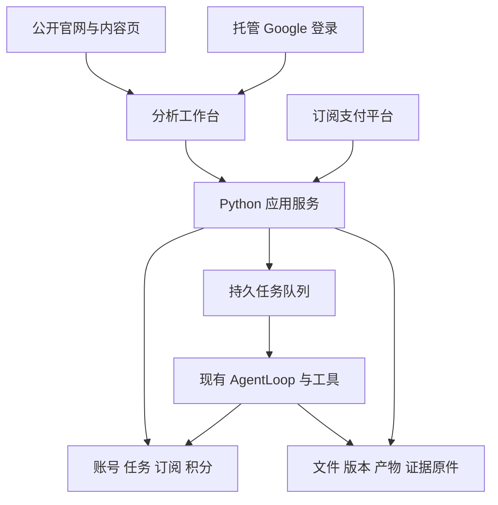

# 海外个人版 SaaS MVP 设计草案

版本：0.1；日期：2026-10-16；状态：讨论草案，未批准实施。

本草案整理海外个人版 SaaS 的产品范围、架构、套餐用量、扣费规则、模块改造边界，以及与当前可信交付重构的衔接。目标是尽量复用已有分析与可信发布能力，将账号、云端运行和商业计费的责任放在明确的应用边界。

本草案只新增设计材料，不修改代码、正式默认、现行产品需求或[唯一重构总计划](../superpowers/plans/2026-09-22-analysis-agent-trust-reset-plan.md)，也不授权测试批次、Provider 调用、支付账户操作或部署。S3 → S4 → S5 的顺序与原有准入条件保持不变。后续商业化实施是否以及何时纳入唯一计划，需要另行明确。

## 状态定义与已确认事项

本文使用四种状态，避免把整理文档当作采纳方案。

| 状态 | 含义 |
| --- | --- |
| 已确认 | 用户在本次讨论中明确提出的目标或约束 |
| 既有约束 | 当前产品需求、重构计划和运行规则中已存在的要求 |
| 建议方案 | 本草案提出的设计，仍待讨论和确认 |
| 待验证假设 | 用于推演的价格、额度、期限或资源数字，不能直接作为配置或销售承诺 |

### 已确认事项

| 编号 | 已确认内容 | 对设计的约束 |
| --- | --- | --- |
| C01 | 海外用户优先 | 优先评估海外登录、支付、部署和获客路径 |
| C02 | 首期是可收费的个人版 MVP | 围绕个人完整使用与订阅闭环确定范围 |
| C03 | 接入账号系统，先支持 Google 登录 | 需要独立账号身份及资源归属 |
| C04 | 接入套餐订阅 | 需要权益、用量、支付生命周期和账单入口 |
| C05 | 配套官网与 SEO，网页改为前后端分离 | 区分公开内容页面和私人分析工作台 |
| C06 | 本轮只整理设计草案，不改代码 | 不实施架构、计费、前端或配置变更 |
| C07 | 不改变当前重构计划的执行顺序 | 不将 SaaS 实施自动插入 S3 与 S4 或 S4 与 S5 之间 |
| C08 | 价格和额度先标为待验证假设 | 不把上一轮举例数字认定为已批准套餐 |

英文优先、Trial 加 Pro、积分制、供应商选型、失败免扣、取消费、额度有效期和数据保存期均属于建议方案。用户要求整理这些方案，不等于已确认其具体政策。

### 既有约束

- 保留现有分析方法、来源版本、执行范围、确认机制、事实与产物证据、需求覆盖和 AcceptedAnswer。
- 现有分析计划、TaskManager、计算 DAG 和发布链继续承担各自责任；不新增另一套分析规划、事实判定或答案发布流程。
- 套餐余额、执行结束、模型自报完成均不能改变事实是否成立或交付是否完整。
- 当前 77 个入口与原 180 项行为的验收要求保持；云端首期开放范围不能用来缩小现行重构的验收分母。
- 历史收据只证明其绑定的源码、输入、环境和路线；云端改造后的行为需要对应证据。
- 真实 Provider 批次继续采用精确冻结、零调用预检和逐批明确授权；本草案不提供此类授权。

## MVP 产品范围建议

以下为首期开放范围提案，尚未替代[现行产品需求](data-agent-product-requirements.md)。

| 领域 | 首期建议 | 后续候选与待讨论边界 |
| --- | --- | --- |
| 账号 | Google 登录、个人资料、退出、账号删除入口 | 其他登录方式、团队与企业账号 |
| 工作空间 | 每个账号自动拥有一个私人空间 | 多空间、成员邀请、公共共享 |
| 输入 | 首期网页突出 CSV 与 XLSX，公布解析和运行限制 | 其他现有格式是否同步开放、数据库及第三方连接 |
| 分析 | 咨询、文件分析、必要澄清、连续追问、图表、已有报告导出 | 定时分析、公开 API、超长任务 |
| 数据管理 | 历史会话、上传版本、删除、私有下载 | 公开分享、协作编辑、跨账号复用 |
| 知识与记忆 | 如首期开放，必须属于个人空间；公共方法知识只读 | 首期是否提供完整管理界面 |
| 商业化 | 一次性试用、一个 Pro 月付套餐、账单、取消续费、用量明细 | 年付、多档套餐、充值包、优惠券 |
| 官网 | 英文优先的首页、定价、真实场景、教程、支持、隐私与条款 | 多语言、内容运营规模与节奏 |
| 运维 | 基本监控、备份恢复、受控客服查询与账务更正 | 企业审计、复杂管理平台 |

云端用户不直接修改平台模型密钥、全局配置或任意安装 MCP。现有本地能力继续保留，其云端开放需要单独核验权限和执行隔离。

上传文件大小不能独立定义承载能力。CSV 与 XLSX 还需检查行列数、解压后大小、解析时间和内存；资源数字必须经过代表性输入与并发验证。

公开官网承担搜索入口与转化，私人会话、原始文件和报告依靠账号授权保护。排除搜索索引只能作为补充，不能代替访问控制。隐私说明应准确描述发送给模型的数据范围、保存期和删除行为。

## 架构与责任边界建议

采用独立网页前端、Python 应用服务、分析 Worker、PostgreSQL 和私有对象存储。API 与 Worker 可共用一个 Python 工程与分析核心，分别部署。初期保留 Flask，是否更换后端框架单独评估。

### 应用层与分析内核

| 边界 | 责任 | 不承接的责任 |
| --- | --- | --- |
| 前端 | 登录交互、报价展示、确认、任务进度、回答、用量与账单 | 不决定资源归属、扣费或分析完成 |
| 应用服务 | 验证身份、检查权益与资源归属、预占积分、创建和恢复任务 | 不重新解释统计结果或构造事实 |
| 任务队列与 Worker | 可靠投递、执行租约、资源限制、恢复已持久化状态 | 不规划业务步骤，不替代现有 TaskManager |
| 分析内核 | 需求、分析计划、工具、来源范围、确认、证据、可信发布 | 不读取 Stripe 状态或直接增减用户积分 |
| 商业计费服务 | 按已确认政策消费交付状态并结算，处理订阅权益 | 不把付费状态升级为分析有效性 |
| 存储访问层 | 用户空间隔离、逻辑引用、私有读取、版本和原件 | 不将临时工作目录视为永久权威 |

前端可经同域 /api 访问 Python 服务。长任务不依赖浏览器持续在线；SSE 负责观察，任务状态与已接受结果由后端持久化。

Next.js、Supabase、Stripe 均为候选。需要分别确认前端维护能力、认证与存储接入方式、支付主体可用性和费用。使用托管数据库的行级权限不能豁免后台服务的归属校验，尤其要检查具有绕过权限的后台角色。

### 身份与数据访问

服务端验证登录身份后，解析内部 user_id 与个人 workspace_id，再核验 session、upload、artifact、confirmation 和 job 的归属。上述身份不接受客户端自报作为权威。

账号归属与已有分析执行范围叠加：资源既要属于当前用户，又要被当前任务、来源版本和步骤允许访问。上传暂存区、缓存、知识检索、后台导出和下载链接都必须遵守同一归属规则。

Google 身份与内部用户 ID 分离；内部身份绑定提供方的稳定主体标识，不能仅用可变邮箱作为账号主键。

平台模型密钥与管理配置不进入前端或沙盒。个人语言、显示和分析偏好单独保存，不通过修改进程级全局配置实现。

### 存储与运行

- 数据库是账号、归属、任务运行与商业账务的权威；不可变原件和版本快照存入私有对象存储。
- Worker 使用按任务授权的本地工作目录，按需装载文件和快照；本地缓存不能绕过授权。
- 现有 JSON 和 JSONL 语义可通过版本化快照及访问适配逐步保留，不要求立即重写所有工具。
- 各类数据只保留一个可写权威，避免数据库与本地文件长期双写竞争。
- 会话通过数据库租约和版本条件限制并发写入。进程内锁只用于局部同步，不能承担分布式隔离。
- Worker 崩溃后只从可核验检查点恢复；未确定是否已发生的外部调用不能自动重放。
- Python 执行需补操作系统层面的文件、网络、CPU、内存、时间和进程限制；已有子进程与超时继续复用。

## 现有模块复用与改造边界

下表区分算法复用与运行适配，避免把“可复用”误写成“无需改造”。

| 现有模块 | 可以复用 | 需要改造或核验 | 必须保持的边界 |
| --- | --- | --- | --- |
| tools 内的数据与统计工具 | 方法、参数合同、算法、真实结果结构 | 数据读取、产物保存和资源约束的接入 | 不因套餐更换方法含义或缩小原始目标 |
| visualization 与 report | 图表数据、来源绑定、导出内容 | 私有产物访问、网页安全呈现、语言与界面适配 | 网页与导出消费同一已接受结果 |
| agent/publication | 事实核验、覆盖、AcceptedAnswer、统一发布 | 读取原件与快照的存储适配 | 不新增商业层的分析完成判定器 |
| AgentLoop 与 AgentContext | 分析流程、上下文与执行范围 | 注入执行身份、存储访问、资源政策和任务关联 | 不在分析内核分散加入套餐判断 |
| agent/confirmation | 必要澄清、版本检查、幂等恢复 | 跨进程持久化、归属和计费任务关联 | 不按每次澄清或恢复重复收费 |
| 上传票据与来源版本 | 文件摘要、版本、绑定与实际读取记录 | 暂存归属、对象存储、配额与票据权限 | 不以客户端文件名或路径证明所有权 |
| session/history 与 workspace | 规范历史、会话快照、版本语义 | 存储接口、跨实例恢复、写入版本控制 | 不破坏原历史和 AcceptedAnswer 身份 |
| knowledge 与 memory | 知识、记忆、证据记录与检索合同 | 私人空间隔离、SQLite 存储迁移方案 | 私人内容不进入公共全局检索 |
| AgentManager 与 RunStates | 会话生命周期和终态语义 | 持久任务、租约、重启恢复、跨实例状态 | 执行终态不等于分析交付成功 |
| event_bus 与 Web API | 既有交互与事件语义 | 事件持久化、重连游标、身份检查、版本化接口 | 一轮终态与持久结果一致 |
| LLMClient 与 request_policy | token、容量、截止时间与真实请求边界 | 关联全部物理尝试、成本事件、调用前预算检查 | 未知用量不补零，不增加隐式调用 |
| execution_control | 工具与时长上限、收敛和失败保护 | 承接平台执行政策 | 商业积分不能替代事实或覆盖门 |
| config 与管理入口 | 平台运行参数的组织方式 | 平台配置与个人偏好分离、管理员权限 | 不通过用户请求修改全局密钥或模型端点 |
| Jinja 与 Alpine 前端 | 用户旅程、交互语义、已有验收场景 | 独立组件、账户与计费页面、事件状态管理 | 不在前端重新计算业务结论 |

新增的商业模块是身份映射、权益、积分交易、报价与结算。新增的云端模块是对象存储适配、运行投递与租约、私有下载和运营观测。这些模块不能替代现有业务规划、计算 DAG 或证据账本。

## 套餐与用量设计建议

### 三类用量

| 类型 | 面向对象 | 权威与用途 |
| --- | --- | --- |
| 商业积分 | 用户 | 积分交易与预占记录；决定本期可购买的服务 |
| 实际成本 | 平台 | 模型用量、计算与存储事件；分析盈利和损耗 |
| 执行上限 | 运行系统 | 每任务的成本、调用、时间和资源政策；限制失控执行 |

系统重试、辅助审核、上下文压缩和其他必要内部工作纳入实际成本，不自动增加对用户的报价。用户界面分别展示套餐额度与任务状态；模型上下文容量不能标成套餐剩余额度。

### 套餐参数假设

本表所有数字均为待验证假设 H01 至 H09。采用 Trial 加 Pro 的套餐结构本身也待确认。

| 参数 | Trial 假设 | Pro 假设 | 验证方向 |
| --- | --- | --- | --- |
| H01 售价 | 免费 | 29 美元每月 | 成本与用户价值；不是市场验证结论 |
| H02 积分 | 一次性 20 | 每订阅周期 200 | 满额使用、失败损耗和典型任务成本 |
| H03 积分有效期 | 领取后 7 天 | 对应付款周期 | 试用完成率、周期边界、升级规则 |
| H04 账号运行并发 | 1 | 1 | 多会话、后台任务和 Worker 负载 |
| H05 单次总上传量与文件数 | 10 MB 和 1 个文件 | 50 MB 和最多 4 个文件 | 同时验证单文件、解析、行列和内存上限 |
| H06 存储配额 | 100 MB | 2 GB | 原始版本、派生产物、临时文件的计量范围 |
| H07 订阅结束下载宽限 | 另行确定试用数据保存期 | 示例为 30 天 | 用户导出需求、成本与删除政策 |
| H08 轻量问答与标准分析价格 | 1 和 10 积分 | 1 和 10 积分 | 完整交付率、任务成本与价格可理解性 |
| H09 预占最长有效期 | 示例为 24 小时 | 示例为 24 小时 | 等待澄清、排队和跨周期处理 |

可先保持一个月付付费档，暂缓年付、充值包和复杂升级补差价。是否采用不结转、到期清理以及试用转付费时保留余量，需要按待讨论清单确认。

### 计费任务与报价

建议采用 analysis_job_id 关联一次计费任务。一项任务可包含原始请求、规划、工具执行、多次必要澄清、多个 turn_id、模型物理尝试和最终交付，最终只结算一次。

analysis_job_id 不替代原业务任务、步骤、需求、确认或答案 ID。会话可以容纳多个计费任务；同一计费任务可以经历多轮交互。

| 用户动作 | 建议处理 |
| --- | --- |
| 确定性上传预览、查看历史、下载已有产物 | 0 积分，受配额和频率限制 |
| 通用咨询、解释已有可见结果 | 轻量问答，假设 1 积分；不新增数据计算 |
| 在公布边界内完成明确分析请求 | 标准分析，假设 10 积分 |
| 回答原任务必要澄清、正常恢复 | 包含在原报价内 |
| 刷新、断线重连、重复相同操作 | 返回原任务，不产生新扣费 |
| 新目标、换数据重算、已完成后的新计算 | 重新报价，用户同意后另建任务 |
| 重新生成内容或新算图表 | 按实际服务范围报价，不等同于免费重复下载 |

报价优先依据用户选择的模式、确定性文件元数据和版本化规则生成，不额外调用模型决定价格。普通发送入口应明确显示本次价格或已同意的上限；后端不接受客户端提交的价格作为权威。

如正式规划后发现范围超限，应先停止并提示拆分或调整；内部调用已经发生的成本由平台记录，不得事后静默加价。规划与澄清本身也消耗资源，必须纳入任务预算和频率限制。

报价建议绑定：用户空间、会话、原请求引用、服务模式、来源版本、范围或范围版本、报价政策版本、最大积分、执行政策版本、有效期和幂等键。需要引用历史结果时同时绑定其身份。

保持同目标、同来源和同报价范围的澄清恢复沿原任务继续；真实目标或来源变化沿既有需求修订机制处理。商业层只检查绑定与价格变化，不另建业务意图分类器。

### 预占与结算

执行前完成权益、资源归属、报价有效性和余额检查，在同一数据库事务中预占积分并创建任务及可靠投递记录。余额不足或报价失效时不启动新的收费执行。

建议逻辑为：报价确认 → 积分预占 → 任务执行或等待澄清 → 持久交付或明确终态 → 一次结算与释放余量。任务运行状态和账务状态分别保存；等待用户不是计费终态。

以下为待确认的首期扣费政策，以标准分析预占 10 积分为例。取消费、部分交付免扣及期限尤其需要确认。

| 情形 | 建议扣费 | 判定条件 |
| --- | --- | --- |
| 原报价范围的必要交付全部完成 | 10 | 需求覆盖与 AcceptedAnswer 可核验，并已持久化 |
| 校验失败或执行前发现不支持 | 0 | 尚未形成有效可执行范围 |
| 平台异常、Provider 失败或产品交付失败 | 0 | 保留错误和实际成本，不伪造零成本 |
| 执行预算耗尽等导致必要交付部分完成 | 0 | 保留有效结果及缺口，首期暂不做按完成比例计价 |
| 用户在实际执行前取消 | 0 | 建议以第一项受预算约束的模型或分析操作尚未派发为界 |
| 用户在执行开始后主动取消且未完整交付 | 示例为 1 | 起算边界与取消事件可核验，前端事先披露 |
| 完整结果已持久化后关闭页面或取消 | 10 | 按持久交付状态处理，不依赖用户是否打开结果 |
| 执行结果暂时不确定 | 暂缓结算 | 进入核对；期限内无法证明完整交付则释放，期限待确认 |
| 内部重试、重复队列消息、重复通知 | 不新增扣费 | 仍属于原任务和原结算身份 |

“流程 completed”“存在 AcceptedAnswer”和“模型说已完成”都不足以单独支持全额收费。必须核对本次报价对应的必要交付；收费规则不能撤回、缩减或重写原义务。

没有显著差异、现有证据不足以证明因果等结论，可以是完整有效的回答。应依现有方法与覆盖合同判定，不能按结论是否积极判断收费。用户主观满意度通过支持政策处理，不交给模型裁决扣费。

部分交付免扣会使平台承担损耗。应监测无进展、重复失败与取消频率，在可解释的边界暂停继续发起任务；不能无限免费重试，也不能把防滥用规则变成隐性加价。若完整交付率不足，先处理质量或售卖范围，再确定套餐。

结果未知与成本未知分开处理：已经核验完整交付的固定价任务，不因内部 token 未返回而自动免单；结果未知的任务不能仅因平台已产生成本而全额扣费。释放后迟到的结果不得在没有新授权时追扣。

### 预占的并发与周期边界

- 余额检查和预占必须原子化；跨标签页、会话和后台操作统一遵守账号级并发与额度。
- 预占、最终扣款、释放和人工补偿具有业务幂等标识。任务重复投递不能产生多次结算。
- 等待澄清释放 Worker 计算资源，但仍保留有期限的报价和积分预占。
- 预占到期的任务关闭；后续继续需要重新确认报价和预占，不能对已关闭任务静默重放。
- 跨周期任务绑定原积分批次。已预占部分按既定政策保留到结算，不能同时从新周期扣一次。
- 释放回已过期批次的积分不得重新变成长期可用额度；需区分释放冻结与赠送新额度。
- 额度耗尽后仍可查看和下载历史、取消任务，以及在原授权范围内完成必要澄清。
- 取消与完成竞态依据持久状态和版本条件裁决；人工更正用补偿交易，不覆盖原记录。

## 订阅与账务建议

### 订阅周期

建议按真实订阅周期发放积分，存储 UTC 时间并按用户时区展示。发放依据经过校验的订阅、付款和有效周期，不依据支付成功跳转页面或月初定时器自行重置。

Webhook 需要验签、持久接收、去重、处理乱序并可核对当前支付状态。事件 ID 去重之外，还须按订阅周期或发票行等业务身份保证额度只发放一次，具体键随冻结的支付接口版本确定。

| 情形 | 建议权益处理 | 待讨论处 |
| --- | --- | --- |
| 首次付款或续费确认 | 对匹配产品与周期发放一次权益 | 试用剩余积分如何处理 |
| 取消续费 | 已付周期内继续有效，到期停止新收费任务 | 是否允许即时结束 |
| 支付失败或需要额外验证 | 不发放未付款的新周期额度，提供更新付款入口 | 是否提供执行宽限及范围 |
| 到期且未续费 | 保留明确期限的查看下载，停止新收费任务 | 数据与账单保存期限 |
| 退款或争议 | 钱款、剩余额度与权益分别处理并留记录 | 退款条件和已消费额度处理 |
| 额度耗尽 | 保留历史与账单入口 | 何时增加充值包 |

支付平台只管理订阅和钱款状态；应用服务管理任务权益与积分消费。首期可使用受控后台人工处理退款和积分补偿，仍需记录原因、操作者和幂等身份。

### 最小数据责任

| 数据对象 | 用途与关键约束 |
| --- | --- |
| users 与 workspaces | 内部身份、提供方绑定、空间归属 |
| subscriptions | 支付客户、订阅、已确认周期与权益版本 |
| credit_grants | 发放批次、来源、金额度数、有效期和唯一业务身份 |
| credit_reservations | 任务预占、绑定批次、期限、当前状态 |
| credit_transactions | 发放、扣款、释放、过期及补偿的不可覆盖记录 |
| analysis_jobs | 原请求、报价、执行政策、范围版本、运行与结算关联 |
| usage_events | 每次物理调用或计算的实际消耗与未知状态 |
| payment_events 与投递记录 | 支付去重、可靠处理、任务投递和核对 |

商业积分使用整数最小单位，货币使用明确币种与精度，禁止依赖浮点累计余额。积分余额可以有事务内维护的投影，但应能与记录核对。

积分交易是新增商业账务，不是另一套分析事实账本，也不替代现有真实 Provider 验收账本。账号或文件删除需要按明确政策清理用户内容，不能通过删除原账务记录来修改历史扣费。

## 内部成本与执行上限建议

### 成本事件覆盖

一次计费任务的实际成本应包含主分析、意图识别、辅助审核、摘要或压缩、重试和失败尝试。同步、流式与辅助客户端都需经过可追踪的实际请求边界。

建议关联：workspace_id → analysis_job_id → turn_id → physical_attempt_id。事件记录模型与端点配置身份、价格版本、输入输出与缓存 token、执行时间、状态以及 reported、estimated 或 unknown 等用量依据。

实际调用价格与商业积分价格分别版本化。平台更换模型或费率不得重算已结算的用户报价；需要重新验证成本和质量，不能为满足毛利静默降低必要交付。

### 运行预算

- 派发前检查任务剩余内部成本、调用次数、时间和计算资源，并为可能的输出与在途请求预留预算。
- 对未知调用成本保守处理，不把超时、断连或本地取消当作远端零消耗。
- 保留最终结果组织与持久化需要的预算，避免全部资源用于探索。
- 预算到达上限时沿现有收敛和部分交付规则处理，不能伪造全完成或缩小必答范围。
- 计算 Worker 与 Python 沙盒有独立资源上限；付费账号不能绕过隔离。
- 单次请求容量、单任务成本上限和用户月积分分别管理，不能互相替代。

### 定价验证

下面只是 H01 与 H02 的算术推演，净收入与执行成本比例也是假设，不表示当前支付费率或已测成本。

| 输入 | 假设 |
| --- | --- |
| 月售价 | 29 美元 |
| 扣除相关项目后的净收入 | 27 美元 |
| 可用于模型与执行的比例 | 30% |
| 月积分 | 200 |

每积分平均执行成本目标 = 27 × 30% ÷ 200 = 0.0405 美元。10 积分标准分析的平均预算对应 0.405 美元；月度满额使用对应 8.10 美元。剩余收入仍需覆盖其他运营成本与目标利润。

成本口径须计入辅助工作、失败、取消和分摊的试用损耗。该值是满额使用情况下的平均目标，不是每项任务的硬上限，也不能证明 29 美元套餐可行。

验证应覆盖轻量咨询、标准分析、多文件、建模、长会话与失败路径，核对完整交付率、成本分布、尾部消耗、耗时、内存、取消和重试损耗。不得只挑成功且便宜的任务。

可先检查已有用量日志的覆盖和缺失；新增真实 Provider 成本样本必须另行冻结与授权。数据不足时保留假设，不能将成本未知改成零。

## 减少返工的五组接口建议

接口是未来实现的讨论边界，不在本轮加入源码，也不要求 S3 为商业化新增通用框架。

| 接口 | 建议输入输出 | 与现有核心的关系 |
| --- | --- | --- |
| 执行身份 | 内部用户、空间、服务端核验的资源权限与执行身份 | 在原任务范围约束外增加账号归属 |
| 存储访问 | 逻辑文件和快照引用、版本、摘要、授权范围 | 适配本地与云端，保留原件语义 |
| 任务提交与恢复 | 计费任务、原业务身份、幂等键、检查点、确认引用 | 不替代业务规划与确认服务 |
| 交付结果 | AcceptedAnswer 引用、需求覆盖、产物、明确失败或缺口 | 商业层消费现有事实，不另做模型评审 |
| 用量事件 | 物理尝试、执行政策、实际或未知消耗与价格版本 | 统一覆盖主调用与辅助路径 |

适配应围绕函数和责任边界进行，避免复制整个 AgentLoop、重写工具全集或建立一套并行 SaaS 分析引擎。前端复用同一 API 结果与事件语义，不自建答案计算链。

迁移方案还需确定历史本地会话如何处理。候选是只迁移明确选择的数据，或保留旧会话只读；不能自动把某台开发机器的全局数据分配给云端账号。迁移需验证引用、摘要和回滚，不覆盖原始证据。

## 与 S3 S4 S5 的衔接

### 当前顺序与准入保持

截至 2026-10-16 核对，唯一计划记录 S3 正在有限收敛，S4 尚未开始，S5 尚未开始且未获授权。具体状态以后续唯一计划为准，本草案不维护第二套实施看板。

现行顺序仍为 S3 有限收敛 → S4 本地最终验收与自然准备 → S5 两批自然验收，并分别满足原有准入和授权要求。本草案不要求这些阶段等待 SaaS，也不自动插入账号、计费、存储或前端改造。

| 阶段 | 本草案可提供的设计参考 | 不改变的责任 |
| --- | --- | --- |
| S3 | 记录可复用接口、存储依赖、用量覆盖和云端风险 | 原有限清单、77 入口、180 行为、旧责任退役及原测试策略 |
| S4 | 将现有请求、事件、终态、导出和环境合同作为未来适配依据 | 当前候选的完整离线、正常应用路径、必要视觉和零调用预检 |
| S5 | 既有成本数据在适用时可作为后续评估输入 | 同一候选与业务输入判据，两批独立精确冻结、各自授权并完整通过 |

SaaS 文档本身不触发整库回归或 Provider 批次。本文验收条目不追加到当前 S3 有限清单，也不使尚未开发的商业能力成为 S3 阻塞项。

### 未来接入的决策点

未来明确授权 SaaS 实施时，先判断对分析核心、公共接口、配置和证据的影响，再在唯一计划中记录接入位置和受影响验收；不直接执行本草案中的建议顺序。

若沿原顺序完成 S3–S5 后再改造，原验收仍只证明原候选。云端适配影响来源访问、确认、运行恢复、模型配置或发布时，需对新候选建立对应验证身份，不能沿用旧绿灯。

若以后希望在最终候选冻结前统一接入云端边界以减少重复验收，必须另行确认阶段安排。本草案没有作出这种顺序变更。

### 变更影响与证据复用

| 未来变更 | 可复用的基础 | 新增或重核的证据 |
| --- | --- | --- |
| 官网内容与独立公开页面 | 已验证的产品能力描述 | 公开页面、SEO 与转化链路 |
| 新工作台接同一核心结果 | 原数值和发布合同 | SSE、确认、刷新、下载与视觉一致性 |
| 账号和私有存储 | 文件版本、摘要与原读取范围 | 全路径跨账号隔离、失效下载与权限检查 |
| Worker、队列和快照 | 单次执行语义、原终态与恢复规则 | 重复投递、崩溃、租约、检查点和持久结果一致性 |
| 套餐和内部资源限制 | 原执行预算与部分交付语义 | 额度限制是否改变必答交付、结算与终态一致性 |
| 模型或请求配置变化 | 历史方法与失败记录 | 新候选质量、成本及按原规则所需的自然验收 |

## SaaS 专项验收建议

以下为未来 SaaS 候选的验收草案，未加入当前阶段任务。测试通过只证明相应层级，付款沙盒不证明真实收款，HTTP 路线不证明视觉，旧核心回执不证明新的云端部署。

| 编号 | 场景 | 独立判据 |
| --- | --- | --- |
| A01 | A 账号提交 B 的会话、文件、产物或确认 ID | 所有读取、下载、恢复与后台执行均拒绝越权 |
| A02 | 暂存上传尚未绑定会话 | 仍有明确账号归属，不能被其他账号认领 |
| A03 | 多标签页同时消耗最后一笔额度 | 原子预占，余额不透支，账号并发不绕过 |
| A04 | 相同请求重复发送 | 同一业务幂等身份只创建一个任务与预占 |
| A05 | 多次必要澄清和恢复 | 不新增用户扣费；业务确认仍按原版本校验 |
| A06 | 新目标或相关数据换版 | 原权限与来源重新核验，必要时新报价 |
| A07 | 完整交付与合理否定结论 | 按已确认政策正常结算，不依赖结论积极程度 |
| A08 | 部分结果、失败或预算耗尽 | 真实覆盖与缺口保留，按已确认政策结算 |
| A09 | 用户取消与完成并发发生 | 依据持久交付与版本裁决，最多一次结算 |
| A10 | 重复或乱序付款通知 | 验签、事件去重和业务周期去重同时成立 |
| A11 | 月末预占、次月完成或释放 | 绑定原积分批次，不重复扣费或复活过期额度 |
| A12 | Worker 崩溃或队列重复投递 | 无重复外部效果、无伪造完成，未确定调用不自动重放 |
| A13 | 模型超时或用量字段缺失 | 成本标未知，交付状态与成本状态不混淆 |
| A14 | 余额用尽或订阅到期 | 历史下载与已有任务处置符合已确认政策 |
| A15 | 完成后刷新、重连和导出 | 同一 AcceptedAnswer 与产物，不重复计费 |
| A16 | 预占超时后迟到结果 | 无静默追扣，保留原释放与后续核对记录 |
| A17 | 存储满、超大或高展开率文件 | 在明确边界拒绝或停止，资源与扣费记录一致 |
| A18 | 沙盒访问文件、网络或超用资源 | 只能访问获授权输入，不可读取其他用户或平台密钥 |
| A19 | 退款、人工补偿或账号删除 | 原账务不可覆盖；用户数据按政策处置 |
| A20 | 内部辅助调用和重试 | 全部归入原任务成本，不绕过预算或增加报价 |

## 待讨论与待验证清单

| 编号 | 待定事项 | 当前建议或分歧 | 决定所需信息 |
| --- | --- | --- | --- |
| D01 | 首期功能、格式和语言 | 英文优先、CSV 与 XLSX；其他现有能力逐项确定 | 用户旅程与云端能力映射 |
| D02 | 套餐结构与计价单位 | Trial 加一个月付 Pro，固定服务积分价 | 价格可理解性、成本与付费意愿 |
| D03 | 价格、额度和资源阈值 | H01 至 H09 全部待验证 | 代表性任务与满额使用成本、负载样本 |
| D04 | 部分交付和失败扣费 | 首期部分交付与产品失败免扣 | 完整交付率、损耗及滥用风险 |
| D05 | 主动取消规则 | 执行前免费，执行后示例扣 1 积分 | 起算点、竞态处理和用户可理解性 |
| D06 | 服务范围与范围变化 | 明确模式与上限，超范围先停止再报价 | 现有需求与计划能提供的稳定绑定 |
| D07 | 周期、结转和预占期限 | 不结转、原批次结算、有限预占 | 跨月、试用转付费和长期等待场景 |
| D08 | 退款、宽限与数据保存 | 受控人工退款，下载宽限示例 30 天 | 服务政策、用户内容删除和账务保留边界 |
| D09 | 供应商与部署 | Next.js、保留 Flask、托管认证与数据库、Stripe 为候选 | 收款主体、地区、成本与维护能力 |
| D10 | 存储和历史迁移 | 单一权威、版本化原件、明确选择迁移或只读保留 | 当前路径依赖、数据量与回滚验证 |
| D11 | 首期知识与记忆 | 开放即完整隔离；界面可简化 | 云端业务价值与迁移成本 |
| D12 | SaaS 实施接入位置 | 当前不插入 S3–S5；以后另行确定 | 核心阶段出口与公共合同影响分析 |

后续确认应逐项标记采纳、调整或否决，并保留参数的验证依据。产品政策确认、实现授权和真实外部服务授权分别记录；不得从“讨论通过一种计价模型”推导出部署或调用授权。

## 依据与相关文档

### 仓库依据

- [唯一重构总计划](../superpowers/plans/2026-09-22-analysis-agent-trust-reset-plan.md)：当前阶段、接续顺序和 S4/S5 硬门。
- [产品需求](data-agent-product-requirements.md)与[可信回答需求](trusted-answer-publication-requirements.md)：现有行为与发布责任。
- [Web 应用入口](../../src/data_agent/web/app.py)、[聊天接口](../../src/data_agent/web/blueprints/chat.py)、[运行状态](../../src/data_agent/web/run_state.py)：当前 Web、执行与持久状态边界。
- [规范历史](../../src/data_agent/session/history.py)、[个人记忆当前存储](../../src/data_agent/knowledge/memory.py)、[证据当前存储](../../src/data_agent/knowledge/evidence.py)：现有本地存储与待适配点。
- [模型客户端](../../src/data_agent/llm/client.py)、[请求政策](../../src/data_agent/llm/request_policy.py)、[工具执行预算](../../src/data_agent/agent/execution_control.py)：用量、真实请求和执行上限。
- [可信发布服务](../../src/data_agent/agent/publication/service.py)、[发布合同](../../src/data_agent/agent/publication/contracts.py)、[确认服务](../../src/data_agent/agent/confirmation/service.py)、[Python 沙盒](../../src/data_agent/tools/sandbox.py)：交付、确认和执行边界。

当前设计依据工作树为 C:/Users/duguy/.codex/worktrees/trust-rebuild/data-agent，分支 codex/trust-rebuild-20260927；登记 HEAD 为 f7210e170d4dd1945abec15d57e364e04942eae4，包含既有未提交工作。HEAD 不代表本草案已冻结完整源码，也不代表 SaaS 已通过验收。D:/Project/Daily/data-agent 保持只读供体定位。

### 官方资料

以下资料支持供应商行为和架构约束，不支持本草案的价格、额度或完成率假设；接入时需按选定接口版本重新核验。

- [Google OpenID Connect](https://developers.google.com/identity/openid-connect/openid-connect)：身份验证与稳定主体标识。
- [Supabase Google 登录](https://supabase.com/docs/guides/auth/social-login/auth-google)：托管登录候选。
- [Supabase 行级权限](https://supabase.com/docs/guides/database/postgres/row-level-security)：行级权限及后台绕过角色边界。
- [Stripe Webhook](https://docs.stripe.com/webhooks)：签名、重复事件和事件乱序。
- [Stripe 订阅事件](https://docs.stripe.com/billing/subscriptions/webhooks)：付款与订阅生命周期。
- [Stripe 账单周期](https://docs.stripe.com/billing/subscriptions/billing-cycle)：订阅周期与 UTC。
- [Stripe 可用地区](https://stripe.com/global)：收款主体资格的初步核验入口。
- [Google JavaScript SEO](https://developers.google.com/search/docs/crawling-indexing/javascript/javascript-seo-basics)：公开内容的渲染与抓取。

