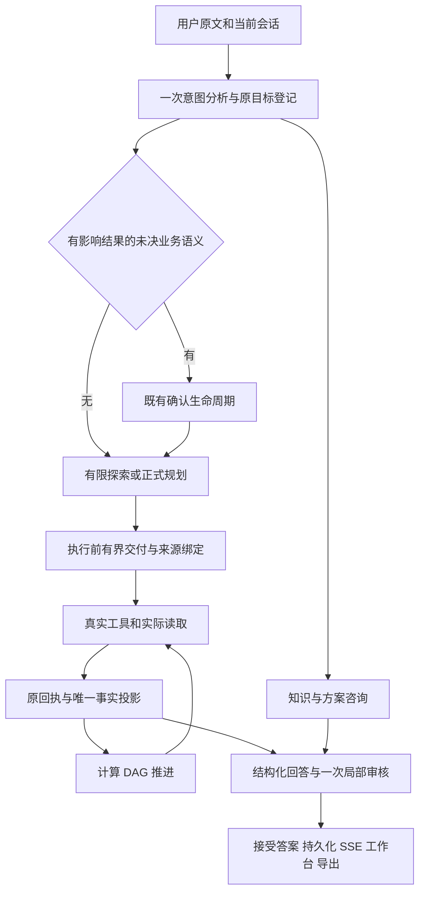
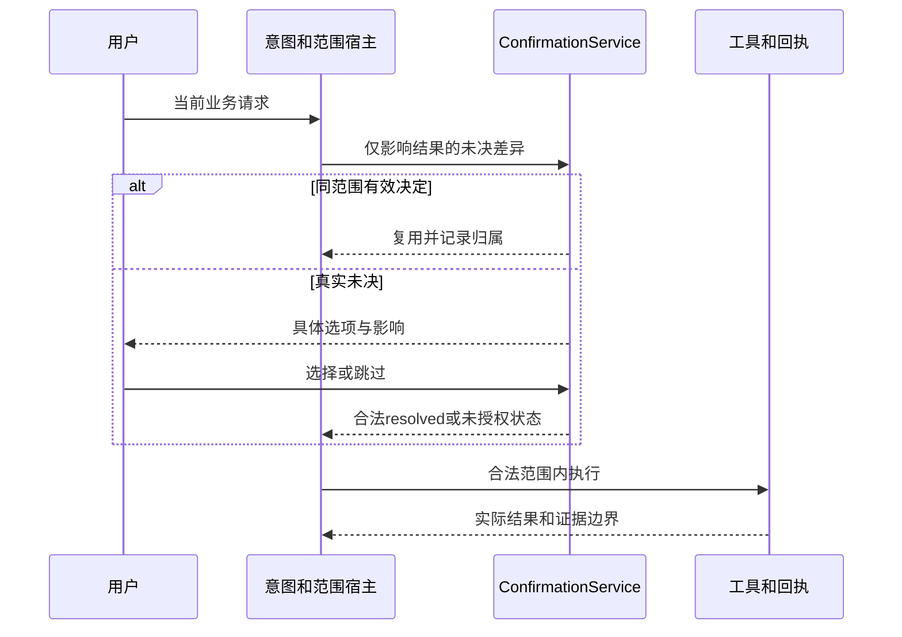

# Data Agent 产品需求

版本：2.0；更新：2026-10-10。本文是现行行为基线，实施状态只见[唯一总计划](../superpowers/plans/2026-09-22-analysis-agent-trust-reset-plan.md)。原文及旧阶段收据已归档；本文不表示当前代码已通过。

## 1. 产品目标

用户可以咨询数据分析知识、设计分析方案，也可以提供数据完成专业分析。产品必须交付有来源、方法边界和可审计依据的结果；有效描述、解释、条件建议应得到保留。不能把“没有错说”当作已完成用户任务。

允许模型改变合法措辞、顺序、方法和假设候选。用户业务目标、事实数值、来源版本、必要方法边界、需求覆盖与权限保持一致。结构化系统承接模型提议，不通过关键词/正则猜模型散文来建立事实或完成状态。

范围为当前电脑端Web/CLI智能体及既有数据/分析/知识/工具能力。不新增第二规划器、调度器、事实库、发布链或付费评审。保留受限Python、现有Skills/MCP扩展；外部能力的真实环境是否可用单独说明。

## 2. 九类意图与用户旅程

| ID | 路由名称 | 用户目的 | 必须行为 |
| --- | --- | --- | --- |
| PROD-I01 | simple_response | 简短交流 | 不制造分析任务；问候不得吞掉同时提出的计算 |
| PROD-I02 | knowledge_qa | 概念、公式、统计方法 | 无文件可答，示例标明示例，不声称已分析用户数据 |
| PROD-I03 | analysis_consultation | 指标/实验/分析方案 | 给步骤、字段、粒度、窗口与局限，不强制上传后才回答 |
| PROD-I04 | result_followup | 解释、改写或继续结果 | 解析原答案/未完成目标；表达改写不重算；实际新增计算独立登记 |
| PROD-I05 | intent_negotiation | 目标不明确 | 只问影响交付的真实差异，不逼多指标只选一项 |
| PROD-I06 | data_requirement | 了解所需数据 | 明确缺哪份/哪些字段和一个可执行数据动作；可答咨询先交付 |
| PROD-I07 | data_operation | 导入、预览、清洗、变换、导出 | 实际执行并核验效果与来源，不默认启动完整报告 |
| PROD-I08 | directed_analysis | 针对问题分析 | 自动选合法方法；必要业务歧义才确认；可算项实际完成 |
| PROD-I09 | comprehensive_report | 多指标、多源综合 | 保留全部主问题与来源，解释冲突/不可比性，不无授权跨源加总 |

单个枚举不是验收目标：简单计算经data_operation或directed_analysis都按实际行为验收。混合咨询与执行分别交付；否定、转折和多目标顺序不能改变业务义务。文件存在不等于用户要求计算。

## 3. 核心功能和保留边界

| ID | 能力 | 必须保留 |
| --- | --- | --- |
| PROD-D01 | 输入与工作区 | CSV/TSV、Excel、JSON/JSONL、SQL；上传票据/SHA、会话/项目隔离、版本、预览完整列身份；环境依赖缺失须明示 |
| PROD-D02 | 清洗与变换 | 类型、清洗、派生字段/特征、聚合/透视/连接、导出；原数据不可变，核对键/粒度/基数/缺失及实际父源血缘 |
| PROD-A01 | 描述与探索 | 时序、时期比较、分布、相关、分组、Top N、分解、漏斗、cohort；数值与对象/窗口/单位成组交付 |
| PROD-A02 | 统计与建模 | A/B、因果、回归、归因、分类、预测、SHAP、模拟、曲线拟合的已有声明模式；方法前提、估计对象和验证状态可核 |
| PROD-A03 | 开放计算 | 受限Python、代码/结果/回放、执行前业务参数和真实读取；任意stdout不是已核业务事实 |
| PROD-A04 | 多源分析 | independent显式1—16输入，synthesis只消费证据；独立失败隔离，比较/联合读取必须声明全部输入 |
| PROD-T01 | 任务与预算 | 既有唯一计划与TaskManager、停止/超时/恢复；模型自报完成不是事实，预算和账本可核 |
| PROD-T02 | 计算DAG | 事实/产物/结构化关系作为成功依赖；拒环、自依赖、缺依赖、错会话/步骤/版本；开放内容另核 |
| PROD-C01 | 业务确认 | 只确认未定分母/窗口/成本/对象；有效范围复用、相关变化重核、skip不授权、恢复一次 |
| PROD-E01 | 计算证据 | 真实工具回执、原始结果、摘要、实际读取和结构化claim；模型confidence不提供权威 |
| PROD-E02 | 竞争假设 | 当前目标/版本的支持、反驳、争议、未决、失效；原测量和结构化谓词决定关系，描述方向不升级因果 |
| PROD-K01 | 知识与记忆 | 项目规则、知识检索、记忆候选/确认；检索供咨询与定位，不能升级当前数据事实 |
| PROD-X01 | 扩展与运行入口 | 工具搜索发现、文件、Skills、MCP、模型设置和CLI可达；权限/配置保持，外部故障如实说明 |
| PROD-O01 | 回答与表达 | 多问题覆盖、解释、条件行动、简短/标准/详细、角色/语言变化；事实不变，表达确有变化 |
| PROD-O02 | 图表与导出 | Markdown、表格、公式、适用Mermaid、真实Plotly图和现有导出；不得伪造数值图或新增未要求格式 |
| PROD-S01 | 会话 | 新建、读取、停止、继续、回退重发、压缩、刷新、重启；保存需求与未完成义务，同一接受答案身份 |
| PROD-S02 | 分支与旧历史 | 分支继承聊天；重新加载/分析建立分支事实；父答案只是历史。旧协议会话只读，不做执行迁移 |
| PROD-W01 | Web/工作台 | 上传、SSE、确认卡、任务/项目/知识/设置；正文、侧栏、刷新与导出读取同一接受对象 |

forecast现行目标只保留真实auto/backtest有序回测能力，按用户2026-10-10确认退役simple/prophet误导别名，明确拒绝这两个参数；不新增对应算法。

相关性现行合同保留pearson/spearman/kendall完整矩阵及各对有效样本数，弱相关与零相关不因摘要阈值丢失；系数无量纲，不证明因果。2026-10-10用户确认：常数列及不足两条有效观测的未定义系数均为null（未知），包括Kendall对角线；普通列自身相关仍为1。原指标和correlation_method必须与派发及交付声明一致。

DID现行合同（2026-10-10用户确认）：保留四格均值差中差；缺任一处理组×期单元不计算效应且不补零；四格齐全但任一格不足两条只交付点估计，区间/p值未知。零方差退化检验不制造显著性。仅有0/1两期不能验证平行趋势，基线水平差不当作趋势差。区间与p值明确为独立四组方差和正态近似，未校正重复个体/聚类/序列相关；这些假设未验证，不把工具名升级为因果识别。效应与区间、p值的交付和缺口分别定位。

完整工具入口及家族见[77入口清单](../audit/2026-10-10-capability-coverage.md)。保留名字不等于能力通过，必须按每种声明模式检查业务效果和方法边界。

操作效果合同（2026-10-10用户确认）：沿用原需求、AnalysisPlan、真实ToolResult/回执、宿主目录和同一AcceptedAnswer；新增operation交付及effect引用，核对执行前原目标/参数/权限、实际新对象与父版本或文件字节/扩展状态。纯文件/扩展操作可无dataset_inputs，不制造虚假分析来源；数据操作仍绑定精确来源。操作效果不进入数据事实claim、不新增账本，保存前再次核实际对象，失败/变更/越域不能显示完成。已有交付ID可在同目标同范围重用。

清洗/转换边界（2026-10-10用户确认）：清洗逐列记录实际填补数、策略后与最终缺失及原因；删除记录不计作填补，mean/median仅数值且无法求值不换策略。所选范围未解决缺失标部分完成，明确keep按选择保留缺失。类型转换保留原坏值处理并补齐category，分别记录原缺失、成功/失败转换及新增缺失；不能转换的保留真实新表与部分完成。自动转换继续原建议筛选，公开跳过列，不增加强制转换。沿原effect目录、requirement gap及AcceptedAnswer交付；宿主核实际对象、父源和计数，旧答案复用不得消除缺口。

变换合同：结构化参数按公开优先级覆盖旧params JSON，两种输入由同一函数解析；显式默认值也必须生效。filter/select/rename/sort/group_aggregate/resample/pivot/merge保留，pivot继续含宽转长和长转宽。派发前绑定全部实际来源，merge复用多父派生并保留双方版本；同一回执可交付所需操作效果和原聚合事实，各按原目标声明覆盖，不增完成账本。变换作为写能力串行派发，事实与效果共用参数/全部来源验证。
聚合/重采样裁决：count统计指定列非缺失数，size统计行数；旧count没有目标列必须要求选择列或使用size。重采样沿原日期解析与频率算法，空桶/全缺失sum为未知，真实观测零为零；公开有效/排除记录和缺失/坏日期数。原范围存在日期排除时，实际新表与已知结果保留，事实交付和操作效果均携带同一范围缺口，不签全部完成。预算去重只读源/计划身份，派发前再绑定操作对象；无正式计划应返回原formal_plan_required。
分布合同：保留原均值、ddof=0总体标准差和偏置矩偏度/峰度；补齐同一有限范围的min/25%/50%/75%/max，pandas线性插值，无观测为null，沿原回执持久化与交付。所有选中数值列保留；没有有限观测或退化的统计量为null。Shapiro仅3≤n<5000且非退化时计算，结论为rejected/not_rejected/unknown，未拒绝不证明正态。显式缺列/重复/非数值选择整体拒绝；逐列公开原行数、缺失、非有限排除与有效数，非有限排除沿同一交付缺口保留已计算量和原范围部分完成。宿主核对实际来源计数，不开放综合期原表读取。

Skills边界（2026-10-10用户确认）：安装目录及安装/启用/禁用/删除全局管理；加载/卸载、list_skills的loaded状态和指令注入属于当前会话。网页管理与AgentLoop共用一个目录所有者，全局禁用/删除清除所有会话的对应加载；重新启用不自动恢复加载。其他会话的加载状态不得成为本会话效果证据。

模拟边界（2026-10-10用户确认）：optimize保留现有份额分配和逐次剪裁，称约束分配候选；交付前复核全部默认/显式上下界与目标，越界不交付，未找到不等于数学不可行，不宣称最优/最小变更/最小二乘。每组零或负基数拒绝，不新增优化器。sensitivity保留乘法/等比例算术和完整分组；零总量且目标非零时保留基线/目标/缺口，比例及分组反推未知；维度字符串仅接受唯一匹配，缺失/歧义拒绝。算术情景不授予因果或预测验证。

## 4. 原目标、探索与计划演化

业务目标保存真实原文跨度、来源消息、数据身份、窗口/分母/口径及用途；表达偏好另存。等价续问显式引用原目标，不凭原文不同判冲突，也不凭工具相同合并不同目标。非法结构保留原目标及明确未决原因，独立有效目标继续；不能静默丢字段后扩大范围。

有限探索在现有授权与预算内读取结构、预览、质量。正式业务计算必须在派发前登记交付和来源。探索结果可帮助规划，不得执行后追认其已完成正式交付。无数据任务的普通工具效果按自己的合同验收，不套虚假的统计计划。

同目标、同来源和同业务范围允许记录必要交付追加，保留旧义务/ID/证据；删除、替换、缩小、换窗口或版本须有原目标原子变更。每目标32交付、每步64交付、每次计划12步的既有上限保留；超限具体失败或有记录分批，不截断。计算DAG与最终回答共用事实投影，解释/行动不阻塞计算，但仍为最终必答义务。

## 5. 来源、数值与方法细则

- 字节相同不证明来源相同；上传/外部原文件、真实派生、会话生成数据分别有宿主身份。模型声明父源不提供血缘。有限公式承接只覆盖已核父版本、原列/行数/来源保留的一次derive_field边；任意过滤/覆盖/派生链不能借用这个证明。
- 同一业务对象新版：用户明确、当轮票据与目标唯一时直接绑定，不能因其他无关已加载对象强制询问。真多候选才澄清；新版本加载成功才替换，失败保留旧版。相关计划/证据/确认重新判适用性，无关对象不全局失效。
- 聚合同时保留原始记录数与派生行数；count/size/nunique分别为非空数/行数/非空唯一数；全缺失SUM保持未知，未知单位不得补币种。
- 日期列端点不是自动获得的业务窗口；含首尾日数、两期日历并集、重叠记录去重须按真实定义计算，不能用最早至最晚跨度代替不连续并集。
- 窗口每单成本为SUM(cost)/SUM(orders)，不是逐日比率累加。分母/零值/缺失语义未知时明确未决。确认业务列名可绑定真实原列与分组SUM，不授予币种、因果或增量含义。
- 曲线零值口径（2026-10-10用户确认）：长表与宽表均先逐条按zero_values筛选，再对同一x或序列列求均值；exclude排除零，keep保留零。有效记录数及排除零值数必须来自实际观测。零值业务含义仍unknown，排除不证明未观测或未到期；此口径不授予预测或因果验证。
- 已算精确样本内统计不因小样本或单来源自动失真。统计推断、因果、预测各自核方法/假设/验证；既不能无限升级，也不能全部降成不可用。

A/B（2026-10-10用户确认）：恰好两组，单位先sum/mean聚合，有跨组同单位固定配对，配对不足不回退独立检验；配对设计拒绝显式Mann–Whitney/chi2，不换方法。退化t保留均值/差值，统计量/p值/区间未知；auto明确正态性未评估时的秩检验依据。

ML/SHAP（2026-10-10用户确认）：保留原随机按行留出、现有分类/回归算法与可选CV；公开实际算法、原留出预测与验证限制。分类统一编码，公开原标签、每类/宏平均指标和默认正类统计约定。TreeExplainer逐类绝对均值，完整分类总体各类等权平均；回归按样本平均。单分类输出保留实际类别，完整平均未知。模型属于当前会话、当前数据版；model_kind=auto/regression/classification，auto只用唯一匹配，两种都有效时明确要求选择，不静默挑一个。以上均不授予未来/外部验证或因果强度。

- 聚合曲线拟合不强要用户级数据，用户级留存则必须具相应粒度。
- Python参数声明、回执摘要和可重放只证明相应执行/来源，不证明任意代码实现业务方法。结果继续保留探索性边界。
- 同身份同参数同原结果可去重展示，执行回执仍保留；不同来源/窗口/版本不因数值相同合并。

## 6. 确认与假设

方法许可、工具名、模型自报safe_default不能代替真实决定。用户批准也不提供数据/因果/预测证据。重复resume只应用一次；expired/cancelled/skipped不可复用授权。

假设必须有当前ID/目标/来源/版本、原测量引用和可计算关系。无支持不是反证；同时存在有效支持与反证为争议；变更依赖后重算。状态、依据、限制和区分性下一步在正文可见，不仅写进内部state。

## 7. 连续会话、压缩与表达

唯一当前任务的“继续”承接未完成义务，同版事实复用；新增业务范围先登记。纯表达改写绑定原接受答案；找不到该答案时说明定位缺口，可答独立知识，不冒充已解释原结果。

压缩保存可核完整早期轮次和原工具成对消息，不拆短续问；只有一个分析轮次时保持原历史。能压缩时必须实际缩短模型上下文。页面/导出还原原接受答案，不能用模型摘要替换；归档读者共享同一哈希校验，不能扩大模型权限。回退重发和新版本不得复活失效确认。

偏好优先级：本轮明确要求 > 有效会话偏好 > 任务复杂度 > 默认。简短仍回答所有明确问题；详细不能凭空加事实；“不要建议/图标”被遵守。全篇来源/限制可以共享，局部可能误导的解释须有就近限定。数据相关开放片段只用一次有界审核。

工作台区分已核结果和待验证发现；有效结果默认六条并显示总数/可展开其余。失效结果保留历史性质。电脑端1440px、键盘入口、公式/表格/真实图、刷新与现有导出均验收；不新增移动端、PDF或Word产品要求。

## 8. 需求追溯和变更

VP/IC/CP的180个原行为编号保留在[统一验收](../superpowers/validation/2026-09-30-trusted-answer-pipeline-acceptance.md)。旧兼容、旧技术selector、零新增审核等条款按已批准决定显式替代，详见[系统回顾冲突表](../audit/2026-10-10-project-retrospective.md)。

可计算项必须实际交付；诚实缺口单独计覆盖，不能抵消该项未完成。历史通过不自动签收当前代码，缺原材料为unassessed。出现需要削减能力、改变业务方法或事实权限的取舍，先讨论确认；普通责任收敛按唯一计划实施。

漏斗裁决35—37（2026-10-10用户确认）：事件模式使用逐用户最早有效顺序路径，window_hours限制相邻已选事件；无时间列只证明集合包含。总体从完整来源独立计算，各组完整保留；预聚合同步骤先求和，自动顺序按聚合计数降序并注明推断，缺失步骤/零分母未知，非法计数拒绝。率列只接受有限0—1累积比例，逐列有效记录等权均值，步骤和整体比值明确为累积率列均值之比；人数未知，不虚构人数、真实用户转化或加权总体。全部沿唯一正式计划、原回执、目录和AcceptedAnswer交付，不另建链。

cohort裁决38（2026-10-10用户确认）：保留首次观测月/逐月去重用户留存，年龄轴从0补齐至实际观测末月；已到达且无事件为0、未到达为null。披露首次观测不等于真实首次、末月可能不完整及用户身份口径限制。公开原记录、有效记录、联合排除和缺失用户/缺失时间/无效时间各原因数（原因可重叠）；有排除则原范围部分完成，已计算矩阵保留。显式event_col缺失拒绝，已有event_col不隐式筛选事件值。参数与来源在既有正式计划/原回执中绑定，沿唯一封闭适配交付，不新增账本。

聚类裁决39（2026-10-10用户确认）：保留StandardScaler＋KMeans(random_state=42,n_init=10)，只交付实际非空簇，公开请求与实际簇数。按输入记录计数，不假定记录为独立用户或制造客群差异；原尺度均值及ddof=1样本标准差保留，单记录簇标准差null。所选特征缺失按列和联合排除披露，有排除则原范围部分完成；不存在/重复/非数值特征及非有限值明确拒绝，不新增填补或聚类算法。特征、请求簇数及实际结果沿唯一正式计划/原回执/封闭适配/AcceptedAnswer交付；不足请求簇数或未知描述量保留实际结果与具体缺口。

TopN裁决40（2026-10-10用户确认）：保留原按记录sort_values/head及默认首个数值列；n只接受正整数，显式不存在、空项或重复返回列拒绝。公开实际排序列、方向、请求上限、真实返回列及来源/返回行数；有限数值交付原值，不预先舍入。并列与缺失排序沿原算法，缺失/非有限单元格沿原JSON口径为未知，不授予业务解释。save_as创建真实新表，核对精确参数、实际内容、父版本和权限，沿既有操作效果交付；未指定save_as只交付排行，操作目标不得虚报创建。唯一选择器与publication.native封闭适配承接表、实际条数和操作效果，不新增账本或同功能双链。

贡献分解裁决41（2026-10-10用户确认）：保留sum分组总和之差及原mean加权合并贡献；缺席组均值null，实际条数与权重0。mean使用等价的已观测中心化加权项之差，不把未知均值补0或推断反事实。两期及各组有效条数、原源/联合排除和逐项重叠计数、窗口外及重叠行数公开。百分比分母保留abs(total_change)与abs(period_a.value)，零分母未知、绝对量保留；原日均归一化继续按窗口日数。有无效/缺失记录排除则原范围部分完成；不识别因果归因或授予时间可比性。实际参数、完整分组、原值和范围沿唯一正式计划/原回执/封闭适配/AcceptedAnswer交付，宿主同一算法owner复核来源；不新增分解方法或账本。

因素分析裁决42/43（2026-10-11用户确认）：保留标准化OLS＋HC3、Holm多重校正和VIF原算法；拒绝目标自包含、重复/不存在的显式特征以及不存在的显式单位/时间列。常数目标、样本不足及不可计算的推断交付null和具体缺口，原数值转换、联合完整案例筛选与特征排除真实公开，原范围或所选特征未完整估计时沿原合同部分完成。单位/时间只披露参与估计行的实际范围、缺失/坏值/重复情况，不据此聚合、聚类或校正时间相关性；独立性未验证。相关列若同时作为显式或自动特征，另标实际特征使用，不能冒充按单位/时间设计。仅授予统计关联；原正式计划/回执/封闭适配/AcceptedAnswer交付，宿主复用同一算法owner核对真实来源，不新增因果、面板/时序算法或账本。

时间序列裁决44/45（2026-10-11用户确认）：保留按时间排序后逐记录线性回归、原滑窗均值差、原序列自相关与4位统计显示；斜率/滞后以排序观测为单位，重复日期不聚合，p值未校正时间相关或验证独立性。自相关阈值只标启发候选，不证明季节性，不新增去趋势/季节检验；完整滑窗及命中候选交付，零前均值的百分比和阈值判定null，保留原均值/绝对差。原float转换失败、显式错列及value_col/target_col冲突拒绝；原日期解析/自动选列保留并公开实际列。缺失/坏日期/非有限逐项与联合排除公开，有限有效记录计算，有排除则原范围部分完成；不可计算推断未知。原计划/回执/唯一算法owner/封闭产物/宿主源核对交付，不新增算法、补值或账本。

预测裁决46/47（2026-10-11）：原auto/backtest有序留出与末值/线性选择、同时间求和保留；完整时间戳和真实有限筛样/重复汇总范围必须沿原回执交付，有排除则原范围部分完成，筛后重核点数/等间隔。1.96×留出残差样本标准差仅为未校准残差启发带，不表示95%预测覆盖；少于两条残差或不可算时上下界null，可算零宽带也不证明未来不确定性。实现错误修正并验证；要求校准覆盖率的目标仍未完成，不能以说明代替满足目标。按原入口/封闭产物/宿主实值/正常AgentLoop、SSE保存刷新导出正反例签指定范围；不是S3整体签收。

时段比较裁决48（2026-10-11用户确认）：可加数值仍按原sum，显式错列/非数值/重复指标或维度拒绝；只计算有限观测，各期/各组记录有效/排除数，原范围不完整标部分完成；无有效观测合计null而真实观测零仍0。保留原日历窗口/日均算术及ratio_of_sums的严格原操作数要求、非可加列必须给公式，不新增检验或归因。原回执/封闭产物/宿主实值核对及正常AgentLoop—SSE—保存刷新导出签指定范围。

2026-10-11裁决49：数据画像/就绪度仅作真实列级诊断；空表明确无可分析记录，通用缺失率、重复或样本量阈值不整体阻断目标。方法可行性由实际所选方法/列的真实前提决定；基础检查不授予方法验证。缓存必须绑定实际数据版本。

2026-10-11裁决50：用户同意模型视图按当轮正式必要交付及解释所需上下文投影；所有已请求来源、指标、图和必要限制必须保留，未请求且重复的完整审计详情保留在原宿主快照、回执及可恢复详情中。发布及完成状态仍由同一宿主合同裁决。用户随后批准实施完整请求token预算：65536 tokens软目标，必要交付可扩展到实际剩余上下文；按当前模型/端点输入、上下文及输出上限预留输出与10%余量，系统提示/历史/工具定义/响应格式全部核算。优先本地tokenizer，无匹配时明确标注UTF-8保守估算；MAX_TOKENS为空时保留Provider管理语义并预留已知最大输出。实际输入/输出/缓存用量和按显式价格估算的费用写原日志，未知不补零。超硬容量在传输前拒绝，不增加重试、审核或调用额度，不授权真实Provider调用。

记忆持久化/提升边界（2026-10-12用户确认）：原记忆状态、确认置信调整、去重和全局管理/检索语义保留；单资源写入结果在原SQLite事务提交前回读，回读或提交失败不先发布新状态。记忆提升仅支持同一知识根及数据库：创建正式知识与标记已提升共用一个SQLite事务及既有文件回滚，实际正文/索引/记忆指向共同成功或共同还原；不同根或数据库在写入前明确拒绝，不新增跨库提交协议。标题/摘要原fallback及显式覆盖、正文原字节、标签/域/来源memory_promotion保留。可捕获异常的一致性不等于断电/强杀恢复，回滚存储自身失败仍明确报错；记忆与知识引用材料不能升级为当前数据事实。

单次记忆提取原子边界（2026-10-12用户确认）：一次提取中的候选创建和去重来源刷新共用一个SQLite事务，共同成功或共同还原；保留原识别规则、数量上限、去重键及状态边界。刷新必须实际生效并在提交前核验；仅candidate/rejected按原规则刷新，其他状态不被重写。自动提取失败仍保留已保存会话及证据，不阻止正常数据回答，且不将候选或引用材料提升为数据事实。独立创建/确认效果依下述批准边界交付；提取完整会话授权/参数及并发/断电边界另行验收。

独立记忆操作边界（2026-10-13用户确认）：明确创建/确认请求可沿既有operation交付，绑定当前会话、配置全局库和完整参数。创建核实际新ID及完整行摘要；确认绑定执行前目标旧行，仅支持候选→已确认，已确认支持逐字段未变的幂等完成，其他状态或不存在目标在写入前拒绝。执行后与最终提交均重核真实行、权限及参数；记忆引用保持低优先级，不成为当前数据事实，不新增账本。全局管理语义保留；并发旧状态竞争和完整标量/其他操作矩阵仍须单独验收。

检索数量边界（2026-10-13用户确认）：知识、记忆、会话证据和上下文服务的数量参数仅接受整数，不接受bool、浮点或字符串；非正整数表示空结果且不读取条目。正数按原关键词评分和排序取不超过该数目的匹配项，不补足虚构结果。检索材料保持参考/低优先级上下文，不授予当前数据事实；查询/权限及独立知识交付完整模式另行验收。

工具发现返回边界（2026-10-13用户确认）：tool_search返回全部匹配名称、既有摘要和相关分数，公开总数与返回数，不设隐藏20项上限。摘要仍最多200字符，每项明确是否截短；匹配材料是工具目录上下文，不是当前数据事实。原关键词评分、排序、发现和当前会话分组激活保留，完整请求容量仍由原预算守卫约束，不新增算法、分页链或账本。

Skills目录交付边界（2026-10-13用户确认）：独立列目录请求沿既有table交付，不要求数据集；绑定当前会话、配置全局目录、真实文件SHA与本会话加载状态，真实空目录可完成。安装/启用仍为全局，加载仅本会话；源文件、目录、配置、缓存或加载状态不符时不可复用旧目录证明，读取与最终提交均重核。目录不成为数据结论或执行许可，不新增账本。多目录/错误发现/重启及完整权限阶段另行验收。

MCP配置操作边界（2026-10-13用户确认）：新增/替换、启用、禁用、删除沿既有操作效果交付；执行前核当前会话、明确请求、配置全局目标、旧SHA与完整参数，成功后/最终提交核真实字节及解析配置。只核配置保存，不说明运行时连接或断连成功。未声明或参数不符不得先改文件；缺失目标和实际保存失败显示具体失败，不伪完成或泛化为缺数据。成功只清除匹配交付的旧失败，不扩大远端权限。

MCP目录边界（2026-10-13用户确认）：独立列目录沿既有table交付，允许真实空配置。全局配置文件与当前进程已有连接记录分别核验；无管理器时连接状态未知，不能当作已断开或真实空连接集合。缓存记录未主动探活，不保证远端现在可达，也不表示新配置已生效；不因列目录授予远端调用权限。当前会话、配置路径/原字节SHA/解析配置及进程快照在读取和最终提交重核，不升级为数据事实或另建账本。

MCP既有错误状态合同修复（2026-10-13）：协议显式isError=true时，即使携带解释文本，也必须沿原error结果交付，保留完整原文，不生成成功回执。通用调用与动态别名共用原client投影；本轮只修复既有失败状态，不扩展远端结果的正式数据事实或操作效果权威。

独立会话导出边界（2026-10-13用户确认）：既有操作效果承接明确的会话导出请求，执行前冻结已持久化公开历史范围、原答案/图表来源和完整参数，执行后及提交核实际文件；后续追加不进入已导出范围，原范围变化拒绝。HTML/Markdown/PDF共用原实现，网页PDF复用原转换器；未知格式不静默改HTML。PDF依赖/转换失败交付明确HTML备用件与部分完成；存储失败保留旧产物并报告真实原因。导出不验证正文数据结论、不新增账本。

规划上下文登记一致性（2026-10-13既有职责修复）：保存需求或展示方案草案，成功须核实际会话状态、产物和目录一致；可捕获写入/登记/读回失败须保留旧状态及原文件，不遗留成功记录。AnalysisSpec仍为展示草案，未新增独立正式交付或执行算法；规划内容不能作为当前数据事实依据。

证据备注登记一致性（2026-10-13既有职责修复）：新增/同ID修订成功须核实际状态、产物和目录一致；可捕获写入/登记/读回失败保留原记录和原文件，失败修订无成功回执。备注仍是研究上下文，不能成为数据事实或直接关闭DAG；原回执/数据版/统计绑定规则不变。独立正式备注交付未新增。

分析摘要既有职责修复（2026-10-13）：get_analysis_summary只读导航已记录上下文，已知sample_size=0保留原值，未知/缺省不被当0。原记录的claim/confidence为研究备注，不能作为当前数据事实或关闭必要数据交付；真实结论仍取原计算回执。未新增独立正式摘要交付。

回答目标既有一致性修复（2026-10-13）：只选择原宿主核验目录ID与原必要交付ID，需求/来源/指标/类型/范围不被改变；绑定成功须核实际保存状态，捕获故障恢复原内存及文件字节，重复绑定不保存/不增版本。控制绑定不创造事实；选择失败不丢弃已有独立有效事实。未扩大原交付或权限边界。

用户提问批准边界（2026-10-13）：保留每批1—4题；显式多问题文本必须为有效非空JSON数组，且各问题为含非空问题文本的对象。非法或超限在挂起/写入确认前明确拒绝，不截掉尾题、不换成单问题；合法问题顺序/选项与用户回答沿原CLI/Web确认流程保留。提问及回答不创造数据事实。

多文件综合批准边界（2026-10-13，裁决63—65）：按自然日聚合；带时区仅同一时区，混合或不同时区拒绝。仅有限有效观测，完整对齐序列交付原值，真实零保留0、未观测为未知，排除公开且原范围不完整为部分完成；重复源或指标明确拒绝。save_as仅依精确预声明计划创建真实多父派生对象并持久化。共享写入在变更/持久化前拒绝非单段、平台保留/ADS和文件系统路径冲突名称，不改名或覆盖；旧快照读取规则保留。

沙盒超时批准边界（2026-10-14，裁决66）：timeout仅接受1—30的整数秒，不接受bool、浮点或字符串；默认30秒，非法值在启动子进程前明确拒绝，不强转或剪裁。原隔离执行与超时终止保留。裁决67：仅run_python成功后进入待处理探索结果状态；失败仍记原调用/fallback/重复错误预算，保留成功结果处理义务与原权限。

图表选源批准边界（2026-10-14，裁决68）：以data明确选择的来源不存在或不可读时，在写图前明确拒绝，不改用其他表或data_json；省略data时保留原纯工具main优先/最大表选择。正常AgentLoop原active_dataset预绑定仍保留，本次不声称全局默认来源机制统一。图文件、数值与来源版本须由原回执和AcceptedAnswer交付，PNG/页面与其他模式分别验收。

图表批准边界（2026-10-14，裁决69）：JSON与注册表/结果引用不可并用；JSON-only图仅探索、不绑定注册数据事实。结果引用须宿主核验唯一当前来源，data仅作同源身份断言；冲突在写图前拒绝。省略data时来源取原回执，不由任务默认猜测；正式注册数据图继续经原表/计算回执和AcceptedAnswer交付。

2026-10-14 图表聚合获批切片：裁决70/71已获直接用户批准并实施。原chart_contract与原_validate_chart_spec共用唯一count模式判定；在原bar/stacked_bar/pie及时间x轴line支持范围中，count统计原指定列非缺失条数，跳过数值转换，文本/数值/混合/全缺失控制已核，不去重或解释为用户人数。原_prepare_chart_dataframe的日期分组与柱图分组、原pie分组统一走唯一_aggregate_chart_groups，sum使用min_count=1，mean/median仍为原聚合算法，删除create_chart内重复pie聚合；原分组排序及dropna=False保持。全缺失组为未知，真实观测零仍0；各组行数/有效数/实际值随原metadata保存，原图中悬浮信息公开有效数，未知图增加可见说明。pie有未知组时沿原_chart_error在_save_chart前拒绝，正式目标保留缺口；不生成成功图或以已知子集冒充完整占比。原HTML/PNG保存函数、图表来源读取、权限、回执和发布链未改；没有新绘图链、散文解析或账本。先行RED15反例/3控制、6正常链及151独立核对保留于r1，修正的观察夹具不改变产品；本轮72新增指定项，当前同源联合121通过（72新增+32来源绑定+17显式来源），相关12份完整文件387通过，666独立核对；8条正常应用链含7实际HTML成功与1未知饼图缺口，8份实际MD。原完整HTTP52/52、23唯一持久终局、92文件/138事件，Provider0/forbidden0/远端MCP0。视觉/真实PNG、完整9图种参数/权限/重放/重启/并发/存储故障尚未签收；本轮没有common55/full-offline，不借旧3344+1升级证据。 源码/收据tmp/s3-chart-aggregation-20261014-r2/source-identity.json、receipt.json；77指定/0仅登记、原180为26局部/0完整/154待核，非S3整体签收。

2026-10-14 图表聚合获批切片：裁决70/71已获直接用户批准并实施。原chart_contract与原_validate_chart_spec共用唯一count模式判定；在原bar/stacked_bar/pie及时间x轴line支持范围中，count统计原指定列非缺失条数，跳过数值转换，文本/数值/混合/全缺失控制已核，不去重或解释为用户人数。原_prepare_chart_dataframe的日期分组与柱图分组、原pie分组统一走唯一_aggregate_chart_groups，sum使用min_count=1，mean/median仍为原聚合算法，删除create_chart内重复pie聚合；原分组排序及dropna=False保持。全缺失组为未知，真实观测零仍0；各组行数/有效数/实际值随原metadata保存，已知组在原图悬浮信息公开有效数，未知组因无悬停点在原图注释直接公开身份和有效数。pie有未知组时沿原_chart_error在_save_chart前拒绝，正式目标保留缺口；不生成成功图或以已知子集冒充完整占比。原HTML/PNG保存函数、图表来源读取、权限、回执和发布链未改；没有新绘图链、散文解析或账本。先行RED15反例/3控制、6正常链及151独立核对保留于r1，修正的观察夹具不改变产品；本轮72新增指定项，当前同源联合121通过（72新增+32来源绑定+17显式来源），相关12份完整文件387通过，673独立核对；8条正常应用链含7实际HTML成功与1未知饼图缺口，8份实际MD。原完整HTTP52/52、23唯一持久终局、92文件/138事件，Provider0/forbidden0/远端MCP0。视觉/真实PNG、完整9图种参数/权限/重放/重启/并发/存储故障尚未签收；本轮没有common55/full-offline，不借旧3344+1升级证据。 源码/收据tmp/s3-chart-aggregation-20261014-r3/source-identity.json、receipt.json；77指定/0仅登记、原180为26局部/0完整/154待核，非S3整体签收。

2026-10-14 图表系列合同修复指定切片：原多指标柱图在已按color_col分组聚合/归一化后仍用整表生成每个指标的一条trace，导致组身份丢失；正常Loop仍接受图并answered。原raw模式也因只看量级而写入normalized警告。先以直接/registry和6条正常AgentLoop建立9反例/9对照，独立126项核实际HTML/回执/答案/MD，原文件保留r1。仅修复已公开参数合同：原bar分支统一为指标×颜色组循环，无color时单组；沿原line命名习惯和原分组排序/dropna=False，各trace以类型化meta绑定指标及颜色值，原聚合审计按该身份承接有效数，缺失组不丢失。normalize仍用原各颜色组×指标的max(abs)=100，customdata从原raw_df取对应行，仅在原悬浮中公开真实原值；raw不改值，只有实际normalize时才写归一化警告。单/多指标柱图共用一条原绘制循环，删除旧两个分支，不保留同功能双链；其他8图种绘制体及原保存/聚合函数AST不变，权限/来源/回执/发布等其他源码哈希未变。35新增项含9正常链，实际9HTML/9MD，缺失颜色、组合标签、计数、未知及有效数指定边界已核。当前同源联合156、相关387、独立752、原完整HTTP52/52；均为离线证据，Provider和真实远端MCP0。视觉/真实PNG未评估，未跑common55/full-offline；完整模式及S3出口未签收。 源码/收据tmp/s3-chart-series-20261014-r2/source-identity.json、receipt.json；77指定/0仅登记，原180仍26局部/0完整/154待核。
