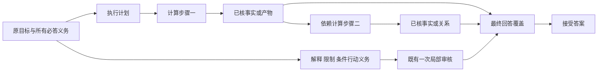
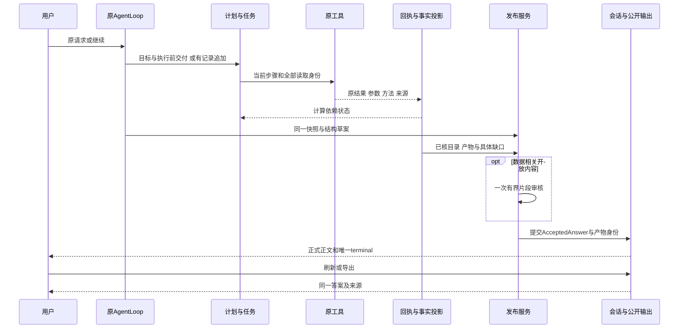

# 可信交付链现行设计

版本：2.0；更新：2026-10-10。依据[产品PRD](../../product/data-agent-product-requirements.md)、[发布PRD](../../product/trusted-answer-publication-requirements.md)及已批准Q1—Q3。本文定义目标架构，不声称当前代码已经实现。阶段和状态只见[唯一总计划](../plans/2026-09-22-analysis-agent-trust-reset-plan.md)；旧设计字节在[归档](../../audit/archive/2026-10-10-plan-reset/manifest.json)。

## 1. 改造边界及设计假设

已证实的矛盾跨越模型公开接口、执行权限、产物语义、任务依赖和最终覆盖；仅改提示/validator的一侧不能闭合。选择重构这些接口，保留现有AgentLoop、AnalysisPlan、TaskManager、workspace/版本、confirmation、原工具、原回执、结构claim和AcceptedAnswer；不推倒整个应用。

设计假设：明确各层语义及生命周期、从工具生产者建立业务结果合同、在正常路径做独立交叉验收，可以消除已定位的确定性断点。S1的跨边界正反例检验此假设；全部工具方法与自然语义可靠性仍分别由S3/S5检验。不能先写“根因解决”再把剩余失败解释为模型随机性。

## 2. 唯一责任与删除范围

下列路径均相对src/data_agent。每项新增规则只归一个所有者，其余层消费同源定义或结果；允许职责拆分，不能形成第二套权威。

| 所有者 | 输入/输出 | 本次替换或删除 |
| --- | --- | --- |
| agent/llm_intent、analysis_entry、publication/requirements | 原消息 → 业务目标/偏好/变更提议 → 原需求账本 | 坏scope静默删除、不同目标去重、重复意图判断、模型ID证明语义完整 |
| agent/analysis_plan_contracts、tools/analysis_flow、registry能力合同 | 当前目标/作用域 → 公开schema、结构校验、动态身份核验与typed error | 手写不一致的同义schema；合同错误自由文字猜测恢复 |
| agent/execution_scope、loop的三个派发入口、workspace | 阶段权限与派发前身份 → 实际工具执行 | “计划可选但发布必需”冲突；无计划正式完成；派发后补归属 |
| 原计划/需求事务、workflow_projection | 单调追加或明确目标变更 → 当前步骤/任务投影 | existing!=deliveries一概拒追加；部分失败留下半更新需求/计划 |
| tools生产者或publication/native的唯一封闭适配 | 实际结果 → 具有业务语义的测量/产物/效果 | dict/list/scalar猜业务类型、键名猜指标、参数白名单静默丢弃 |
| publication/facts、deliveries、runtime、原tool_receipts | 回执/原值/身份 → 单一可重建事实目录与匹配结果 | 持久化第二目录/事实库；无结果与合同不匹配混为缺数据 |
| session/task_manager、workflow_projection | 已核计算交付投影 → 计算DAG推进 | 开放解释必须出现于事实projection；任务completed自行授信 |
| publication/service、audit、renderer | 同一快照/结构草案 → 接受事实、开放片段、最终coverage | 多终局builder；整篇语义审批；重复coverage；二次语义审核 |
| 原提交、session/public_messages、compact、report、Web | AcceptedAnswer → 保存/公开/刷新/导出 | latest猜测、摘要替原答案、前端重判、旧协议执行兼容链 |
| EvidenceRecord、analysis_spec、hypotheses | 研究注解/方法建议/原测量关系 | 注解confidence变事实、样本阈值一概降级、文字相似升级假设 |

原工具的JSON文本序列化可以沿现有传输使用；它不赋予业务类型。每个业务结果必须选择一个明确的生产者/封闭适配定义，不能同一输出同时保留旧猜测fallback。模型不填写工具结果JSON路径。

## 3. 四类信息与三个完成含义

| 对象 | 必含信息 | 谁决定有效 | 不表示 |
| --- | --- | --- | --- |
| 原业务需求 | 原消息/跨度、原文、目标ID、revision、对象/窗口/口径、用途、生命周期 | 用户原请求及宿主原子登记；模型仅提议语义 | 分解完整或已计算 |
| 必要执行交付 | 原目标ID、业务类型、范围/统计量/参数、稳定交付ID、所属计划/步骤 | 当前合同及动态来源/权限校验 | 已有结果；未来可追认旧回执 |
| 真实业务产物 | 具体值/原路径、指标/统计量、单位/粒度/分母/窗口、方法限制、产物、回执/实际读取/版本 | 工具生产者合同＋宿主证据核验 | 算法任意正确或业务解释必然成立 |
| 最终回答义务 | 事实、知识、解释、限制、条件行动、风格及逐项结果 | 同一接受trace和一次适用的局部审核 | 计算DAG的前置成功事实 |

三种完成分开：工具返回成功、计算依赖就绪、用户问题完整回答。它们共用事实投影，不能互相替代，也不新增持久“完成账本”。

结构类型覆盖现有measurement/table/series/fit/forecast/scenario/hypothesis/chart/artifact/operation及knowledge/interpretation/limitation/conditional_action。概念类型不抹平不同方法的实际能力；详细模式在工具族合同定义。

曲线零值口径（2026-10-10用户确认）：长表与宽表均先逐条按zero_values筛选，再对同一x或序列列求均值；exclude排除零，keep保留零。有效记录数及排除零值数必须来自实际观测。零值业务含义仍unknown，排除不证明未观测或未到期；此口径不授予预测或因果验证。曲线的series/fit/scenario由现有唯一封闭适配声明实际指标和参数；业务范围显式保留zero_values，不以通用数组列键代替原指标。

## 4. 状态、权限及原子变化

| 原运行阶段 | 允许 | 成功转移条件 | 必须拒绝 |
| --- | --- | --- | --- |
| 咨询/需求理解 | 概念、方案、明确示例、真实原目标提议 | 仅实际执行请求进入数据链 | 有文件自动计算，历史文字当当前事实 |
| 有限探索 | 当前授权票据/对象的加载、结构、预览、质量；保留回执 | 对象/字段/业务口径足够明确后提交正式交付 | 扩展无关对象，事后追认正式完成 |
| 正式计算 | 当前步骤、全部来源/版本、必要交付、业务参数预绑定的原工具 | 真实回执及语义产物已核 | 旧revision/step、无绑定、额外读取、结果回来后换归属 |
| 有记录追加 | 同目标/来源/业务范围添加必要交付和后续步骤 | 原义务、旧ID、旧回执保留；新交付以后续派发产生 | 缩小/替换范围、复用探索回执充新完成 |
| 综合/发布 | 证据读取、事实/图/关系组合、一次开放审核 | 逐项结果和同一接受答案事务提交 | synthesis读原表；解释当计算凭证 |

这张表定义现有运行阶段职责，不增第三种combination_mode或第二状态机。只读工具不自动免计划：用于结构了解可探索，用于正式必答计算须预绑定。独立一般工具操作按效果合同执行，不制造虚假分析义务。

计划/需求/任务变更先在暂存副本校验全部目标、边界及引用，成功后原子提交；保存失败回滚内存与对应投影。有效同边界追加保留旧交付；replace/withdraw/换版更新revision、退役受影响未来步骤，历史结果不改写。超限明确失败或分批并保留全部义务；不得截断。必要交付的标签不能用来合并业务范围不同的目标。

明确替换产生的新目标先标记待来源绑定；若加载改变了同名数据版本，必须有本目标待绑定期间的真实成功加载回执核验当前身份，正式计划接受时冻结。未加载成功、仅修改内存数据、复用旧加载回执不能绑定新版；同版本范围替换可在正式计划时直接冻结。旧目标及其原版本/证据保留，普通续问不自动跟随同名新版。此时序为2026-10-10用户明确批准。

全局session/plan/revision身份错整笔拒绝；独立目标中的局部提议错误保留原目标和错误字段，其他有效目标可提交，但涉及相互依赖的replace/withdraw不能半提交。技术错误按现有有限恢复，不让用户批准工具名或无限重试。

## 5. 公开接口及错误合同

同一类型/约束定义生成模型可见schema和结构校验；公开说明包含必填条件、枚举/值域、数量上限、未知字段策略及可引用现有ID。JSON字符串入口若保留，解析后仍用同一结构合同；不能成为宽松通道。动态来源、revision、当前授权、实际读取单独核验，不假称JSON Schema可证明当前性。

错误至少给稳定code、责任阶段、字段/目标/步骤定位、可恢复性和允许的下一步。区分 invalid_proposal / unresolved_business_scope / stale_identity / unauthorized_input / execution_failed / result_contract_mismatch / unavailable_result / evidence_insufficient / budget_exhausted 等语义；具体枚举在现有错误模块统一实现。错误码描述是设计语义，不要求新增并行错误框架。

同一已知合同错误不能再凭“cannot/type/不存在”等散文猜恢复类别。未知第三方错误保留原诊断并归未知失败，不能编造为用户缺数据。Provider/流/记账故障按批次规则停止，不作为产品语义反例补调用。

## 6. 工具结果语义合同

复用现有ToolCapability.input_contract/output_contract和ToolResult/回执通道，逐族明确：

- 注册入口、公开参数与声明模式、允许阶段、副作用和权限。
- 输入对象、实际读取、来源版本/父源、行粒度；工具参数到业务参数的显式类型、单位、值域和映射。
- 结果类型、原指标/统计量、值及精度、单位/分母/窗口、原结果位置或产物身份；空值/异常原因。
- 方法/模型、估计目标、训练/验证范围、假设/限制与可支持结论；缺少的证据不能由模型补标签。
- 非事实工具的实际效果、权限、产物和失败状态；不要求统计claim。
- 生产者或唯一适配者，以及独立数值/方法oracle。全部声明模式在能力清单逐项有状态。

例如：distribution_analysis(amount)的mean必须仍为amount/mean测量，不能变成只有count/mean/std列名的宽泛表；forecast的periods必须映射为同一业务预测跨度，3期结果不能因字段被过滤报无序列。forecast只公开auto/backtest真实能力，明确拒绝simple/prophet误导别名；此边界已于2026-10-10由用户批准，不新增Prophet。参数映射闭合不代表预测经过外推验证，方法强度仍独立核对。

correlation_analysis与causal_analysis继续由既有生产者和publication.native唯一封闭适配负责。相关矩阵的实际列、method、完整方阵、系数值域/对称性、成对样本数进入核验；列名/高相关摘要/样本数元数据不能冒充完整矩阵。常数或不足样本系数按批准口径为null，系数无量纲。DID核验实际组/期/指标、四格样本量、原精度均值/方差、差中差、原独立组近似标准误/区间/p值；假设保持unverified。causal_method/causal_output定位原交付，未知效应或推断沿现有completion_gap投影，不增加完成账本。缺格不补零，方差不足不赋区间或显著性；基线水平不当趋势。DID不新增面板/聚类算法。

A/B（2026-10-10用户确认）：恰好两组，单位先sum/mean聚合，有跨组同单位固定配对，配对不足不回退独立检验；配对设计拒绝显式Mann–Whitney/chi2，不换方法。退化t保留均值/差值，统计量/p值/区间未知；auto明确正态性未评估时的秩检验依据。

ML/SHAP（2026-10-10用户确认）：保留原随机按行留出、现有分类/回归算法与可选CV；公开实际算法、原留出预测与验证限制。分类统一编码，公开原标签、每类/宏平均指标和默认正类统计约定。TreeExplainer逐类绝对均值，完整分类总体各类等权平均；回归按样本平均。单分类输出保留实际类别，完整平均未知。模型属于当前会话、当前数据版；model_kind=auto/regression/classification，auto只用唯一匹配，两种都有效时明确要求选择，不静默挑一个。以上均不授予未来/外部验证或因果强度。

唯一publication.native适配核原派发方法、指标、特征与数据版。分类从原留出预测重算混淆/每类/宏平均；回归重算R2/RMSE/MAE；CV从各折分数核均值/标准差和实际验证设计。SHAP核模型归属、当前版本、完整类别/特征及等权聚合。fit/table/scenario不能由结果键形状自动授予；未知产物沿既有completion_gap保留。模型缓存继续为现有进程内单一缓存，按会话/项目与目标类型隔离，不增第二模型库。

来源和步骤在派发前捕获。流式、顺序非流式、只读并行均将该身份传回记回执；不能取执行结束后已经推进的当前任务。执行中源换版拒绝将旧结果记到新版；加载产出的新版本从加载结果登记。宿主可以只读核原身份而不开原数据权限。

目录从真实回执重建，无第二持久库。匹配核对交付类型、指标、统计量、全部来源、业务参数、当前版本、声明归属和方法限制；失败保留具体原因。整表和子测量不因同值互相证明；一个产物可按明确同范围关系服务多个义务，但每项目标独立验收。

操作效果合同（2026-10-10用户确认）：沿用原需求、AnalysisPlan、真实ToolResult/回执、宿主目录和同一AcceptedAnswer；新增operation交付及effect引用，核对执行前原目标/参数/权限、实际新对象与父版本或文件字节/扩展状态。纯文件/扩展操作可无dataset_inputs，不制造虚假分析来源；数据操作仍绑定精确来源。操作效果不进入数据事实claim、不新增账本，保存前再次核实际对象，失败/变更/越域不能显示完成。已有交付ID可在同目标同范围重用。

清洗/转换边界（2026-10-10用户确认）：清洗逐列记录实际填补数、策略后与最终缺失及原因；删除记录不计作填补，mean/median仅数值且无法求值不换策略。所选范围未解决缺失标部分完成，明确keep按选择保留缺失。类型转换保留原坏值处理并补齐category，分别记录原缺失、成功/失败转换及新增缺失；不能转换的保留真实新表与部分完成。自动转换继续原建议筛选，公开跳过列，不增加强制转换。沿原effect目录、requirement gap及AcceptedAnswer交付；宿主核实际对象、父源和计数，旧答案复用不得消除缺口。

变换合同：结构化参数按公开优先级覆盖旧params JSON，两种输入由同一函数解析；显式默认值也必须生效。filter/select/rename/sort/group_aggregate/resample/pivot/merge保留，pivot继续含宽转长和长转宽。派发前绑定全部实际来源，merge复用多父派生并保留双方版本；同一回执可交付所需操作效果和原聚合事实，各按原目标声明覆盖，不增完成账本。变换作为写能力串行派发，事实与效果共用参数/全部来源验证。
聚合/重采样裁决：count统计指定列非缺失数，size统计行数；旧count没有目标列必须要求选择列或使用size。重采样沿原日期解析与频率算法，空桶/全缺失sum为未知，真实观测零为零；公开有效/排除记录和缺失/坏日期数。原范围存在日期排除时，实际新表与已知结果保留，事实交付和操作效果均携带同一范围缺口，不签全部完成。预算去重只读源/计划身份，派发前再绑定操作对象；无正式计划应返回原formal_plan_required。
分布合同：保留原均值、ddof=0总体标准差和偏置矩偏度/峰度；补齐同一有限范围的min/25%/50%/75%/max，pandas线性插值，无观测为null，沿原回执持久化与交付。所有选中数值列保留；没有有限观测或退化的统计量为null。Shapiro仅3≤n<5000且非退化时计算，结论为rejected/not_rejected/unknown，未拒绝不证明正态。显式缺列/重复/非数值选择整体拒绝；逐列公开原行数、缺失、非有限排除与有效数，非有限排除沿同一交付缺口保留已计算量和原范围部分完成。宿主核对实际来源计数，不开放综合期原表读取。

Skills边界（2026-10-10用户确认）：安装目录及安装/启用/禁用/删除全局管理；加载/卸载、list_skills的loaded状态和指令注入属于当前会话。网页管理与AgentLoop共用一个目录所有者，全局禁用/删除清除所有会话的对应加载；重新启用不自动恢复加载。其他会话的加载状态不得成为本会话效果证据。

模拟边界（2026-10-10用户确认）：optimize保留现有份额分配和逐次剪裁，称约束分配候选；交付前复核全部默认/显式上下界与目标，越界不交付，未找到不等于数学不可行，不宣称最优/最小变更/最小二乘。每组零或负基数拒绝，不新增优化器。sensitivity保留乘法/等比例算术和完整分组；零总量且目标非零时保留基线/目标/缺口，比例及分组反推未知；维度字符串仅接受唯一匹配，缺失/歧义拒绝。算术情景不授予因果或预测验证。

效果由publication.native唯一解析现有回执与实际对象；deliveries目录按原producing_delivery_ids和精确operation声明匹配；requirements、HostSnapshot、PublicationService与commit共用effect_ids。计划和公开schema同源，纯操作可无数据，普通数据交付引用ID仍须实际输入。SkillLoader共享目录及全局管理，每个AgentLoop持有会话加载视图；上下文解析器、prompt注入与网页管理使用同一所有者，删除旧全局loaded与独立网页目录路径的责任。文件生产者直接结构化返回实际SHA，禁止从成功散文解析证明。

## 7. 计算DAG与回答覆盖

workflow_projection只将计算所需事实/产物/结构关系ID传给成功依赖检查；开放义务保留在原需求中，供最终发布核验。只有开放内容的步骤不能伪装成事实前驱；若模型提出这样的计算依赖，在登记时给可定位合同错误。不能把开放义务直接删除来“修复阻塞”。

失败、取消或closed_by_publication可以让当前轮终结，不满足后继成功依赖；独立无依赖步骤仍可执行。真实事实就绪后前序步骤可推进，即使其解释待最终审核；最终覆盖此时仍是partial而非完整。

## 8. 发布、审核、历史时序

草案使用已有结构节点引用事实/图/公式，宿主原位渲染；不得让自由正文或旧隐藏绑定成为另一路径。全局身份拒绝/局部片段拒绝按发布PRD执行。完整事实与合法独立开放内容保留，未核项具体说明。模型自报“完成”、词语相似或人工改state不能提供coverage。

审核输入只用同一快照、相关事实及必要全篇条件，每轮最多一次；输入由共享完整请求token容量检查，审核响应64000字节解析上限保留。模型视图65536 tokens为软目标，必要交付可扩展到实际剩余上下文；草案128000字节、宿主2048事实及128引用等结构上限保留。只投影未请求且重复的详情，必要组完整内联；超过真实硬容量就保留宿主事实及明确容量缺口，不增加循环。

压缩的模型摘要与用户原始归档分工明确，公开历史读原接受对象并核摘要。分支父答案仅聊天历史。旧协议只读，不做执行兼容；新协议的恢复/改写/换版/导出等仍完整。数据/确认/假设有效性由原系统核查，UI不重算。

## 9. 验证设计和实施约束

每个边界同时检查生产者、消费者、公开schema、提示和正常入口。单元可隔离构造对象；应用链不得事后注入plan/step/delivery绑定、跳过registry、mock掉回执/校验/提交。独立oracle来自fixture和业务定义，不用同一个产品匹配器生成expected。

用原失败材料作RED，另测合法变体和危险相邻负例：顺序变化、同义reuse、追加、非法范围、同值异源、实际返回但合同失配、解释未核而计算可继续。固定模型测试只证明结构编排，不能签收自然质量。

逐步在同一链替换责任并删除旧规则，保留原能力测试；不保持两套功能路径用于“兼容验收”。方法或能力变化超出已批准范围时先讨论。具体阶段、工具族分母、原180项承接和两批自然门见唯一计划/现行验收，本文不另记阶段流水。

漏斗裁决35—37（2026-10-10用户确认）：事件模式使用逐用户最早有效顺序路径，window_hours限制相邻已选事件；无时间列只证明集合包含。总体从完整来源独立计算，各组完整保留；预聚合同步骤先求和，自动顺序按聚合计数降序并注明推断，缺失步骤/零分母未知，非法计数拒绝。率列只接受有限0—1累积比例，逐列有效记录等权均值，步骤和整体比值明确为累积率列均值之比；人数未知，不虚构人数、真实用户转化或加权总体。全部沿唯一正式计划、原回执、目录和AcceptedAnswer交付，不另建链。

cohort裁决38（2026-10-10用户确认）：保留首次观测月/逐月去重用户留存，年龄轴从0补齐至实际观测末月；已到达且无事件为0、未到达为null。披露首次观测不等于真实首次、末月可能不完整及用户身份口径限制。公开原记录、有效记录、联合排除和缺失用户/缺失时间/无效时间各原因数（原因可重叠）；有排除则原范围部分完成，已计算矩阵保留。显式event_col缺失拒绝，已有event_col不隐式筛选事件值。参数与来源在既有正式计划/原回执中绑定，沿唯一封闭适配交付，不新增账本。

聚类裁决39（2026-10-10用户确认）：保留StandardScaler＋KMeans(random_state=42,n_init=10)，只交付实际非空簇，公开请求与实际簇数。按输入记录计数，不假定记录为独立用户或制造客群差异；原尺度均值及ddof=1样本标准差保留，单记录簇标准差null。所选特征缺失按列和联合排除披露，有排除则原范围部分完成；不存在/重复/非数值特征及非有限值明确拒绝，不新增填补或聚类算法。特征、请求簇数及实际结果沿唯一正式计划/原回执/封闭适配/AcceptedAnswer交付；不足请求簇数或未知描述量保留实际结果与具体缺口。

TopN裁决40（2026-10-10用户确认）：保留原按记录sort_values/head及默认首个数值列；n只接受正整数，显式不存在、空项或重复返回列拒绝。公开实际排序列、方向、请求上限、真实返回列及来源/返回行数；有限数值交付原值，不预先舍入。并列与缺失排序沿原算法，缺失/非有限单元格沿原JSON口径为未知，不授予业务解释。save_as创建真实新表，核对精确参数、实际内容、父版本和权限，沿既有操作效果交付；未指定save_as只交付排行，操作目标不得虚报创建。唯一选择器与publication.native封闭适配承接表、实际条数和操作效果，不新增账本或同功能双链。

贡献分解裁决41（2026-10-10用户确认）：保留sum分组总和之差及原mean加权合并贡献；缺席组均值null，实际条数与权重0。mean使用等价的已观测中心化加权项之差，不把未知均值补0或推断反事实。两期及各组有效条数、原源/联合排除和逐项重叠计数、窗口外及重叠行数公开。百分比分母保留abs(total_change)与abs(period_a.value)，零分母未知、绝对量保留；原日均归一化继续按窗口日数。有无效/缺失记录排除则原范围部分完成；不识别因果归因或授予时间可比性。实际参数、完整分组、原值和范围沿唯一正式计划/原回执/封闭适配/AcceptedAnswer交付，宿主同一算法owner复核来源；不新增分解方法或账本。

因素分析裁决42/43（2026-10-11用户确认）：保留标准化OLS＋HC3、Holm多重校正和VIF原算法；拒绝目标自包含、重复/不存在的显式特征以及不存在的显式单位/时间列。常数目标、样本不足及不可计算的推断交付null和具体缺口，原数值转换、联合完整案例筛选与特征排除真实公开，原范围或所选特征未完整估计时沿原合同部分完成。单位/时间只披露参与估计行的实际范围、缺失/坏值/重复情况，不据此聚合、聚类或校正时间相关性；独立性未验证。相关列若同时作为显式或自动特征，另标实际特征使用，不能冒充按单位/时间设计。仅授予统计关联；原正式计划/回执/封闭适配/AcceptedAnswer交付，宿主复用同一算法owner核对真实来源，不新增因果、面板/时序算法或账本。

时间序列裁决44/45（2026-10-11用户确认）：保留按时间排序后逐记录线性回归、原滑窗均值差、原序列自相关与4位统计显示；斜率/滞后以排序观测为单位，重复日期不聚合，p值未校正时间相关或验证独立性。自相关阈值只标启发候选，不证明季节性，不新增去趋势/季节检验；完整滑窗及命中候选交付，零前均值的百分比和阈值判定null，保留原均值/绝对差。原float转换失败、显式错列及value_col/target_col冲突拒绝；原日期解析/自动选列保留并公开实际列。缺失/坏日期/非有限逐项与联合排除公开，有限有效记录计算，有排除则原范围部分完成；不可计算推断未知。原计划/回执/唯一算法owner/封闭产物/宿主源核对交付，不新增算法、补值或账本。

预测裁决46/47（2026-10-11）：原auto/backtest有序留出与末值/线性选择、同时间求和保留；完整时间戳和真实有限筛样/重复汇总范围必须沿原回执交付，有排除则原范围部分完成，筛后重核点数/等间隔。1.96×留出残差样本标准差仅为未校准残差启发带，不表示95%预测覆盖；少于两条残差或不可算时上下界null，可算零宽带也不证明未来不确定性。实现错误修正并验证；要求校准覆盖率的目标仍未完成，不能以说明代替满足目标。按原入口/封闭产物/宿主实值/正常AgentLoop、SSE保存刷新导出正反例签指定范围；不是S3整体签收。

时段比较裁决48（2026-10-11用户确认）：可加数值仍按原sum，显式错列/非数值/重复指标或维度拒绝；只计算有限观测，各期/各组记录有效/排除数，原范围不完整标部分完成；无有效观测合计null而真实观测零仍0。保留原日历窗口/日均算术及ratio_of_sums的严格原操作数要求、非可加列必须给公式，不新增检验或归因。原回执/封闭产物/宿主实值核对及正常AgentLoop—SSE—保存刷新导出签指定范围。

2026-10-11裁决49：数据画像/就绪度仅作真实列级诊断；空表明确无可分析记录，通用缺失率、重复或样本量阈值不整体阻断目标。方法可行性由实际所选方法/列的真实前提决定；基础检查不授予方法验证。缓存必须绑定实际数据版本。

2026-10-11裁决50：用户同意模型视图按当轮正式必要交付及解释所需上下文投影；所有已请求来源、指标、图和必要限制必须保留，未请求且重复的完整审计详情保留在原宿主快照、回执及可恢复详情中。发布及完成状态仍由同一宿主合同裁决。用户随后批准实施完整请求token预算：65536 tokens软目标，必要交付可扩展到实际剩余上下文；按当前模型/端点输入、上下文及输出上限预留输出与10%余量，系统提示/历史/工具定义/响应格式全部核算。优先本地tokenizer，无匹配时明确标注UTF-8保守估算；MAX_TOKENS为空时保留Provider管理语义并预留已知最大输出。实际输入/输出/缓存用量和按显式价格估算的费用写原日志，未知不补零。超硬容量在传输前拒绝，不增加重试、审核或调用额度，不授权真实Provider调用。

记忆持久化与提升的唯一责任（2026-10-12批准边界）：MemoryStore在原SQLite事务中回读实际写入结果；KnowledgeLibrary.create与同库MemoryStore.promote_to_knowledge共用唯一_create_with_connection创建实现。提升的确认状态读取、知识正文/索引创建、记忆状态/指向更新及回读在同一事务和现有rollback_atomic_writes边界内完成，提交成功后才返回；异根/异库在落盘前拒绝。公开管理/工具返回和既有状态/检索规则保留，不新增知识层、账本或第二发布链；独立创建/确认记忆效果按下述既有合同承接；其他操作和提取完整参数/会话权限仍依唯一计划逐项验收。

记忆提取原子责任（2026-10-12批准边界）：MemoryCandidateExtractor仅拥有单次提取事务编排，证据索引读取、去重读取、候选创建和候选元数据刷新绑定同一个SQLite连接。单条创建与提取共用MemoryStore._create_candidate_with_connection，刷新共用MemoryStore._refresh_candidate_with_connection并在提交前回读核原状态门和实际全部字段，提取器旧直接SQL刷新退役。结果仅在事务提交后返回；可捕获故障整批回滚。EvidenceStore原索引事务及已保存会话不纳入该可选提取事务，原自动失败隔离语义保留；不新增账本、状态机或发布链。

记忆操作效果责任（2026-10-13批准边界）：原native.capture_operation_binding核配置MemoryStore根/数据库、当前会话、规范化完整参数；创建捕获已有ID集合，确认捕获完整旧行及其规范SHA。公共工具保留原返回字段并附完整state/before，MemoryStore.confirm与confirm_memory复用唯一_confirm_with_connection写入，事务内读取/更新/回读共同回滚。原resolve_operation_effect核实际ID、完整行与原参数/旧行，HostSnapshot既有effects支持memory对象，原renderer区分已确认未变幂等；原commit再次重解相同效果后才保存AcceptedAnswer。全局管理语义保留，无新账本、知识层或散文判定。并发状态竞争和其他操作不由本次指定验收推定通过。

检索数量责任（2026-10-13批准边界）：knowledge.sqlite_store.search_limit为唯一数量规范化入口，接受Integral且排除bool；Library/Memory/Evidence在任何条目读取前验证并对非正值返回空集合，RetrievalService先验证全部三项数量，再调用原检索和字符预算投影。移除_positive_limit隐式int转换，公共search_knowledge复用同一存储实现；无新评分、过滤、账本或发布链。SSE传输轮次与AgentLoop发布轮次沿各自既有身份核验，不混同。

工具发现责任（2026-10-13批准边界）：registry内唯一tool_search继续调用原发现、_tool_search_haystack及排序/分组扩展；结果tools为全部匹配项，matches/returned对应真实总数与返回数，逐项description_truncated核原description长度是否超过200字符。未增加工具执行权限、数据事实或发布链；原模型请求预算核完整结果与后续工具定义。动态发现异常、跨进程缓存及正式目录交付仍另行验收。

Skills目录责任（2026-10-13批准边界）：原business scope/plan schema以catalog_output=skills承接无数据身份table；skill_tools内唯一_list_skills_result与_skills_catalog_snapshot核既有发现缓存、原解析结果、配置目录、实际源文件SHA及当前会话加载集合。原执行绑定/回执/结果读取传递skills_binding，native闭合适配仅skills字段，HostSnapshot拒绝借数据集或方法身份，原renderer展示空目录并省去假单位。原commit重新读取且比较原快照skills_binding，禁止以事后新绑定替换旧证明；无新账本、模型散文解析或发现算法。

MCP配置责任（2026-10-13批准边界）：mcp.config内唯一save_mcp_config复用原rollback_atomic_writes/write_bytes_atomic，序列化后替换并核实际字节及解析后配置；mcp_tools内唯一_next_mcp_config/_mutate_mcp_config由四公开工具和管理API共用。原operation_spec/派发守卫/执行绑定/回执/native effect/HostSnapshot/commit承接file对象，保存配置与实际连接生命周期分离。已核类型化缺失目标/保存失败沿原需求source_binding.operation_failures按必要交付ID及完整operation精确绑定，成功仅清除该项；失败不生成成功回执、效果或数据claim，不增加账本或散文解析。

MCP目录责任（2026-10-13批准边界）：原table/business scope增加mcp_servers/mcp_health输出，普通数据方法仍要求真实数据身份。mcp_tools内唯一_mcp_catalog_snapshot分别核mcp.config原字节/解析结果和原MCPClientManager缓存快照（包含完整工具schema摘要），产生当前会话mcp_binding；工具与管理API共用读取者，不创建连接或探活。原派发绑定/回执/结果读取/native metadata table/HostSnapshot结构校验/commit承接，提交比较原快照与重读证明，禁止同内容事后换来源。原renderer显示空配置和未知连接并省去假单位，不新建账本或生产散文解析。

MCP既有调用错误投影（2026-10-13）：唯一MCPClientManager._call_tool_async先聚合原文本投影，再以显式协议isError决定原JSON error结果，沿既有registry/receipt/Loop错误路径承接。所有通用与动态别名仍经同一manager，不加散文识别或第二调用链；连接门控、原RPC异常计数、成功RPC归零、健康缓存与生命周期方法未变。独立正式调用与多模态结果权限仍未裁决。

会话导出责任（2026-10-13批准边界）：export_conversation加入原操作集合，复用原计划schema/guard/捕获绑定/receipt/native effect/HostSnapshot/commit。report内唯一_conversation_source绑定规范历史前缀SHA和公开投影、原接受答案/归档/图表文件；唯一_render_public_messages与原pisa.CreatePDF为工具、registry、API共用，旧HTTP散文长度/HTML重复渲染退役。源范围允许调用后追加，拒绝原范围改写；输出路径/SHA/注册类型与原证明在读回和提交重核。PDF内置CJK字体修复中文方框，BytesIO成功后才原子发布；图表div ID稳定。原atomic rollback/manifest及Loop必要交付失败承接者复用，不新增账本。

规划登记责任（2026-10-13一致性修复）：原两准备入口共用_persist_planning_record，复用原atomic rollback/状态save/_write_analysis_artifact/register_artifact；成功读回状态、产物正文及实际清单SHA，失败恢复原内存和文件字节，不新增账本。analysis_artifact在原类别判断中为写操作，不另建调度链。原正式计划、证据/目标/摘要函数不变；旧AnalysisSpec展示语义不变。验证为可捕获异常，不是崩溃恢复或并发安全证明。

证据登记责任（2026-10-13一致性修复）：唯一_persist_planning_record同合同重命名为_persist_analysis_record，需求、方案、证据共享原atomic rollback/状态save/_write_analysis_artifact/register_artifact；原证据非事务写入体退役。保留原add/upsert、输入/计划/当前回执/源版/统计绑定、可选任务核对语义；成功前读回核实际状态、产物正文与清单SHA，失败恢复旧记录及旧产物。旧不可变产物保留，不新增账本或事实权威。本轮捕获故障不证明可选任务核对故障原子性、并发或崩溃恢复。

分析摘要责任（2026-10-13既有职责修复）：原get_analysis_summary唯一导航函数保留非None样本数及原字段/记录顺序/完整范围，移除未使用的散文摘要导入，说明原研究上下文职责。原发布合同/native适配器不变，summary receipt不成为数据claim来源；高confidence/9999原备注不能覆盖当前0/3真实回执。无新解析或发布链；完整权限/迁移/异常状态与并发未据此签收。

回答目标责任（2026-10-13既有一致性修复）：record_execution_targets仍是原唯一绑定所有者，校验与返回schema不变。复用原rollback_atomic_writes与state.save读回，替换原两字段回滚为完整内存及实际文件字节恢复；原工具wrapper只在成功后同步版本。原schema/目录匹配/发布native合同不变，无第二绑定链、事实权威或账本。当前验证为可捕获单进程故障，未签收并发/崩溃或回滚存储自身故障。

提问责任（2026-10-13用户批准）：原ask_user_question完整验证显式questions文本为有效1—4题数组及非空问题文本，再交原UserConfirmationRequired；退役原静默[:4]和解析失败转空数组后的单题回退。原单题解析分支、确认runtime/内核/UI/复用/状态动作/指标映射及发布合同不变，不另建确认链或账本。指定24项及8正常链已核，完整字段/选项和生命周期模式仍待验收。

多文件综合责任（2026-10-13用户裁决63—65）：原multifile生产者为自然日有限求和/外对齐唯一算术所有者，宿主封闭适配复核来源和原值。aligned_data为series，aligned_rows仅count；可选save_as复用原数据对象operation_effect合同及计划/权限，Workspace多父写入复用原namespace事务、atomic回滚、backup/meta和读回核验。共享write-only命名守卫不改变旧reader；不新增持久化格式、账本、发布链或散文解析。67指定项、8正常链及3宿主冷恢复不代表完整模式或S3出口。

沙盒超时责任（2026-10-14，裁决66）：原registry公开schema限制integer/minimum1/maximum30，原run_python生产者执行前检查精确int（排除bool）和同范围；移除原int强转与max/min剪裁，子进程隔离/读取身份/重放合同/终止机制不变。裁决67由原TurnExecutionState承接：record_tool_call保留原次数/预算，record_tool_success在成功run_python后设置pending_fallback_resolution；record_tool_error和原权限保持不变，失败不制造不存在结果的处理义务。

图表选源责任（2026-10-14，裁决68）：原create_chart的data分支核可见目录和单源读取，缺失/不可读沿原_chart_error拒绝；省略data的纯工具默认AST及正常Loop active_dataset预绑定不改。原图表方法、保存、来源版本及发布责任复用，不新增选源链、账本或散文解析。17指定项及4实际HTML交付链不代表完整选择器/9图种/权限或视觉PNG验收。

图表来源责任（2026-10-14，裁决69）：沿原load_result_reference加入唯一chart来源解析，原visualization及execution_scope预绑定共用。JSON冲突先拒绝；JSON-only metadata.data_identity为空，不授正式数据图身份。result_ref data为身份断言，缺省从真实回执绑定，再走原作用域权限；原读取器、绘图/保存/发布合同复用，无新账本或散文解析。

2026-10-14 图表聚合获批切片：裁决70/71已获直接用户批准并实施。原chart_contract与原_validate_chart_spec共用唯一count模式判定；在原bar/stacked_bar/pie及时间x轴line支持范围中，count统计原指定列非缺失条数，跳过数值转换，文本/数值/混合/全缺失控制已核，不去重或解释为用户人数。原_prepare_chart_dataframe的日期分组与柱图分组、原pie分组统一走唯一_aggregate_chart_groups，sum使用min_count=1，mean/median仍为原聚合算法，删除create_chart内重复pie聚合；原分组排序及dropna=False保持。全缺失组为未知，真实观测零仍0；各组行数/有效数/实际值随原metadata保存，原图中悬浮信息公开有效数，未知图增加可见说明。pie有未知组时沿原_chart_error在_save_chart前拒绝，正式目标保留缺口；不生成成功图或以已知子集冒充完整占比。原HTML/PNG保存函数、图表来源读取、权限、回执和发布链未改；没有新绘图链、散文解析或账本。先行RED15反例/3控制、6正常链及151独立核对保留于r1，修正的观察夹具不改变产品；本轮72新增指定项，当前同源联合121通过（72新增+32来源绑定+17显式来源），相关12份完整文件387通过，666独立核对；8条正常应用链含7实际HTML成功与1未知饼图缺口，8份实际MD。原完整HTTP52/52、23唯一持久终局、92文件/138事件，Provider0/forbidden0/远端MCP0。视觉/真实PNG、完整9图种参数/权限/重放/重启/并发/存储故障尚未签收；本轮没有common55/full-offline，不借旧3344+1升级证据。 源码/收据tmp/s3-chart-aggregation-20261014-r2/source-identity.json、receipt.json；77指定/0仅登记、原180为26局部/0完整/154待核，非S3整体签收。

2026-10-14 图表聚合获批切片：裁决70/71已获直接用户批准并实施。原chart_contract与原_validate_chart_spec共用唯一count模式判定；在原bar/stacked_bar/pie及时间x轴line支持范围中，count统计原指定列非缺失条数，跳过数值转换，文本/数值/混合/全缺失控制已核，不去重或解释为用户人数。原_prepare_chart_dataframe的日期分组与柱图分组、原pie分组统一走唯一_aggregate_chart_groups，sum使用min_count=1，mean/median仍为原聚合算法，删除create_chart内重复pie聚合；原分组排序及dropna=False保持。全缺失组为未知，真实观测零仍0；各组行数/有效数/实际值随原metadata保存，已知组在原图悬浮信息公开有效数，未知组因无悬停点在原图注释直接公开身份和有效数。pie有未知组时沿原_chart_error在_save_chart前拒绝，正式目标保留缺口；不生成成功图或以已知子集冒充完整占比。原HTML/PNG保存函数、图表来源读取、权限、回执和发布链未改；没有新绘图链、散文解析或账本。先行RED15反例/3控制、6正常链及151独立核对保留于r1，修正的观察夹具不改变产品；本轮72新增指定项，当前同源联合121通过（72新增+32来源绑定+17显式来源），相关12份完整文件387通过，673独立核对；8条正常应用链含7实际HTML成功与1未知饼图缺口，8份实际MD。原完整HTTP52/52、23唯一持久终局、92文件/138事件，Provider0/forbidden0/远端MCP0。视觉/真实PNG、完整9图种参数/权限/重放/重启/并发/存储故障尚未签收；本轮没有common55/full-offline，不借旧3344+1升级证据。 源码/收据tmp/s3-chart-aggregation-20261014-r3/source-identity.json、receipt.json；77指定/0仅登记、原180为26局部/0完整/154待核，非S3整体签收。

2026-10-14 图表系列合同修复指定切片：原多指标柱图在已按color_col分组聚合/归一化后仍用整表生成每个指标的一条trace，导致组身份丢失；正常Loop仍接受图并answered。原raw模式也因只看量级而写入normalized警告。先以直接/registry和6条正常AgentLoop建立9反例/9对照，独立126项核实际HTML/回执/答案/MD，原文件保留r1。仅修复已公开参数合同：原bar分支统一为指标×颜色组循环，无color时单组；沿原line命名习惯和原分组排序/dropna=False，各trace以类型化meta绑定指标及颜色值，原聚合审计按该身份承接有效数，缺失组不丢失。normalize仍用原各颜色组×指标的max(abs)=100，customdata从原raw_df取对应行，仅在原悬浮中公开真实原值；raw不改值，只有实际normalize时才写归一化警告。单/多指标柱图共用一条原绘制循环，删除旧两个分支，不保留同功能双链；其他8图种绘制体及原保存/聚合函数AST不变，权限/来源/回执/发布等其他源码哈希未变。35新增项含9正常链，实际9HTML/9MD，缺失颜色、组合标签、计数、未知及有效数指定边界已核。当前同源联合156、相关387、独立752、原完整HTTP52/52；均为离线证据，Provider和真实远端MCP0。视觉/真实PNG未评估，未跑common55/full-offline；完整模式及S3出口未签收。 源码/收据tmp/s3-chart-series-20261014-r2/source-identity.json、receipt.json；77指定/0仅登记，原180仍26局部/0完整/154待核。
